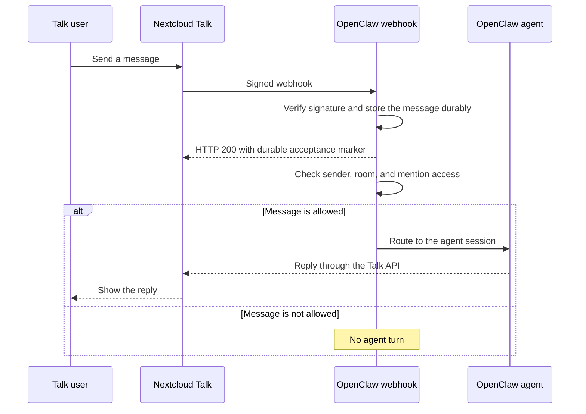

Nextcloud Talk is a downloadable channel plugin (`@openclaw/nextcloud-talk`) that connects OpenClaw to a self-hosted Nextcloud instance through a Talk webhook bot. Direct messages, rooms, reactions, markdown messages, and inbound and outbound Talk file shares are supported.

## Install

```bash
openclaw plugins install @openclaw/nextcloud-talk
```

Use the bare package spec to follow the current official release tag. Pin an exact version only when you need a reproducible install.

Inbound attachments require a host that provides `runtime.channel.media.deleteMediaBuffer`. A source checkout passing tests is not proof that an already published host provides this API. Use the coordinated host/plugin release qualified below, not a standalone build of this plugin with its historical compatibility metadata.

From a local checkout (dev workflows):

```bash
openclaw plugins install ./path/to/local/nextcloud-talk-plugin
```

Check the [application result](/plugins/manage-plugins#apply-changes-and-inspect) after installing.

## How messages reach the agent



The webhook acknowledgement confirms durable receipt, not permission to run an
agent or completion of its reply. Access checks still apply after acceptance. Unknown DM senders may receive a
pairing code instead of an agent reply.
The webhook URL must be reachable from Nextcloud; replies travel back through
the Talk API rather than in the webhook response.

## Quick setup (beginner)

1. Install the plugin (above).
2. Publish the Gateway webhook route `/nextcloud-talk-webhook` through your HTTPS reverse proxy, forwarding to the Gateway port (default `18789`). On your Nextcloud server, create a bot using that public URL:

   ```bash
   ./occ talk:bot:install "OpenClaw" "<shared-secret>" "<webhook-url>" --feature webhook --feature response --feature reaction
   ```

   Keep `--feature response`: without it, outbound replies fail with 401. Repair an existing bot with `./occ talk:bot:state --feature webhook --feature response --feature reaction <botId> 1`.

3. Enable the bot in the target room settings.
4. Configure OpenClaw:
   - Config: `channels.nextcloud-talk.baseUrl` + `channels.nextcloud-talk.botSecret`
   - Or env: `NEXTCLOUD_TALK_BOT_SECRET` (default account only)

   CLI setup (`--url`/`--token` are aliases for the explicit fields; `nc-talk` and `nc` work as channel aliases):

   ```bash
   openclaw channels add --channel nextcloud-talk \
     --url https://cloud.example.com \
     --token "<shared-secret>"
   ```

   Equivalent explicit fields:

   ```bash
   openclaw channels add --channel nextcloud-talk \
     --base-url https://cloud.example.com \
     --secret "<shared-secret>"
   ```

   File-backed secret:

   ```bash
   openclaw channels add --channel nextcloud-talk \
     --base-url https://cloud.example.com \
     --secret-file /path/to/nextcloud-talk-secret
   ```

5. Check `openclaw channels status --probe`; start the Gateway if it is offline. Config changes follow [hot reload](/gateway/configuration/hot-reload). If you changed the service environment, restart the Gateway to load it.

Minimal config:

```json5
{
  channels: {
    "nextcloud-talk": {
      enabled: true,
      baseUrl: "https://cloud.example.com",
      botSecret: "shared-secret",
      dmPolicy: "pairing",
    },
  },
}
```

## Notes

- Bots cannot initiate DMs. The user must message the bot first.
- The webhook URL must be reachable from the Nextcloud server. The Gateway serves `webhookPath` on its own HTTP port. Existing installations may retain an explicit `legacyWebhook` pin for the former port `8788`; new installations open no separate port. Set `webhookPublicUrl` to the bot's external callback URL when using a proxy. Webhook requests are HMAC-SHA256 signed with the bot secret; invalid signatures are rejected and rate limited.
- Message webhooks return HTTP 200 only after the raw event is durably stored; storage failures return HTTP 500. The durable `200` carries `x-openclaw-delivery-accepted: durable`, so reverse proxies can require the marker to distinguish OpenClaw acceptance from a generic `200`. Unsupported non-message events return HTTP 200 without the marker and are logged as ignored.
- The webhook listener admits at most 64 concurrent unauthenticated body reads; overflow requests receive `HTTP/1.1 429` with `Connection: close`. Requests on one keep-alive connection are answered in order, so a queued delivery's `200` acknowledgement always flushes before any overflow rejection closes the socket. The 64-read budget is fixed and not configurable. Accounts sharing a Gateway pathname share its admission and failed-authentication budgets; each retained legacy host and port keeps independent budgets. Deployments that regularly saturate it should reduce or buffer upstream concurrency (for example, cap reverse-proxy fan-in toward the listener) and accept that deliveries refused during saturation may be lost.
- The bot API sends text and reactions. Native outbound attachments use the configured API account instead (see [Outbound attachments](#outbound-attachments)).
- The webhook payload does not distinguish DMs from rooms; set `apiUser` + `apiPassword` to enable room-type lookups (cached about 5 minutes). Without them, every conversation is treated as a room. Inbound attachment retrieval also requires this API account.
- Network fetches, including authenticated inbound attachment requests and outbound requests, go through the SSRF guard. For a Nextcloud host on a trusted private/internal network, opt in with `channels.nextcloud-talk.network.dangerouslyAllowPrivateNetwork: true`.
- With `apiUser`/`apiPassword` and `webhookPublicUrl` set, `openclaw channels status` checks the bot and warns when the `response` feature is missing.

Pre-July-2026 JSON replay caches under `<state-dir>/nextcloud-talk/replay-dedupe/`
are outside the supported upgrade window. Doctor leaves these files unchanged and
stops with recovery guidance. [Upgrade through `2026.9.5`](/install/updating#upgrading-very-old-versions)
and run its Doctor before installing the latest version. Supported SQLite replay
state continues to migrate into durable webhook deduplication.

## Moving existing webhook endpoints to the Gateway

Doctor preserves the previous webhook listener address with a one-shot
`legacyWebhook: { port: 8788, host: "0.0.0.0" }` pin for enabled accounts on an
existing installation that relied on the implicit endpoint. Evidence of prior
operation is required; fresh installations open no separate port. An explicit
`{ port, host? }` object selects that endpoint; an omitted `host` uses `0.0.0.0`.
Omitted or `false` opens no listener, subject to account inheritance. Explicit
listeners use the same Gateway route, HMAC verification, and channel handler.

Nextcloud stores the bot callback URL outside OpenClaw, so an update cannot safely
rewrite it. To use only the Gateway listener, keep the public HTTPS address and
change the reverse proxy's upstream to the Gateway HTTP port (`18789` by default),
preserving `/nextcloud-talk-webhook` or your configured `webhookPath`. If Nextcloud
connects directly, update the bot callback to a reachable HTTPS endpoint for that
Gateway route instead. Update `webhookPublicUrl` if its public address changes;
this field records the address for status checks and does not change Nextcloud's
bot registration.

`openclaw doctor --fix` migrates old `webhookPort` and `webhookHost` settings to
`legacyWebhook`, using Doctor's normal config backup and write flow. Host-only
settings preserve that host with port `8788`. Named accounts preserve their
effective endpoint. Existing settings, including an inherited `false`,
take precedence over retired keys. Doctor and startup report the effective
listener and Gateway destination without changing the external callback URL.

The deprecated TypeScript `webhookPort` and `webhookHost` input fields remain
source-compatible until the next Plugin SDK major. Runtime config uses
`legacyWebhook`; run `openclaw doctor --fix` to migrate the old keys.

Accounts can share a Gateway path: backend origin and signature must identify
exactly one account, so give accounts on the same Nextcloud backend distinct bot
secrets when sharing a Gateway path. Separate legacy endpoints preserve their
original account selection and independent admission and failed-authentication
budgets even when the accounts have the same backend and secret.

Webhook paths retain exact request matching, including query strings, case, and
trailing slashes. `/health`, `/healthz`, `/ready`, `/readyz`, `/startup`, and
`/startupz` belong to Gateway checks, including when a query string follows.
Paths under `/api/channels` require Gateway authentication, including encoded
aliases; Nextcloud's signature does not supply that authentication.
Doctor warns about these paths, and an account without an explicit legacy listener cannot
start with one. Set `webhookPath` to `/nextcloud-talk-webhook` and update the
Nextcloud bot callback and reverse-proxy upstream to the Gateway port and that
path. An enabled legacy listener keeps serving its configured path during this
cutover; OpenClaw does not silently rewrite the callback path.

After verifying delivery through the Gateway route, remove the `legacyWebhook`
pin and restart the account to disable its legacy forwarding. A shared listener
stays open while another account uses that endpoint. Keep
`meta.migrations.webhookListeners`, which Doctor saves with the pin, so later
runs do not recreate it. See [webhook migrations](/gateway/doctor/config-migrations#channel-webhook-listeners)
for included and read-only config sources. Use explicit `false` on an account to
override an inherited root listener.
Legacy ports preserve the exact `/healthz` response: `200 ok` with
`Content-Type: text/plain` for every ordinary HTTP method (HEAD has no body).
Query strings, case changes, and trailing slashes do not match that health path.
This keeps existing reverse-proxy health checks working. When moving the proxy
upstream, use the Gateway's own health checks and `openclaw channels status --probe`;
the main Gateway port keeps its existing JSON check responses.

## Access control (DMs)

- Default: `channels.nextcloud-talk.dmPolicy = "pairing"`. Unknown senders get a pairing code.
- Approve via:
  - `openclaw pairing list nextcloud-talk`
  - `openclaw pairing approve nextcloud-talk <CODE>`
- Public DMs: `channels.nextcloud-talk.dmPolicy="open"` plus `channels.nextcloud-talk.allowFrom=["*"]`.
- Sender allowlists accept bare Nextcloud user IDs (`alice`) or typed Talk actor IDs (`users/alice`), case-insensitively; display names are ignored. This applies to `allowFrom`, `groupAllowFrom`, room `allowFrom`, `mediaAllowFrom`, and configured approvers. Other actor types such as `guests/alice` remain distinct from `alice`.

## Rooms (groups)

- Default: `channels.nextcloud-talk.groupPolicy = "allowlist"` (mention-gated).
- Allowlist rooms with `channels.nextcloud-talk.rooms`, keyed by room token; `"*"` sets a wildcard default:

```json5
{
  channels: {
    "nextcloud-talk": {
      rooms: {
        "room-token": { requireMention: true },
      },
    },
  },
}
```

- Per-room keys: `requireMention` (default true), `enabled` (false disables the room), `allowFrom` (per-room sender allowlist), `tools` (allow/deny tool overrides), `skills` (limit loaded skills), `systemPrompt`.
- To allow no rooms, keep the allowlist empty or set `channels.nextcloud-talk.groupPolicy="disabled"`.

## Quoted replies

On Talk 21 and later, text-reply webhooks can include the quoted message's text
and author. OpenClaw includes that immediate parent as untrusted reply context,
subject to the existing context-visibility policy. The quote does not change the
current sender, command text, mention requirements, session or outgoing reply
target. No additional API credentials or history request are needed.

Quoted files contribute only their caption or filename, not a new download or
transcription. Older webhooks and malformed optional quotes keep normal message
handling. Talk's file/voice Activity webhooks may omit the parent; OpenClaw does
not fetch or infer missing quote context.

## Inbound file shares

- Share the file into the Talk conversation to notify the bot. Uploading it only to Nextcloud Files, or creating a Files share without posting it in Talk, does not emit a supported Talk file-share webhook.
- `channels.nextcloud-talk.mediaAllowFrom` is an account-level allowlist of Nextcloud user IDs whose attachments may be downloaded and processed. It fails closed when omitted or empty at the channel root. Named accounts inherit the root setting when omitted; an explicit empty list denies that account’s media. Use `["*"]` only when every otherwise-authorized sender may send media.
- This media gate never expands access. The ordinary DM/group, room, sender, and mention requirements must admit the message first. When only the media gate denies an attachment, the file is not downloaded, but an otherwise-admissible caption continues through the ordinary text path.
- `channels.nextcloud-talk.mediaMaxMb` limits inbound staging and outbound media size. Positive fractional limits are rounded down to whole bytes. When unset, it falls back to `agents.defaults.mediaMaxMb` (default: 20 MB).
- Talk's webhook link must be on the exact configured `baseUrl` origin (same scheme, hostname, and effective port). Because Talk room shares are participant-only, OpenClaw uses the configured `apiUser`/API password to reread the exact room message without changing its read, notification, or online state; verify its file metadata against the signed webhook; resolve the account's canonical Nextcloud user ID; and verify the WebDAV file ID before retrieving the file. The API account must be able to access the room share; no sender credentials are requested or used.
- Authenticated attachment requests never follow redirects. Talk's `hide-download` restriction, the existing SSRF/private-network policy, and the configured byte limit remain enforced before or during staging.
- After media authorization, a hidden, malformed, wrong-origin, unavailable, or oversize file is omitted from media context. Its caption continues with a generic attachment-unavailable marker for the agent, while the specific bounded reason is logged for operators.

## Outbound attachments

Bot-only accounts keep the existing URL-text delivery for HTTP(S) attachment
links; OpenClaw does not fetch or upload those links. This is not a native file
share. Local files and non-web locations require the API account below and are
never posted as local path text. URLs containing embedded credentials are not
eligible for bot-only delivery.

Native attachments require `apiUser` and `apiPassword` (or `apiPasswordFile`) for
that channel account. The bot shared secret alone cannot upload or share files.
Use a dedicated Nextcloud user with an app password, writable Files storage and
sufficient quota, and add it as a participant with permission to chat in every
target room. OpenClaw does not add the user to rooms or create public-link shares.
Partially configured or unavailable API credentials produce an error rather
than silently falling back to URL delivery. Native upload/share failures also
never trigger a second bot send.

Files appear as messages from the **API user**, not the webhook bot. Text-only
replies continue to use the bot. Captions and reply references are included in the
native file share when supported by the server; ordinary audio is sent as a file,
not relabeled as a voice note.

Explicit voice replies (`message` with `asVoice: true`, or the existing TTS reply
flow) use Talk's native voice-note presentation for MP3 and WAV audio. They require
the same API account as native attachments; a bot-only URL link is not a voice
note. Captions and reply references are preserved. Other formats remain ordinary
attachments, even when voice delivery is requested; OpenClaw does not transcode
them or relabel non-audio files as speech. Voice synthesis still uses your existing
TTS configuration and does not enable automatic spoken replies by itself.

OpenClaw loads attachments through its shared outbound media policy, including
approved local-file roots and `mediaMaxMb`. It uploads a uniquely named file to
`OpenClaw/` in the API user's Files, without overwriting existing files, and grants
the target conversation read access. Successful files remain there so recipients
can continue to download them; remove them manually when no longer needed.

If sharing has started but chat delivery cannot be confirmed, OpenClaw reports
uncertain delivery and retains the upload. Check the room before retrying: the
Nextcloud share API is not idempotent, and retrying can post a duplicate. An
unshared upload is cleaned up when preparation fails before sharing. Own file
webhooks are recognized without ignoring the API user's other messages; delayed
echo recognition depends on retaining the account's bot secret.

## Release qualification for attachment support

The release owner must qualify the first host release containing
`runtime.channel.media.deleteMediaBuffer` before publishing this plugin with
attachment support. This change does not assign that future release number or
claim that an existing registry artifact contains the API.

Use the existing full-release candidate and publication workflow, not a separate
plugin-only publication:

1. Select the actual new host release version and run the normal version sync.
   `scripts/sync-plugin-versions.ts` raises this official plugin’s version,
   `openclaw.compat.pluginApi`, peer requirement, and build version to that release.
   It intentionally leaves `openclaw.install.minHostVersion` unchanged: the
   release-aligned **plugin API floor** is what excludes hosts missing this API.
   Do not publish the attachment implementation with the old API floor.
2. Qualify the exact host and plugin tarballs bound by the immutable full-release
   candidate manifest. Require the SDK surface report and its explicit release
   acknowledgement through the existing release gates. A manifest or a successful
   source test alone does not establish stock-runtime compatibility.
3. Test the exact artifacts together: the new host must load the new plugin and
   stage, retain accepted, and delete rejected/cancelled attachments through the
   public runtime API. The previous supported host must reject an explicit new
   plugin install before activation. Also test a host downgrade with the new
   plugin already installed: external-plugin discovery must skip the incompatible
   API floor and preserve its configuration. Check the new host with the previous
   plugin and the unpinned stable installer’s compatible-version fallback.
4. Preserve the existing publication ordering. The combined workflow publishes
   plugin npm artifacts before core npm, with ClawHub publication started alongside
   plugins. Those registries are not an atomic transaction. During the gap, the
   new plugin’s API floor must prevent activation on an old host; an unpinned
   stable install can select an older compatible plugin instead. Publishing the
   host first is not a substitute for this compatibility contract.
5. Before declaring the release available, read back the exact published host and
   plugin artifacts, npm dist-tags, and ClawHub version/compatibility metadata.
   Verify them against the qualified manifest and repeat the stock-artifact
   compatibility checks. A queued ClawHub publication is not metadata availability.

The package-version sync and install/discovery regression tests exercise the
local enforcement path. Registry readback, actual stock-runtime tests, and release
SDK acknowledgement remain release-time responsibilities.

## Silent sends

Use the message tool's `silent: true` option to post text or attachments without
creating Talk chat notifications, including mention notifications. Messages remain
visible in the conversation. Omitted or false keeps normal notification behavior;
no channel configuration change is needed.

Silent attachments require the server's `media-caption` capability (Talk 18+).
OpenClaw checks this before reading or uploading the attachment and reports an
error if support cannot be confirmed, rather than falling back to a notifying send.

## Capabilities

| Feature         | Status                           |
| --------------- | -------------------------------- |
| Direct messages | Supported                        |
| Rooms           | Supported                        |
| Threads         | Not supported                    |
| Media           | Inbound and outbound file shares |
| Reactions       | Supported                        |
| Native commands | Not supported                    |

## Configuration reference (Nextcloud Talk)

Full configuration: [Configuration](/gateway/configuration)

Provider options:

- `channels.nextcloud-talk.enabled`: enable/disable channel startup.
- `channels.nextcloud-talk.baseUrl`: Nextcloud instance URL.
- `channels.nextcloud-talk.botSecret`: bot shared secret (string or secret reference).
- `channels.nextcloud-talk.botSecretFile`: regular-file secret path. Symlinks are rejected.
- `channels.nextcloud-talk.apiUser`: API login for room lookups (DM detection), the status check, and authorized inbound/outbound attachments. OpenClaw resolves the login to its canonical Nextcloud user ID for WebDAV paths.
- `channels.nextcloud-talk.apiPassword`: API/app password for authenticated room lookups, inbound attachment retrieval, and outbound file uploads/shares.
- `channels.nextcloud-talk.apiPasswordFile`: API password file path.
- `channels.nextcloud-talk.legacyWebhook`: `false | { port, host? }`. An object opens a forwarding listener; `host` defaults to `0.0.0.0`. Omitted or `false` opens no listener. Named accounts inherit the root setting unless they override it.
- `channels.nextcloud-talk.webhookPath`: webhook path (default: /nextcloud-talk-webhook).
- `channels.nextcloud-talk.webhookPublicUrl`: externally reachable webhook URL.
- `channels.nextcloud-talk.dmPolicy`: `pairing | allowlist | open | disabled` (default: pairing). `open` requires `allowFrom=["*"]`.
- `channels.nextcloud-talk.allowFrom`: DM allowlist (user IDs).
- `channels.nextcloud-talk.mediaAllowFrom`: inbound attachment allowlist (user IDs); omitted or empty at the root fails closed. Named accounts inherit the root list unless overridden; an explicit empty list denies media. It never bypasses ordinary authorization or mention gating.
- `channels.nextcloud-talk.groupPolicy`: `allowlist | open | disabled` (default: allowlist).
- `channels.nextcloud-talk.groupAllowFrom`: room sender allowlist (user IDs); falls back to `allowFrom` when unset.
- `channels.nextcloud-talk.rooms`: per-room settings and allowlist (see above).
- Static sender access groups can be referenced from `allowFrom` and `groupAllowFrom` with `accessGroup:<name>`.
- `channels.nextcloud-talk.historyLimit`: group history limit (0 disables).
- `channels.nextcloud-talk.dmHistoryLimit`: DM history limit (0 disables).
- `channels.nextcloud-talk.dms`: per-DM overrides keyed by user ID (`historyLimit`).
- `channels.nextcloud-talk.textChunkLimit`: outbound text chunk size in chars (default: 4000).
- `channels.nextcloud-talk.mediaMaxMb`: inbound/outbound media size limit in MB; falls back to `agents.defaults.mediaMaxMb` (default: 20).
- `channels.nextcloud-talk.streaming.chunkMode`: `length` (default) or `newline` to split on blank lines (paragraph boundaries) before length chunking.
- `channels.nextcloud-talk.streaming.block.enabled`: enable or disable block streaming for this channel.
- `channels.nextcloud-talk.streaming.block.coalesce`: block streaming coalesce tuning.
- `channels.nextcloud-talk.replyToMode`: reply-reference mode (`off | first | all | batched`; default: `all`). Named accounts can override it with `channels.nextcloud-talk.accounts.<id>.replyToMode`.
- `channels.nextcloud-talk.responsePrefix`: outbound reply prefix.
- `channels.nextcloud-talk.markdown.tables`: markdown table rendering mode (`off | bullets | code | block`).
- `channels.nextcloud-talk.network.dangerouslyAllowPrivateNetwork`: allow private/internal Nextcloud hosts past the SSRF guard.
- `channels.nextcloud-talk.accounts.<id>`: per-account overrides (same keys); `defaultAccount` picks the default. Env vars `NEXTCLOUD_TALK_BOT_SECRET` / `NEXTCLOUD_TALK_API_PASSWORD` apply to the default account only.

## Related

- [Channels Overview](/channels) — all supported channels
- [Pairing](/channels/pairing) — DM authentication and pairing flow
- [Groups](/channels/groups) — group chat behavior and mention gating
- [Channel routing](/channels/channel-routing) — session routing for messages
- [Reactions](/tools/reactions) — emoji reaction semantics for the `message` tool
- [Security](/gateway/security) — access model and hardening
