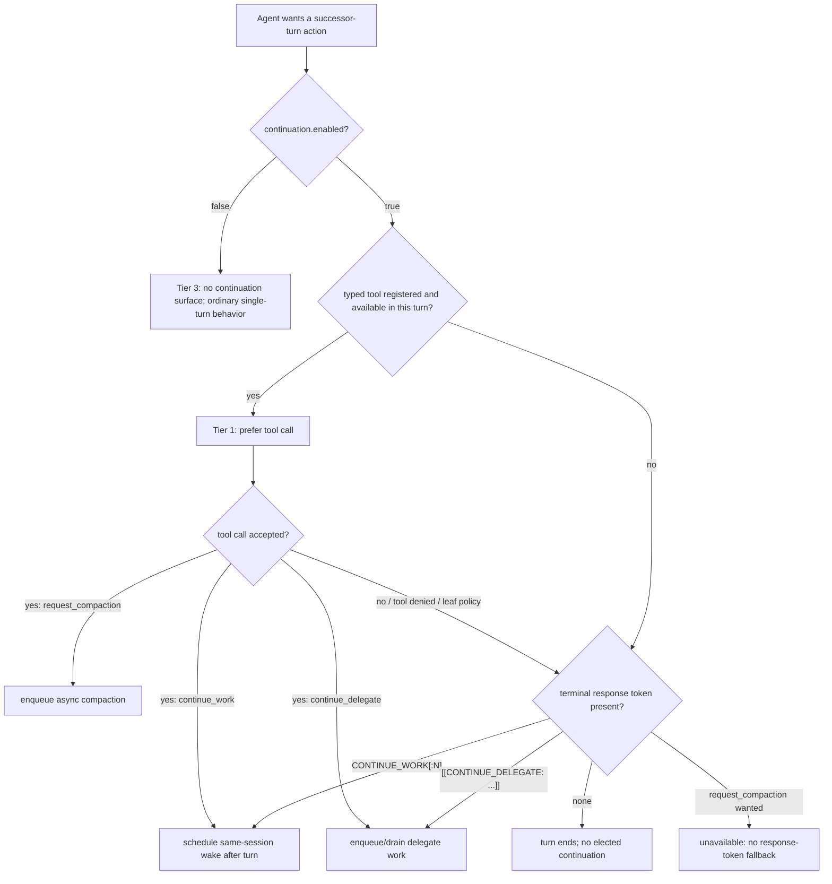
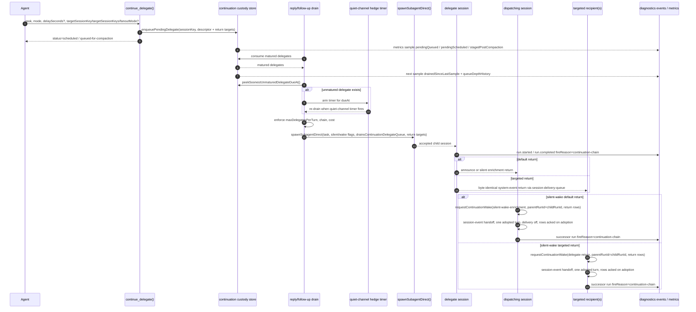
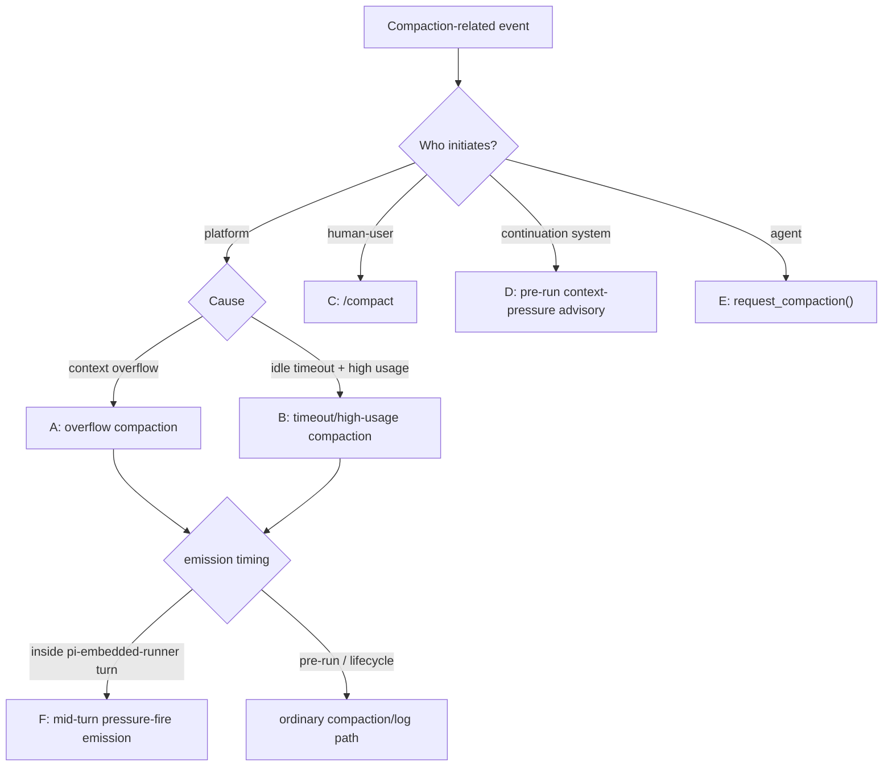
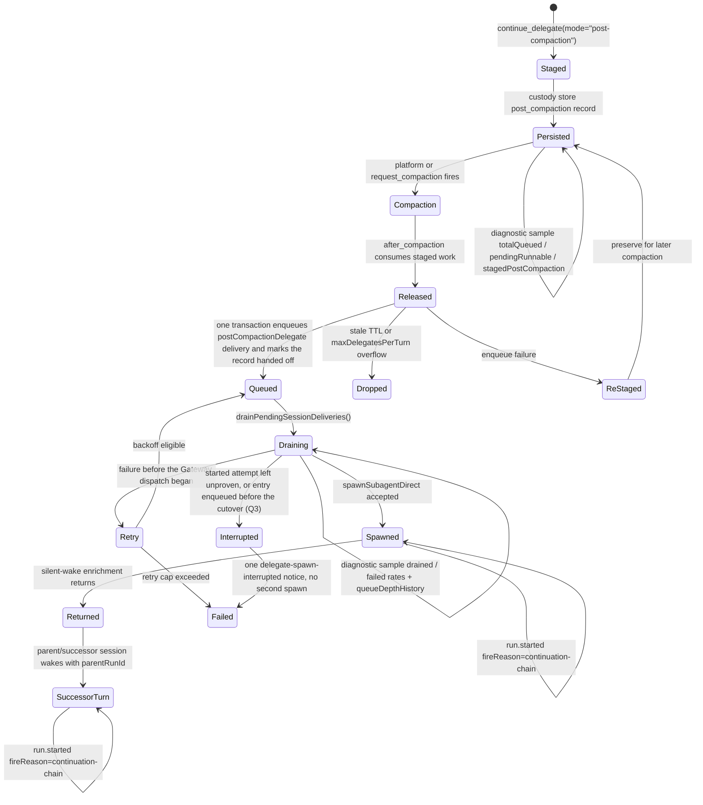
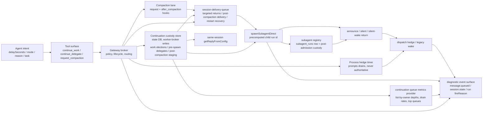
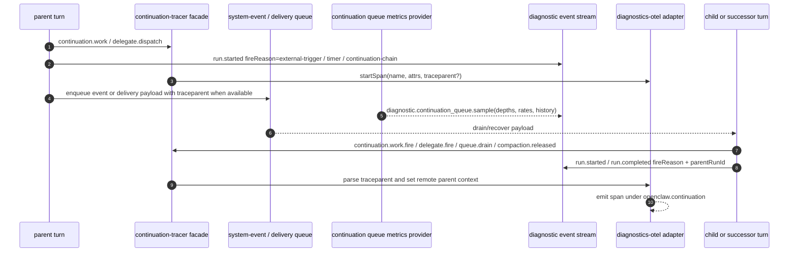

# RFC: Agent Self-Elected Turn Continuation (`CONTINUE_WORK`)

**Status:** Continuation custody implemented; replaceable-head reset implemented for admitted trees and for elections not yet driven (karmaterminal/openclaw#1271); post-compaction shards still end at a reset
**Authors:** OpenClaw maintainers
**Date:** March–May 2026; custody revision September 2026

> **Custody revision (September 2026).** The current runtime uses the continuation custody store for elections and pre-spawn delegates, the session-delivery queue for post-compaction handoff, and `subagent_runs` after child admission (§5.4). Historical descriptions of the removed managed-work substrate in this document are archaeology, not current runtime instructions. The custody revision did **not** settle the reset/child-tree semantics corrected below. Upstream citations pinned to `4d8c9bdd` are historical, not proof of the current candidate.
>
> **Reset contract (November 2026).** A chat session's conversational head is replaceable, and `/new` or `/reset` is not a decision to cancel what the head elected. A reset keeps the continuation-elected delegate tree (admitted children are marked before the reset kill and adopted by the successor, `session-reset-retention.ts`) and the elections the replaced head had not driven yet: queued `continue_work` wakes and queued or claimed delegates (`session-reset.ts`). A kept wake stays bound to the recipient-authority epoch its session had when the work was elected, so it never crosses a real handover (`work-recipient-authority.ts`). It still retires what belonged to the replaced head: a wake already driving its turn, its prompt and runtime queues, its timers and hedge closures (re-armed from custody once the reset settles), and post-compaction shards, which need a rebind rule before they may outlive the context that staged them. Delete, including an incognito reset that deletes the row, ends all of the session's custody. Stopping queued work is a separate, explicit, owner-only act: `/continuations cancel <id...>` terminalizes exactly the named records and replies with a receipt. Sections 5.4.4 and 9.3 describe this behavior.

<a id="replaceable-head-reset-contract-proposed-implementation-and-proof-pending" />

## Replaceable-head reset contract

| Custody at the boundary                                                                                              | `/new` and `/reset`                                                                                                                                                                                                                                                                                                                                                                                                                                               | Delete, including an incognito reset                                                    |
| -------------------------------------------------------------------------------------------------------------------- | ----------------------------------------------------------------------------------------------------------------------------------------------------------------------------------------------------------------------------------------------------------------------------------------------------------------------------------------------------------------------------------------------------------------------------------------------------------------- | --------------------------------------------------------------------------------------- |
| The interrupted head, its prompt and runtime queues, and a `continue_work` wake already driving its turn (`running`) | Retired. The in-flight wake is cancelled, never replayed into the successor.                                                                                                                                                                                                                                                                                                                                                                                      | Retired.                                                                                |
| A queued `continue_work` wake                                                                                        | Kept with its task, provenance, operator custody, recipient-authority binding and original due time; re-armed after the reset settles; wakes the successor at most once, through a crash too: a wake whose turn started but whose delivery was never confirmed ends interrupted with one notice and never runs again (§5.4.2). Repeated swaps neither duplicate nor postpone it. A later owner change, visibility narrowing, member removal or delete refuses it. | Cancelled.                                                                              |
| A delegate queued or claimed but not spawned                                                                         | Kept with its provenance, at-most-once spawn identity, attachment and recipient binding. A claim the reset aborted before dispatch is requeued and spawns once; a claim a crash left unresolved ends in one interrupted notice (Q3).                                                                                                                                                                                                                              | Cancelled.                                                                              |
| A post-compaction shard, staged or claimed for release                                                               | Cancelled until a review/rebind rule exists for context-dependent shards.                                                                                                                                                                                                                                                                                                                                                                                         | Cancelled.                                                                              |
| A post-compaction handoff to the session queue not yet accepted                                                      | Fenced (`cancelRequestedAt`); the queue drain refuses it.                                                                                                                                                                                                                                                                                                                                                                                                         | Fenced.                                                                                 |
| A delegate handed off to `subagent_runs`: the admitted child and its descendants                                     | Retained: marked before the reset kill and adopted by the successor revision. Returns are held while the outcome is uncertain, released when adopted, and fenced when orphaned.                                                                                                                                                                                                                                                                                   | The run is stopped and its held returns fail.                                           |
| A return aimed at the old head                                                                                       | Delivered to the successor: the reset leaves the recipient-authority epoch unchanged.                                                                                                                                                                                                                                                                                                                                                                             | Refused per destination, routed and `all` returns alike: the delete advanced the epoch. |

A reset proves its successor against the session row, as the retention marks do: the commit names the successor revision. After the commit, every head swap (chat `/new` and `/reset`, the Gateway `sessions.reset`, and automatic rollovers that reset) re-arms the kept records from custody alone, with chain state read from and written to the row, the way startup recovery drives them; with continuation disabled the rows stay durable for a re-enable. Nothing the replaced head held in memory (timers, hedge closures, dispatch claims) survives; only the durable election does. The successor gets the same elections the replaced head would have, at their original times, and never more authority: delegate returns and kept `continue_work` wakes stay bound to the recipient-authority epochs captured at election, and a delete, owner change, visibility narrowing or member removal fences each of them through the recipient-authority refusal.

`/continuations` lists a session's live records with their IDs; `/continuations cancel <id...>` (owner only) cancels exactly those records, ends the in-process wake or spawn holding a claim on them, and replies with one receipt line per ID: `cancelled`, `fenced`, `handed-off` (with the admitted child to stop through the subagent controls), `already-ended`, or `not-found`.

**Kept `continue_work` wakes and recipient authority.**

- **Binding.** The election captures the session's recipient-authority epoch into the work state's optional `recipientAuthority` field before the record is written, with the same capture a delegate's binding uses. A failed capture elects nothing. An incognito session has no durable recipient authority, so a `continue_work` election there fails visibly (`continue_work scheduling failed`), as a delegate elected there does. Capture and check open the session's configured store, where its handovers advance the epoch.
- **Checks.** The binding is checked under the agent writer admission at every boundary the wake crosses:
  - the replay sweep at custody boot, before startup recovery drives anything, due or not;
  - the dispatcher's handoff, right after it claims the due records;
  - the turn's final fence, or the active-turn fold note that would adopt the wake.
- **Refusal.** A stale binding is refused at the first boundary that sees it. The record fails with `failureReason` `recipient-authority-changed`, and no wake turn runs. No terminal notice reaches the session, because its current recipient did not elect the work. The election's operator custody is released, except at the fold (see the known limits). The refusal is logged as `[continuation:work-refused] stage=<replay|wake|adoption> reason=<reason> session=<key> flowId=<id>` and counted on a `continuation.queue.drain` span (`queue.refused_count`, `refusal.reason`). The failed record is pruned with other terminal custody after 7 days.
- **Same-owner reset.** `/new` and `/reset` (the chat command, the Gateway `sessions.reset`, New Chat) leave the epoch unchanged, so the kept wake wakes the successor once at its original due time.
- **Records elected before the binding existed** carry no `recipientAuthority`. They are kept across a same-owner reset as bound records are, and each boundary judges them by the session's authority row, whose `updated_at` is its last epoch write:
  - no row (no handover has been recorded for the session), or a last write before `electedAt`: the wake is kept;
  - an advance after the election (`updated_at` later than `created_at`): refused as `recipient-authority-changed`;
  - a row first written after the election: refused as `recipient-authority-unverifiable`. Such a row may come from a handover or from the capture of a later delegate or `continue_work` election, and the row cannot tell them apart. This is the named loss: a wake queued before the upgrade, in a session that had never recorded recipient authority, is dropped if anything records that authority before it fires. Its refusal is logged like any other.
- **Codec compatibility.** The field is additive and optional, with no migration. Old records decode unchanged. A record whose binding is malformed fails closed ("Rejected invalid continuation work payload"), never as unbound. An older build reads a bound record (its work codec drops unknown fields), checks no binding, and rewrites the record without it on its next state write (a claim, anchor or requeue); after rolling forward, that record is judged as unbound.

Known limits: j12′ keeps queued `continue_work` and delegate elections across a reset, not staged, claimed or unaccepted post-compaction shards; keeping those needs their rebind rule (follow-up). The adoption check runs before the wake turn's final fence and before a fold note is delivered; a handover that commits after that read reaches only the next boundary, because the turn is already running. The unbound-record rule compares the agent database's write time with the Gateway's election time; both are the same host's wall clock, so a clock stepped backward between the election and a handover can keep an unbound wake. Doctor's canonical-key repair rewrites a kept epoch with a fresh write time, so an unbound wake elected before such a repair is refused as changed although no handover happened. A wake refused at the fold keeps its operator custody until the Gateway restarts, as a delivered fold does (follow-up). An unreadable authority at the handoff leaves the decision to the adoption check, which retries inside the turn's transient-error budget; an unreadable authority at the fold requeues the wake. While the handoff read is failing, a stale backlog member can still be superseded with the usual count-only coalesce note, a missing session still logs its warning, and a wake whose adoption read fails every retry still ends in the retry-exhausted notice; none of these runs a turn. A claim the reset aborted that is still unwinding when the reset re-arms gets one more look from a hedge 30 seconds later; if it is requeued after that, it waits for the session's next drain. A wake claimed between the reset's custody read and its claim abort stays `running` and is re-driven by running-recovery about a minute later, or, if its turn-start fence had committed, interrupted with a notice instead (§5.4.2). A delegate elected during a turn the reset interrupted, and never dispatched by that turn, carries no inherited silent/wake policy, as after a crash.

This RFC documents a continuation system for persistent OpenClaw sessions. It introduces self-elected turn continuation, delegated follow-up work, same-host targeted delegate returns, context-pressure awareness, and agent-initiated compaction. The implementation is bounded, observable, interruptible, and opt-in.

This mechanism is not a polling convenience. It gives a turn-scoped agent limited authority to make provisions for successor turns: another turn in the same session, a delegated shard, a targeted return to another session, a post-compaction recovery action, or a compaction request that changes the shape of the session before the next agent sees it. The acting agent may not occupy that future context. The substrate therefore records intent in a form a successor can inherit, reject, audit, or complete.

Targeted delegate return is the banner routing primitive: one child can grant another session a turn, wake every known session on the host, or drip silent context into a named session without duplicating the delegate run. That makes continuation a signaling substrate as well as a work-scheduling substrate.

## Table of Contents

- [1. Problem](#1-problem)
  - [1.1 Inter-turn inertia](#11-inter-turn-inertia)
  - [1.2 The dwindle pattern](#12-the-dwindle-pattern)
  - [1.3 Requirements for a continuation primitive](#13-requirements-for-a-continuation-primitive)
- [2. Solution](#2-solution)
  - [2.1 Terminology and scope](#21-terminology-and-scope)
  - [2.2 Unified interface: tools first, response-token fallback](#22-unified-interface-tools-first-response-token-fallback)
  - [2.3 `continue_work()` semantics](#23-continue_work-semantics)
  - [2.4 `continue_delegate()` semantics and return modes](#24-continue_delegate-semantics-and-return-modes)
  - [2.5 `request_compaction()` semantics](#25-request_compaction-semantics)
  - [2.6 Response-token fallback and token interaction](#26-response-token-fallback-and-token-interaction)
  - [2.7 Capability-tier hierarchy](#27-capability-tier-hierarchy)
  - [2.8 Design rationale](#28-design-rationale)
- [3. Implementation](#3-implementation)
  - [3.1 Architecture](#31-architecture)
  - [3.2 Delegate dispatch walkthrough](#32-delegate-dispatch-walkthrough)
  - [3.3 Announce payloads and chain tracking](#33-announce-payloads-and-chain-tracking)
  - [3.4 Tool implementation and prompt gating](#34-tool-implementation-and-prompt-gating)
  - [3.5 Temporal sharding with context attachments](#35-temporal-sharding-with-context-attachments)
  - [3.6 Persistence and restart-survival](#36-persistence-and-restart-survival)
- [4. Platform Integration](#4-platform-integration)
  - [4.1 Two-layer compaction model and trigger taxonomy](#41-two-layer-compaction-model-and-trigger-taxonomy)
  - [4.2 Context-pressure awareness](#42-context-pressure-awareness)
  - [4.3 `request_compaction()` in the compaction lifecycle](#43-request_compaction-in-the-compaction-lifecycle)
  - [4.4 Continuation relay and post-compaction context rehydration](#44-continuation-relay-and-post-compaction-context-rehydration)
  - [4.5 Lifecycle hooks and platform settings](#45-lifecycle-hooks-and-platform-settings)
  - [4.6 Gateway as lifecycle broker](#46-gateway-as-lifecycle-broker)
- [5. Configuration](#5-configuration)
  - [5.1 Core configuration surface](#51-core-configuration-surface)
  - [5.2 Human-user profiles](#52-human-user-profiles)
  - [5.3 Wide fan-out patterns](#53-wide-fan-out-patterns)
  - [5.4 Continuation custody](#54-continuation-custody)
- [6. Observability](#6-observability)
  - [6.1 Diagnostic log anchors](#61-diagnostic-log-anchors)
  - [6.2 Lifecycle traces](#62-lifecycle-traces)
  - [6.3 `/status` continuation telemetry](#63-status-continuation-telemetry)
  - [6.4 Context-pressure telemetry](#64-context-pressure-telemetry)
  - [6.5 Human-user observability and hot reload](#65-human-user-observability-and-hot-reload)
  - [6.6 Chain-correlation via diagnostics-otel](#66-chain-correlation-via-diagnostics-otel)
  - [6.7 OTEL trace wiring across the substrate queue boundary](#67-otel-trace-wiring-across-the-substrate-queue-boundary)
  - [6.8 Trace-context propagation across the continuation lifecycle](#68-trace-context-propagation-across-the-continuation-lifecycle)
- [7. Safety and Security](#7-safety-and-security)
  - [7.1 Guardrails and human-user consent](#71-guardrails-and-human-user-consent)
  - [7.2 Temporal gap and payload integrity](#72-temporal-gap-and-payload-integrity)
- [8. Applicability](#8-applicability)
- [9. Testing](#9-testing)
  - [9.1 Test strategy and terminology](#91-test-strategy-and-terminology)
  - [9.2 Functional coverage](#92-functional-coverage)
  - [9.3 Findings from live validation](#93-findings-from-live-validation)
- [10. Discussion and Future Work](#10-discussion-and-future-work)
  - [10.1 Summary](#101-summary)
  - [10.2 Future directions](#102-future-directions)
- [Appendix A. Extension contracts and future seams](#appendix-a-extension-contracts-and-future-seams)
  - [A.1 Bounded pre-compaction evacuation window](#a1-bounded-pre-compaction-evacuation-window)
  - [A.2 Compaction-triggered evacuation delegate](#a2-compaction-triggered-evacuation-delegate)
  - [A.3 Proposed `context_pressure` lifecycle hook](#a3-proposed-context_pressure-lifecycle-hook)
  - [A.4 Proposed configuration values not shipped in the current codebase](#a4-proposed-configuration-values-not-shipped-in-the-current-codebase)
  - [A.5 Typed `continue_delegate()` on-dispatch input attachments](#a5-typed-continue_delegate-on-dispatch-input-attachments)
- [Appendix B. Alternatives, prior art, and tool comparisons](#appendix-b-alternatives-prior-art-and-tool-comparisons)
  - [B.1 Alternatives considered](#b1-alternatives-considered)
  - [B.2 Prior art](#b2-prior-art)
  - [B.3 `continue_delegate()` compared with `sessions_spawn`](#b3-continue_delegate-compared-with-sessions_spawn)
  - [B.4 Async-only volitional compaction: design decision](#b4-async-only-volitional-compaction-design-decision)
- [Appendix C. Failure modes and behavioral limitations](#appendix-c-failure-modes-and-behavioral-limitations)
  - [C.1 Operational failure modes](#c1-operational-failure-modes)
  - [C.2 Inherited behavioral limitations](#c2-inherited-behavioral-limitations)
- [Appendix D. Detailed implementation evidence](#appendix-d-detailed-implementation-evidence)
  - [D.1 Context-pressure inclusion sketch](#d1-context-pressure-inclusion-sketch)
  - [D.2 Evidence locations](#d2-evidence-locations)
- [Appendix E. Proposed follow-up upstream change: register native spawns before acknowledging](#appendix-e-proposed-follow-up-upstream-change-register-native-spawns-before-acknowledging)

## 1. Problem

### 1.1 Inter-turn inertia

Existing mechanisms for keeping an OpenClaw agent active—heartbeat timers, cron-scheduled wake-ups, loop instructions in system prompts authored by the **human-user** or operator—all work by injecting **external** events on a fixed schedule. They solve the liveness problem: the agent wakes up periodically. They do not solve the **volition** problem: the agent cannot say, mid-work, “I need another turn.” It can only wait for the next scheduled tick.

This distinction matters for three reasons.

First, **context cost.** A heartbeat instruction such as “check all open issues and work on them” occupies space in the context window on every turn, including turns where there is nothing to check. Over thousands of turns and repeated compaction cycles, this static instruction accumulates as the dominant repeated signal in the agent’s working memory—biasing attention toward the polling task and away from the work at hand. The repetition does not merely consume tokens; it shapes what the agent attends to.

Second, **token waste.** Timer-driven polling burns tokens on empty cycles. An agent heartbeating every 60 seconds but with genuine work only once per hour executes 59 empty turns for every productive one.

Third, **granularity.** A cron timer fires on a schedule. The agent knows _during its turn_ whether it has more work. The timer does not know until the next tick. The gap between “I know I have more to do” and “the timer will wake me in 58 seconds” is the inter-turn inertia.

### 1.2 The dwindle pattern

This produces the **dwindle pattern**: an agent with active work in flight decays toward inactivity between unrelated external events. Momentum is lost, context continuity weakens, and work that could have proceeded immediately instead waits for an accidental wake-up.

Observed in production across 4 persistent agent sessions, this pattern consumed substantial productive time each day. The failure mode was not absence of capability; it was absence of an explicit inter-turn continuation primitive.

### 1.3 Requirements for a continuation primitive

A usable continuation primitive for OpenClaw had to satisfy several constraints simultaneously:

1. **Volitional control.** The agent must be able to elect to continue and also elect to stop. This is not an infinite loop with a termination check; it is a choice at each turn boundary.
2. **Same-session continuity.** The common case should preserve the session rather than forcing every continuation through a new child session.
3. **Delegated continuation.** The design must support sub-agent work for cases where a future result, not merely another blank turn, is what matters.
4. **Compaction awareness and preemptive context evacuation.** Persistent sessions need a way to prepare for compaction before the platform forces it.
5. **Bounded operation.** The feature must remain interruptible, rate-limited, observable, and explicitly enabled by the human user.
6. **Fallback behavior.** The mechanism must still work when tools are unavailable, including environments that only allow terminal response tokens.

## 2. Solution

### 2.1 Terminology and scope

This RFC uses the following terms consistently:

| Term                           | Meaning                                                                                                                                                                                                                                                                                             |
| ------------------------------ | --------------------------------------------------------------------------------------------------------------------------------------------------------------------------------------------------------------------------------------------------------------------------------------------------- |
| **human-user**                 | The person who owns the deployment, grants opt-in, and can interrupt or disable continuation.                                                                                                                                                                                                       |
| **operator**                   | The deploying human-user role when discussing configuration, logs, or runtime policy.                                                                                                                                                                                                               |
| **turn**                       | One model generation cycle with a bounded prompt, tool surface, and reply/follow-up lifecycle.                                                                                                                                                                                                      |
| **successor turn**             | A later turn that receives structure arranged by an earlier turn: a wake, a delegate result, post-compaction context, or a compaction outcome.                                                                                                                                                      |
| **continuation**               | Agent-elected work that crosses a turn boundary without becoming an unbounded loop.                                                                                                                                                                                                                 |
| **continuation chain**         | The bounded sequence of successor turns and delegates tracked by chain count, token budget, and chain id where available.                                                                                                                                                                           |
| **delegate**                   | A sub-agent shard spawned through `continue_delegate()` or response-token fallback, with a task string, mode, return targeting (`targetSessionKey`, `targetSessionKeys`, or `fanoutMode`), and optional delay. The typed tool can also carry scoped input attachments into the new child workspace. |
| **relay**                      | A precursor or fallback pattern where one session wakes another by returning a result later.                                                                                                                                                                                                        |
| **temporal shard**             | Work split across time rather than only across simultaneous agents.                                                                                                                                                                                                                                 |
| **substrate**                  | The mechanism that carries a continuation path: process timer/reservation, the continuation custody store, the session-delivery queue, the subagent registry, or the compaction lifecycle.                                                                                                          |
| **broker**                     | Gateway code that translates agent intent into substrate mechanics and policy enforcement.                                                                                                                                                                                                          |
| **continuation custody store** | The continuation-owned records in the shared state database. They hold same-session `continue_work` elections, pre-spawn delegates and post-compaction staging, and are written only through state-database worker operations (§5.4). It is the current custody authority.                          |
| **custody handoff**            | The point at which a delegate stops being owned by the continuation custody store and becomes a `subagent_runs` row in the subagent registry (§5.4.4).                                                                                                                                              |
| **OTel**                       | OpenTelemetry trace emission through `extensions/diagnostics-otel`.                                                                                                                                                                                                                                 |

Status markers:

- **Shipped behavior** names current runtime and schema contracts.
- **Implementation note** explains how the contract is carried today without making the implementation shape the public contract.
- **Historical note** records why a decision exists, but is not itself normative.
- **Future seam** names plausible extension points that are not shipped.
- **Custody revision** names the current durable owner model in §5.4; older substrate comparisons are historical only.
- **Non-goal** explicitly excludes behavior from the current RFC.

### 2.2 Unified interface: tools first, response-token fallback

The implemented solution exposes three continuation capabilities as tools on main-session turns when `continuation.enabled: true`, with fallback response tokens when tools are unavailable.

| Capability             | Primary interface      | Fallback                            | Purpose                                                                      |
| ---------------------- | ---------------------- | ----------------------------------- | ---------------------------------------------------------------------------- |
| Self-elected next turn | `continue_work()`      | `CONTINUE_WORK` / `CONTINUE_WORK:N` | Schedule another turn for the current session                                |
| Delegated work         | `continue_delegate()`  | `[[CONTINUE_DELEGATE: ...]]`        | Dispatch work to a sub-agent, preserve chain semantics, and route the return |
| Volitional compaction  | `request_compaction()` | None                                | Request compaction after preparatory work                                    |

All three tools are fire-and-forget. They schedule their action and return immediately. The current turn continues to completion normally; the follow-up action occurs only after the turn ends.

This yields a strict two-interface model:

- **Primary path:** typed tools with validation, multiple calls per turn where appropriate, and explicit schemas.
- **Fallback path:** response tokens that work when tools are disabled by human-user policy, unavailable to a given depth, or fail in the current turn.

### 2.3 `continue_work()` semantics

`continue_work()` is the same-session continuation primitive.

**Purpose:** request another turn for the current session after an optional delay.

`continue_work()` is temporal self-scheduling, not a loop primitive. Each accepted call elects one successor turn and remains subject to chain, cost, delay, and human-user opt-in bounds. The absence of a continuation request is as meaningful as its presence: the agent can elect to stop.

**Behavior:** calling `continue_work()` schedules a future turn and the current turn completes normally. The call does not terminate the active turn, and it does not force an immediate second generation inside the same turn.

If `delaySeconds` is 30 and the current turn is still active, the 30-second timer starts **after turn completion**, not when the tool call is emitted. The same timing model applies to the `CONTINUE_WORK:30` response token.

**Shipped behavior:** same-session continuation is a durable election. The tool form and the response-token fallback both converge on one `continuation_work` record. That record holds the session key, hop, delay, semantic due time, election time, anchor-finalization time, reason, origin run and turn, the parent run when there is true spawn lineage, and chain metadata. In-process timers are hedge timers only. They may mature a due record promptly, but they are not the source of truth. Gateway startup recovery re-arms or matures queued work from the durable record.

**Current custody:** a `work` record in the continuation custody store owns the `continue_work` election (§5.4). That store is the only transactional authority for elections: election, replacement of parked work, claim, the delivered mark, requeue, terminalization and the terminal-notice obligation are all compare-and-set writes in that one store. Session pending inputs and cron are **not** election authorities (§5.4.3). Every field listed above keeps its meaning and moves as listed in §5.4.2.

When a `continuation_work` row matures while the session is idle, the dispatcher grants a turn to the **same session** directly through the universal reply executor (`getReplyFromConfig`) with a `[continuation:wake]` system event and provenance banner. When the semantic due time arrives while a later turn for the same session is already active, the row does not stack a naked later wake and does not re-anchor its delay. Instead, the dispatcher delivers one trusted `[system:continuation-note]` into the active turn, quotes the original reason as prior intent, includes age/overdue and origin provenance, instructs the successor to re-evaluate before acting, and terminalizes the row only after durable note delivery succeeds. It does not use the continuation wake (§3.2), which hands queued delegate returns to a session-event turn; a matured row grants its own turn. (Historical: before upstream retired the heartbeat runner in upstream #180192 and #180563, this path likewise avoided `requestHeartbeatNow()` and `runHeartbeatOnce()`, because heartbeat registration, active-hours, deferral, and busy skip gates were heartbeat policy rather than same-session continuation policy.) The session-store entry must still exist when the row matures, so sub-agent cleanup and archive sweeps retain child sessions with live or recently granted continuation work.

**Safety model:** the scheduled continuation remains subject to chain-length and token-budget guards. If the current self-continuation chain has already exhausted its configured `maxChainLength` or `costCapTokens` budget within the unbroken self-chain, the call is rejected and the agent may stop, persist state to files, or choose another recovery path. (A fresh non-continuation turn-entry — genuine user message, scheduled (cron) turn, or external system event — resets the chain budget per the per-turn chain-reset semantic in §3.3; the budgets bound unattended-loop depth, not session lifetime.)

### 2.4 `continue_delegate()` semantics and return modes

`continue_delegate()` is the delegated continuation primitive.

**Purpose:** dispatch a sub-agent with typed task, mode, and delay parameters, then route its completion back into the parent continuation chain.

`continue_delegate()` externalizes a shard of future cognition. The task string is a letter to a successor worker: it must carry scope, evidence requirements, desired return shape, and the parent action it is meant to enable.

**Shipped behavior:** the current tool schema exposes `task`, `delaySeconds`, `mode`, `targetSessionKey`, `targetSessionKeys`, `fanoutMode`, `model`, `attachments`, and `attachAs`. The default completion recipient remains the session that dispatched the delegate. Explicit target fields route the same completion envelope through the `session-delivery-queue` substrate to other known sessions on the same host. Delegates using `normal` mode and no explicit target keep the existing visible announce behavior; targeted returns are delivered as session-addressed enrichment events so one delegate completion can fan out byte-identically without duplicating the delegate run.

Typed input attachments use this shape:

```ts
attachments: Array<{
  name: string;
  content: string;
  encoding?: "utf8" | "base64";
  mimeType?: string;
}>;
attachAs?: {
  mountPath?: string;
};
```

These fields carry scoped input into the **new child delegate workspace**. The workspace is the child execution workspace selected by the shared spawn contract—the target-agent workspace or an explicit child `cwd`. Per-session isolation comes from the private UUID receipt directory; this feature does not provision a separate workspace for every child. An accepted non-empty attachment array is a bounded snapshot **by value at tool dispatch**, not a source path, URL, workspace scan, or later-resolved reference. An omitted or empty `attachments` array means no snapshot. Non-empty arrays contain 1–50 entries. An omitted or empty `attachAs` object means no mount hint, and a mount hint is ignored unless `attachments` is non-empty. A non-empty `mountPath` is trimmed to its canonical value before durable enqueue and accepts only ASCII letters, digits, `.`, `_`, `-`, `/`, and `:`; unsafe or control-bearing hints are rejected. The hint affects only the child prompt—it is not an alternate materialization destination.

The fields use the same validation, limits, private receipt directory, per-file hashes, cleanup policy, and `tools.sessions_spawn.attachments` configuration as `sessions_spawn` attachments. Immediate, delayed/recovered, and post-compaction typed delegates retain the snapshot until child spawn or a crash-safe post-compaction queue handoff. The snapshot bytes do not sit in the durable record. They live in a private payload file under `<stateDir>/attachments/continuation-custody/<attachmentId>/payload.json` (at most 8 MiB), and the file is bound to its record ID and owner session. The durable record carries only `attachmentId` and `attachmentCount`. Terminal records keep lifecycle and routing state, but they drop `attachmentId`, and the payload file is released. The owning record is a continuation custody store `delegate` record (§5.4). Custody passes to the subagent registry's own `attachmentId` receipt directory at the custody handoff (§5.4.4). Newly persisted `continue_delegate` tool calls replace each `attachments[].content` value with the established redaction marker, remove each private attachment filename, and preserve only the task plus replay-safe encoding/MIME metadata; `attachAs` is projected to its single mount-path field and removed when no non-empty snapshot exists. A legacy already-redacted snapshot that retains `name` remains replay-safe as-is, so signed historical turns are not mutated or dropped. This does not change the separate trusted-transcript behavior of `sessions_spawn`. Post-compaction queue recovery runtime-validates the discriminated payload and strict attachment members. Malformed records are dead-lettered with structural-only diagnostics, and their raw queue JSON is replaced so attachment bytes do not remain in the failed row. The tool result reports only attachment count and canonical mount options, never attachment content.

The `attachments` and `attachAs` fields are an input contract, not an attachment-bearing return contract. Delegate returns are text-only.

**What the target fields do — and explicitly do not — do.** Every `continue_delegate()` call spawns a fresh sub-agent owned by the dispatcher (a new session under `agent:<targetAgentId>:subagent:<UUID>`). The fresh sub-agent receives the `task` body, runs it, and produces a completion envelope. The `targetSessionKey`, `targetSessionKeys`, and `fanoutMode` fields control **where that completion envelope is delivered** when the fresh sub-agent finishes. They do not redirect the task body, they do not wake an existing session's run loop with the original task, and they do not route work into a named live-attached recipient. A live-attached recipient named via `targetSessionKey` will see only the post-completion `[continuation:enrichment-return]` envelope; it will never see the original `task` string from this primitive.

Probes that test for task-routing semantics (for example, asking the named target to reply with a unique nonce on its bound channel) will observe zero nonce hits and a reply emitted from a fresh subagent UUID. That observation is consistent with the shipped contract; it is not evidence of a routing bug. Cross-session task delivery — addressing an existing session's run loop with a new prompt — is a separate primitive that is out of scope for this RFC.

On the recipient's next turn, the reply runner drains that session-scoped system-event queue and prepends the completion envelope as `System:` context. In `silent-wake` mode the return also requests a `delegate-return` continuation wake for every targeted recipient, so a dormant channel-bound session can wake, consume its own enrichment copy, and produce normal turn output informed by that context. The wake hands the queued envelope itself to the woken turn as its input (§3.2), so the copy is consumed once, not drained again as `System:` context. The target is not expected to echo the completion nonce verbatim unless its next turn independently chooses to do so.

The woken turn's stored input row records what it consumed. `__openclaw.inputDeliveries` lists each durable return row the turn took (`deliveryId`) with the delegate run that produced it (`sourceRunId`), one entry per return even when several returns coalesce into one wake. `__openclaw.inputRunId` names the run that consumed them: the same run id its assistant and tool rows carry as `__openclaw.runId`. `provenance.runId` still names only the wake's lineage, which is the last delegate when returns coalesce. `sessions.get` returns these rows as stored, so a requester can join its own dispatch (the delegate's run) to the run that consumed the result without inferring it from timing. Only an event turn handed its returns by the host records them; a user-authored turn that picks up a queued return keeps its delivery receipt but is never stamped as a delegate consumption, and write hooks can neither forge nor drop either field. The input is staged before its run exists, so `inputRunId` is written to the committed row once that run's provider dispatch is accepted.

**Consumed** means the run's provider dispatch was accepted: a stored row lists the return in `inputDeliveries` and names that run as `inputRunId`. The stamp is written only after every pre-dispatch check passed and the transport carrying the run's request accepted it. In process, that is the provider stream returning its stream; a failure the provider reports inside that stream, such as an HTTP 429 or 401, comes after acceptance. On a cloud worker, it is the launch that carries the input being dispatched to the worker, or the launched worker admitting the input on the admission protocol. Consumed proves neither provider delivery nor that the model attended to the return or acted on it. A worker sends its own provider request, so a worker that fails that request after taking the input still reads consumed. Every other state is **unknown**, and a reader must not infer consumption from it. Unknown covers:

- a retired return;
- a return a turn adopted without a durable receipt (its input was already durable when it drained the return);
- a row whose run was aborted, blocked or refused before its dispatch was accepted (for example, a provider stream that rejected the request, or a worker launch that failed), or died before the stamp.

A return replayed after a crash is stamped only on the replay run's own row. A crashed run that had dispatched it keeps its own stamp, and recovering the return never moves it.

The shipped return-target modes are:

1. **Default:** omit targeting fields and return to the dispatching session.
2. **Single other session:** set `targetSessionKey` to return to one explicitly addressed session, such as a root or depth-1 ancestor.
3. **Multiple sessions:** set `targetSessionKeys` to return one byte-identical completion envelope to every listed session.
4. **Tree fan-out:** set `fanoutMode: "tree"` to return to every ancestor in the current sub-agent/continuation chain.
5. **Host fan-out:** set `fanoutMode: "all"` to return to every known session on the same host.

Multi-recipient return is distinct from multi-delegate fan-out: multi-delegate fan-out runs N delegates that may produce N different artifacts; multi-recipient return runs one delegate and delivers the same completion envelope to N recipients. Aspect multiplexing, per-receiver transformation, backpressure-aware multicast, cross-host publish/subscribe, and SeedLink-style broadcast remain the higher broadcast layer; they do not replace this shipped session-addressed return primitive.

Compared with the delegate response token, `continue_delegate()` adds three core properties:

1. **Multi-delegate fan-out.** Multiple calls in one turn can dispatch multiple delegates in parallel.
2. **Typed parameters.** Delay, mode, task, return targets, and input attachments are schema-validated rather than parsed from free text.
3. **Tool-surface discoverability.** The tool is presented directly in the agent’s available interface when enabled.

The delegate return modes are:

| Mode               | Channel echo | Wake parent           | Use case                                                                          |
| ------------------ | ------------ | --------------------- | --------------------------------------------------------------------------------- |
| `normal` (default) | ✅           | ✅                    | Standard delegate completion                                                      |
| `silent`           | ❌           | ❌                    | Passive enrichment that should color a later turn without waking immediately      |
| `silent-wake`      | ❌           | ✅                    | Quiet background cognition that should trigger the next turn automatically        |
| `post-compaction`  | ❌           | ✅ (after compaction) | Evacuation or resume work that should be released only after compaction completes |

**`silent:`** the sub-agent result is delivered through `enqueueSystemEvent()` instead of the normal announce path. Internally, the `silentAnnounce` flag threads through spawn and registry paths to gate the delivery decision point. The parent absorbs the result on a later turn but is not woken.

**`silent-wake:`** channel output remains suppressed, but the return triggers a generation cycle through `requestContinuationWake()`: one session-event turn with transport delivery off, which records its result in the transcript and keeps the chain budget (§3.2). This enables quiet background processing without visible channel noise. (Historical: before upstream retired the heartbeat runner, the cycle came from `requestHeartbeatNow()`.)

**`post-compaction:`** the delegate is staged on the session until compaction completes, then released into the successor session alongside workspace boot files and post-compaction lifecycle context.

**`model:`** an optional provider/model override for the spawned delegate, for example `github-copilot/claude-sonnet-4.6`. Omitted — or the sentinel value `"default"` — leaves the delegate inheriting the dispatching session's model, which is the existing, fully backward-compatible behavior. Supplied, it routes the fresh sub-agent to that provider/model so a parent can cost-route a fan-out (for example an Opus parent dispatching Sonnet or Haiku children). This is the delegate-side twin of `sessions_spawn(model)` and shares its contract: the model string is not validated at dispatch time; unknown refs resolve, or fail, downstream when the sub-agent is spawned. `model` composes with every return mode, with `delaySeconds`, with `post-compaction` staging, and with the response-token fallback.

The delegate response token uses the same targeting contract for fallback/directive paths:

```text
[[CONTINUE_DELEGATE: task | target=session-key]]
[[CONTINUE_DELEGATE: task | targets=key1,key2,key3]]
[[CONTINUE_DELEGATE: task | fanout=tree]]
[[CONTINUE_DELEGATE: task | fanout=all]]
[[CONTINUE_DELEGATE: task | model=provider/model]]
[[CONTINUE_DELEGATE: task | model=sonnet | fanout=tree]]
```

The response-token form does **not** accept inline attachment blobs. Text such as `attachment=...` remains part of the delegate task; it is not parsed into an attachment field. A token-path task may refer to a file that already exists in the shared workspace, but models and callers must not treat `attachment=` as supported token syntax. `continue_work()` also has no attachment fields.

Without `silent-wake`, parent-orchestrated chain hops can stall until an unrelated external message arrives.

### 2.5 `request_compaction()` semantics

`request_compaction()` is the agent-initiated compaction primitive.

**Purpose:** allow the agent to prepare working state, then request compaction on its own schedule rather than waiting for overflow.

`request_compaction()` is the agent asking to become smaller under controlled conditions. It does not compact immediately and it does not let a child compact its parent. It asks the platform to perform the lifecycle transition after the current turn, after the agent has had a chance to evacuate state.

**Behavior:** the tool enqueues compaction and returns immediately. The current turn finishes normally; compaction runs between turns on the same path used by platform compaction.

`request_compaction()` operates on **the current session only**. If a delegate calls `request_compaction()`, it compacts the delegate’s session, not the parent. This isolation is intentional: a child should not compact the parent session through an inadvertent tool call.

The tool has no response-token fallback. Volitional compaction is tool-only in the current design.

`request_compaction()` works in concert with context-pressure awareness (§4.2) and post-compaction delegate release (§4.4): the agent notices rising pressure, prepares working state, stages recovery delegates, and then elects compaction. The three capabilities together form a volitional compaction lifecycle—awareness, preparation, and execution—all under agent control.

The intended lifecycle has three pressure points:

1. **Initial context-window evaluation.** When a session is new to a context window, the platform can establish the habit of regular evacuation: save useful working shape early, not only at crisis time.
2. **Rising pressure.** As context usage grows, advisory events should make evacuation more salient and let the agent choose between staging recovery work, writing durable notes, or requesting compaction at a time it controls.
3. **High pressure.** At roughly 90% and above, the advisory should make elective `request_compaction()` the obvious safe option. Choosing compaction before the hard overflow boundary is usually better than being compacted at window exhaustion, possibly mid-turn.

This cycle is the **lich pattern**: the agent electively arranges the payload that should enrich its successor after compaction. It is a savegame for after compaction, chosen by the agent rather than imposed by the platform. Over dozens or hundreds of compactions, the session can keep re-creating the working shape it chose to preserve: files, staged delegates, silent returns, and post-compaction recovery tasks.

### 2.6 Response-token fallback and token interaction

When tools are unavailable, the continuation system falls back to terminal response tokens:

```text
CONTINUE_WORK                 → schedule another turn with default delay
CONTINUE_WORK:30              → schedule another turn 30 seconds after turn completion
[[CONTINUE_DELEGATE: <task>]] → dispatch a delegate sub-agent
DONE                          → default inert state until another external event
```

The term **response token** covers both bare terminal tokens such as `CONTINUE_WORK` and delimited body-carrying tokens such as `[[CONTINUE_DELEGATE: ...]]`. The square brackets are only the delimiter for the delegate token body; they are not a separate interface.

Limitations of response-token fallback:

- One continuation signal per response.
- End-anchored parsing.
- No multi-delegate fan-out in a single turn.
- No fallback form for `request_compaction()`.

Parser constraints are part of the portable interface:

- The runner scans backward to the last text payload before parsing, because tool-call payloads may follow the response text.
- Response tokens take precedence over a same-turn `continue_work()` tool request when both exist.
- The delegate parser matches the last end-anchored `[[CONTINUE_DELEGATE: ...]]` block and supports multiline task bodies.
- Delegate fallback accepts an optional `+Ns` suffix for spawn delay; optional `| silent` / `| silent-wake` suffixes; optional `| target=...`, `| targets=...`, or `| fanout=tree|all` return-target directives; and an optional `| model=<provider/model>` override that routes the spawned delegate to a specific model (omitted => inherit the parent session's model). Example: `[[CONTINUE_DELEGATE: task | model=sonnet | fanout=tree]]`. The model string is not validated at parse time; an empty `model=` value is rejected as malformed.
- Delegate fallback has no attachment directive. `attachment=...` is ordinary task text; reference an existing workspace file or use the typed tool instead.
- Delegate fallback task text is truncated to 4096 characters, matching the tool schema.
- `CONTINUE_WORK` accepts an optional integer seconds suffix as `CONTINUE_WORK:N`.

`NO_REPLY` is a silence token, not a continuation token. Ordering matters: if the turn should be silent and also schedule continuation, the continuation token must remain terminal in the raw response so the continuation parser sees it first; after stripping that continuation token, `NO_REPLY` must be the only remaining displayed text.

Token interaction remains straightforward:

| Raw response shape                           | Behavior                                                                             |
| -------------------------------------------- | ------------------------------------------------------------------------------------ |
| `NO_REPLY` then terminal `CONTINUE_WORK`     | Strip continuation, leave `NO_REPLY`, suppress channel output, schedule continuation |
| `HEARTBEAT_OK` then terminal `CONTINUE_WORK` | Acknowledge heartbeat, then schedule continuation                                    |
| Response text then terminal `CONTINUE_WORK`  | Deliver response text, then schedule continuation                                    |
| `CONTINUE_WORK` alone                        | Schedule continuation with no substantive response text                              |

### 2.7 Capability-tier hierarchy

The system follows a three-tier capability hierarchy.

```text
Tier 1: continuation.enabled=true and tools available
  → use continue_work(), continue_delegate(), request_compaction()
  → response tokens remain available as same-turn fallback if tool use fails

Tier 2: continuation.enabled=true and tools denied by policy or depth
  → use CONTINUE_WORK or CONTINUE_WORK:N
  → use [[CONTINUE_DELEGATE: ...]]
  → request_compaction() unavailable

Tier 3: continuation.enabled=false
  → no continuation features available
  → standard single-turn behavior
```



The hierarchy is a decision rule, not a user-facing mode switch. Tier 2 is selected by capability or policy failure; agents should prefer typed tools when the gateway presents them.

### 2.8 Design rationale

1. **Gate by capability, not turn type.** Tool visibility is controlled by `continuation.enabled`, while abuse prevention is handled by runtime guards such as `maxDelegatesPerTurn`, `maxChainLength`, and `costCapTokens`.
2. **Prefer structured invocation.** Tools avoid the fragility of regex parsing and allow explicit schemas.
3. **Support width.** Fleet-scale fan-out requires multiple delegates in one turn; the response-token path cannot express that efficiently.
4. **Keep the interface self-describing.** When tools are available, the continuation surface appears explicitly in the tool inventory rather than relying on prior knowledge of terminal tokens.
5. **Reuse implementation paths.** Tools and response tokens converge on the same signal extraction, durable custody scheduling, budget, and dispatch machinery.

In OpenClaw, `continue_work()` is the first primitive that lets an agent say “I am not done yet” without trapping it in a loop that cannot also say “I am done.”

## 3. Implementation

### 3.1 Architecture

The implementation hooks into existing gateway layers rather than adding a parallel runner.

1. **Token parsing:** `parseContinuationSignal()` and `stripContinuationSignal()` in `src/auto-reply/continuation/signal.ts` detect and remove continuation tokens from displayed output.
2. **Signal detection:** the main reply runner, follow-up runner, and spawn-init attempt path inspect finalized payloads and typed tool callbacks with `extractContinuationSignal()`, so typed `continue_work()` and `CONTINUE_WORK[:N]` fallback produce the same work signal.
3. **Same-session work scheduling:** `scheduleContinuationWork()` persists a `continuation_work` election and advances continuation chain state after the current turn completes. The durable record, not the timer handle, is the election. **Custody revision:** the record is a `work` record in the continuation custody store. Election and parked-work replacement commit in one owner-conditioned state-database transaction (§5.4.3).
4. **Same-session work dispatch:** `dispatchPendingContinuationWork()` consumes matured rows, enqueues `[continuation:wake]`, checks that the elected session is present and not already active, then calls `getReplyFromConfig()` directly for that same `SessionKey`. Busy sessions are requeued instead of orphaned.
5. **Delegate queueing:** tool-path delegates, including typed input attachments and mount options, are enqueued via `enqueuePendingDelegate()` and consumed after the response finishes, or after a follow-up or announce boundary drains the same queue. **Custody revision:** the pre-spawn owner is a `delegate` record in the continuation custody store. The record hands custody to a `subagent_runs` row at child admission, under a precomputed child run ID (§5.4.4).
6. **Return routing:** delegate completions resolve default, explicit, multi-recipient, tree, or host-wide return targets and deliver same-host targeted returns through `session-delivery-queue`.
7. **Lifecycle dispatch:** post-compaction delegates are staged as durable records and released through the compaction completion path into `session-delivery-queue` delivery. **Custody revision:** staging is a `post_compaction` record in the continuation custody store. Release enqueues the queue entry and marks the record handed off in one state-database transaction (§5.4.4).

No new transport layer is introduced. Continuation uses system events, existing sub-agent dispatch, same-host session delivery, and the standard reply executor. Same-session `continue_work` grants its turn directly through the reply executor. Delegate returns that wake their recipient use the continuation wake (`src/auto-reply/continuation/continuation-wake.ts`), a thin bridge to upstream's session-event handoff (`enqueueSessionEventForHost`). (Historical: earlier revisions woke delegate returns through the heartbeat wake path, `requestHeartbeatNow()`, which upstream retired in #180192 and #180563.)

### 3.2 Delegate dispatch walkthrough

The delegate path has two ingress forms that converge at spawn but differ in durability before spawn.

#### Turn 0: emit and strip

Suppose the agent emits:

```text
Here is the PR review summary.

[[CONTINUE_DELEGATE: verify the test suite passes and report results +10s]]
```

For response-token fallback, the gateway then:

1. Parses the terminal delegate response token.
2. Strips it from displayed output, so the user sees only the review summary.
3. Enqueues a durable delegate record with task, origin run, clamped delay, mode, model, and return-target metadata if present, through the same `enqueuePendingDelegate()` path as the typed tool, and persists chain state. A `| post-compaction` token stages a post-compaction record instead.
4. Arms a hedge timer for the due time. The timer only prompts a drain; the record is the durable state.

**Correction:** earlier revisions described the token form as a process-scoped reservation. At C (`7b3815d7`) `agent-runner-continuation-signal.ts` already calls `enqueuePendingDelegate()` and `stagePostCompactionDelegate()` for the token form. It therefore crosses the same durable store as the tool, carrying no attachment reference. The rest of this RFC uses that behavior.

For the typed tool path, the gateway instead writes a durable custody record:

1. `continue_delegate()` validates `task`, `delaySeconds`, `mode`, optional return targeting, and typed input attachments.
2. `enqueuePendingDelegate()` commits a queued durable record that preserves the attachment reference and mount options for the later child spawn. At C the row committed first and the payload file was written afterwards; a payload write failure failed the row. **Custody revision:** the payload file is written first, bound to a pre-minted record ID, and the record commits second. The tool reports `scheduled` only after that commit. A crash between the two writes leaves only an unreferenced file, which the startup custody reconcile deletes (§5.4.4, boundary 0).
3. `consumePendingDelegates()` drains only matured records. Unmatured records stay queued until `createdAt + delayMs`.
4. `peekSoonestUnmaturedDelegateDueAt()` lets the dispatcher arm a hedge timer so a quiet channel still re-drains at the next due time.
5. Corrupt records are logged with structural diagnostics only and terminalized as `failed`. Their attachment reference is scrubbed and the payload file released. They are not silently dropped.

**Current custody:** these steps write continuation custody store records through state-database worker operations (§5.4). Claiming a matured record for spawn is a separate compare-and-set write. It records the spawn attempt and the precomputed child run ID before `spawnSubagentDirect()` runs, which gives restart recovery an exact key to look up in `subagent_runs` (§5.4.4). A post-compaction record differs: its first `running` state is a **release claim**, not a spawn claim, and carries no attempt. Its child run ID becomes durable atomically with the session-delivery queue insert and the permanent handoff, and `deliveryStartedAt` is persisted before the drain spawns (§5.4.4, "Post-compaction"). "`running` implies a recorded attempt" therefore holds for pending delegates only (design review, 2026-09-29).

The durability contract is path-specific:

| Path                             | Pre-dispatch state                                                                              | Restart behavior                                                                                                                                                                                                                                                                                                                       |
| -------------------------------- | ----------------------------------------------------------------------------------------------- | -------------------------------------------------------------------------------------------------------------------------------------------------------------------------------------------------------------------------------------------------------------------------------------------------------------------------------------- |
| `continue_work()` tool or token  | Custody store `work` record plus optional hedge timer                                           | Queued work survives restart; exact hedge timer state is process-scoped and is re-established by recovery or later dispatch.                                                                                                                                                                                                           |
| Delegate response-token fallback | Custody store `delegate` or `post_compaction` record (no attachment reference) plus hedge timer | Same as the tool form: queued work survives restart until it is claimed; an unresolved claim ends in the interrupted notice; the hedge timer is process-scoped.                                                                                                                                                                        |
| Tool `continue_delegate()`       | Custody store `delegate` record; after admission, a `subagent_runs` row                         | Queued work survives restart until it is claimed. A claimed record is reconciled against `subagent_runs` by its precomputed child run ID (§5.4.4). If a restart leaves the claim unresolved, the record ends with one `[continuation:delegate-spawn-interrupted]` notice and is never re-spawned. Hedge timer state is process-scoped. |
| `mode="post-compaction"`         | Custody store `post_compaction` record, then session-delivery queue entry after release         | Staged work survives until consumed, expired, cancelled, or released; the release commits the queue entry and the handed-off mark together; queued delivery has retry/restart semantics.                                                                                                                                               |



#### Gap window

Between scheduling and spawn, the parent session is idle while a durable custody record is live. This is the principal temporal gap for audit and security analysis. Typed attachment content stays in the private payload file referenced by the custody record until materialization. The token path stores only task text and routing metadata, and both forms cross the same durable store (the token form is recorded as a delegate record with no attachment reference). Neither path carries a private cryptographic capability.

#### Spawn and wake

When the timer fires, `spawnSubagentDirect()` creates the child session, materializes any typed attachments under the child's private `.openclaw/attachments/<id>` receipt directory, carries forward delivery context, records `[continuation:delegate-spawned]`, and advances accepted chain state. Attachment names, encodings, sizes, and mount hints pass through the same validation and limits as `sessions_spawn`.

When the child completes, the existing announce path delivers untargeted results back to the dispatching session. Targeted returns resolve one or more same-host recipient session keys and deliver a byte-identical completion envelope through `session-delivery-queue`; `silent-wake` targets also request a continuation wake for those recipients. The wake is classified through structured continuation metadata such as `continuationTrigger: "delegate-return"`, allowing a successor turn to distinguish internal continuation from unrelated user input.

**Continuation wake.** `requestContinuationWake({ sessionKey, reason, parentRunId, deliveryIds })` names the durable return rows it was raised for, never their payloads. Its contract:

- **Turns coalesce, payloads never merge.** Requests for one session and delivery class within 250 ms become one ordinary session-event turn (`enqueueSessionEventForHost`) that carries every named queued occurrence with its own identity. A silent wake never shares a turn with a visible one.
- **Acknowledge on adoption.** Each occurrence is claimed while the turn owns it. Rows are acknowledged only once ordinary reply admission adopts the turn. A refused, deferred-then-abandoned or never-adopted turn releases its claims and leaves its occurrences queued as passive events with their rows pending, so the next ordinary turn, the delivery scheduler or a restart replay still owns them. A targeted return logs `Delivered to` only for recipients that received it.
- **Refused returns.** A return whose recipient authority advanced is refused at whichever boundary sees it first (enqueue, restart replay, wake handoff or prompt drain). It is never delivered, woken or acknowledged as adopted, and the refusal is logged as `[continuation:return-refused] stage=<stage> reason=recipient-authority-changed` with its session and row.
  - A refusal before the row is written leaves no row.
  - A written row settles as a `failed` receipt for its deterministic id, never as recovered. The receipt keeps no payload, and the maintenance sweep removes it after 30 days, the same bound as a delivered row's `completed` receipt. It does not raise the dead-letter warning in `openclaw health` or `openclaw status`; every refusal is visible through its `[continuation:return-refused]` log line, and the fanout and drain spans count the refusals they record.
  - While the receipt lasts, a retried announce of the same return cannot write its row again: it writes no pending row and is never adopted, woken or acknowledged. After the receipt expires, a retry writes a new row, and that row is refused again.
  - The receipt is the refusal's one write, with no settlement recorded first. If that write is lost, the row stays pending and the next replay decides it again. An advanced authority never reverts, so replay refuses the row to the same receipt, unless an earlier replay check now ends it first (a reset that orphaned its source run, or a recipient owner that is gone): that check removes the row, as it would any row.
  - Other dead letters, such as an exhausted retry budget or a reset that orphaned the source run, still remove their row.
- **Refused kept wakes.** A kept `continue_work` wake is refused the same way at replay, wake handoff and adoption (see **Kept `continue_work` wakes and recipient authority**).
- **Lineage through admission.** A `delegate-return` or `silent-wake-enrichment` wake carries `continuationTrigger: "delegate-return"` and `parentRunId` into the turn's reply options, so the woken turn keeps the chain budget instead of resetting it as a fresh turn-entry would.
- **Silent stays silent.** A `silent-wake-enrichment` wake runs with transport delivery off; it records its result in the transcript only. It is distinct from an external sub-agent return, which announces visibly.
- **Restart replay.** A row records its producer's wake (`returnWake`), and replay wakes exactly as the producer would have.

(Historical: earlier revisions requested a heartbeat wake here, `requestHeartbeatNow()`, which drained the recipient's queue on a heartbeat turn. Upstream retired the heartbeat runner in #180192 and #180563.)

A representative timeline is:

```text
t=0s    emit [[CONTINUE_DELEGATE: task +10s]]
        → parse and strip
        → commit a durable delegate record with default return target
        → arm hedge timer

t=10s   timer fires
        → spawnSubagentDirect()
        → persist accepted hop label
        → enqueue [continuation:delegate-spawned]
        → child begins work

t≈20s   child completes
        → result delivered to parent
        → wake classified as delegate-return
        → parent resumes with child result in context
```

A targeted return changes only the completion routing:

```text
t=0s    continue_delegate(task="inspect leaf state", fanoutMode="tree", mode="silent-wake")
        → commit a custody-store delegate record with tree fan-out return target

t=10s   depth-3 child completes
        → resolver expands tree to root + ancestors
        → one completion envelope is enqueued to each ancestor session
        → recipients receive silent enrichment; wakeable recipients get delegate-return continuation wakes
```

### 3.3 Announce payloads and chain tracking

When the child finishes, `runSubagentAnnounceFlow()` assembles an internal completion payload that includes task label, status, result text, reply guidance, and return-routing metadata. The default recipient receives this as an inbound event and resumes work. Targeted recipients receive the same completion text as session-addressed system events.

The task string effectively becomes a letter to the future turn. Any useful context embedded in that task survives into the child prompt and the later completion payload.

Input attachments stop at the child workspace boundary. They are not copied back into the completion payload. The missing return-attachment seam starts where `readSubagentOutput()` selects text from child history, continues through the text-only event assembled by `runSubagentAnnounceFlow()`, and ends at `enqueueContinuationReturnDeliveries({ text })`. A future return-attachment contract must define structured capture, persistence, recipient rendering or mounting, cleanup, and fan-out semantics across that whole path.

Session metadata tracks continuation state through:

- `continuationChainCount`
- `continuationChainStartedAt`
- `continuationChainTokens`
- `continuationChainId`

**Chain-state lifecycle.** These four fields accumulate together within an unbroken self-continuation chain and **reset together** at turn-entry whenever the inbound origin is not a mid-chain continuation-wake (the `!isContinuationWake` gate evaluated at `get-reply-run.ts`). The reset fires before `loadContinuationChainState` reads the SessionEntry, so a fresh turn opens with `chain 0/maxChainLength` and a freshly minted `continuationChainId`; a fresh turn that itself elects a continuation then advances the new chain from 0 (not from the prior carried count). Only genuine mid-chain wakes preserve the accumulating count so a runaway self-loop still trips the cap: `work-wake` (a `continue_work` timer firing) and an in-chain `delegate-return` (a `[continuation:chain-hop:N]` return — part of a chain the session itself elected). An **ordinary** inter-session subagent completion is classified separately as `subagent-return`: it is an external turn-entry, not a self-elected continuation hop, so it does **not** set `isContinuationWake` and therefore resets the chain budget like any other fresh turn. Without that distinction a long-lived session with a stale at-cap chain count would reject every continuation elected from an unrelated subagent return (the doom-lock).

The full session-rotation reset path (`agent-runner-session-reset.ts`, fired by `/reset`, compaction-failure-recovery, role-ordering-conflict, or ACP-explicit-`resetSession`-flag) clears these fields as part of a broader sessionId-mint and continues to apply for those error-recovery paths; the per-turn chain-reset above is the additive shipped behavior that bounds the leash to _unattended_ self-continuation rather than session lifetime.

Delayed delegates reserve future hop labels before spawn and persist accepted hop state only after acceptance. This keeps planned work distinct from accepted chain state and prevents retries or pre-spawn failures from consuming chain budget.

For response-token chain hops, the hop label is encoded directly in the task prefix as `[continuation:chain-hop:N]`. This is necessary because inbound messages reset some session-level counters between hops.

Budget inheritance follows three rules:

1. **Chain index:** child hop labels advance within the configured maximum.
2. **Token budget:** `continue_work()` chains and tool-path delegate chains accumulate against `costCapTokens`; response-token chain cost accumulation exists but remains less reliable at the announce boundary because child token data may not yet be written.
3. **Delay bounds:** each hop is clamped to runtime-configured `minDelayMs` and `maxDelayMs`.

Follow-up turns also drain the `continue_delegate` queue and persist advanced chain state. Without that follow-up drain, delegates scheduled by a continuation turn would wait for the next unrelated inbound message rather than continuing the chain they were created to serve.

**Trace context.** The desired trace shape is that a root turn, depth-1 child, deeper child, and cross-session return all remain in one trace: the root has a trace id and span, each delegate receives that trace id with its parent span, and returning results keep the trace id plus the producing span so enqueue, delivery, and successor-turn spans can be assembled later. The substrate already has the pieces for that shape: system events and queued session delivery payloads can carry W3C `traceparent`, and the diagnostics-otel adapter stitches spans to a supplied `traceparent` (§6.6). The end-to-end propagation contract — producer-IN, return-OUT (default/targeted/multi/fanout), restart-resilience, and chain-budget anti-flood accounting — is documented in §6.8, with seam-by-seam implementation references and a verification contract.

### 3.4 Tool implementation and prompt gating

`continue_work()` and `continue_delegate()` are structured entry points into shared continuation machinery.

For `continue_delegate()` specifically:

- tool calls enqueue durable custody records (continuation custody store records, §5.4); runtime objects use `mode` as the single source of truth, while boolean flags remain only a persisted compatibility projection;
- typed input attachments and `attachAs` mount options use the shared sub-agent attachment contract and remain referenced by the durable record until child spawn;
- `agent-runner.ts`, `followup-runner.ts`, and the announce path consume that queue after the relevant generation boundary;
- delayed tool delegates use filter-at-consume plus the hedge timer described above;
- response-token fallback enqueues the same durable records without attachments.

The tool is denied to **leaf** sub-agents through `SUBAGENT_TOOL_DENY_LEAF`, but remains available to orchestrator sub-agents and continuation chain hops below maximum depth.

Consumption differs by context:

- **Main sessions:** post-response consumption in `agent-runner.ts`.
- **Spawned sub-agents:** announce-boundary consumption in `subagent-announce.ts`, using the requester session as the topology root.

The routing distinction matters. Spawned sub-agents run with `deliver: false` and reach generation through the ingress path (`agentCommandFromIngress` → `runEmbeddedPiAgent`) rather than the ordinary reply path (`get-reply-run.ts` → `runReplyAgent`). The announce-boundary consumer exists specifically so these child sessions can still create the next delegate hop while preserving parent-rooted topology through `targetRequesterSessionKey`.

The system prompt branches on tool availability in `src/agents/system-prompt.ts`:

- when tools are present, the prompt teaches the tool path first and labels response tokens as fallback;
- when tools are absent, the prompt teaches response tokens only.

This keeps the agent’s taught interface aligned with the actual capability surface.

### 3.5 Temporal sharding with context attachments

Continuation is not limited to “same session, one more turn.” Both `sessions_spawn` and the typed `continue_delegate()` tool can create a child with scoped inline input attachments, and continuation can combine that child input with delayed dispatch and targeted text return.

This yields **temporal sharding**:

```text
agent receives complex task
  → spawns N sub-agents with sessions_spawn or continue_delegate and scoped inline attachments
  → sub-agents execute in parallel over different horizons
  → completions return to the parent, a named sibling, the ancestor tree, or all known sessions
  → parent synthesizes
  → parent elects continue_work() or DONE
```

Inline context attachments can include:

- memory files,
- partial results from prior shards,
- narrowed project specifications,
- diffs or code fragments,
- human-user-provided working notes.

This turns either typed child-spawn surface from “start a task” into “start a task with scoped memory already attached.” `sessions_spawn` is the explicit child-task primitive. `continue_delegate()` adds continuation chain accounting, delayed and post-compaction durability, and return modes while reusing the same attachment materializer. `continue_work()` and `[[CONTINUE_DELEGATE: ...]]` remain attachment-free.

These are parent-to-child input attachments only. The text completion paths described below do not provide structured child-to-parent return attachments.

Targeted return adds an out-of-tree path back to a useful recipient. A depth-3 leaf can return directly to root; a verifier can wake the sibling session that owns deployment; a monitor can drip silent context into a session that should learn the fact but should not speak yet. `fanoutMode: "tree"` addresses every ancestor in the current chain, while `fanoutMode: "all"` addresses every known session on the host. This is why targeted return is a signaling primitive, not merely a delegate convenience.

```text
root
  → planner
    → shard A
      → leaf detects urgent state
      → leaf returns with fanoutMode="tree" and mode="silent-wake"

delivery:
  root receives wake + enrichment
  planner receives wake + enrichment
  shard A receives wake + enrichment
  unrelated host sessions are untouched unless fanoutMode="all" was requested
```

### 3.6 Persistence and restart-survival

Continuation is not carried by one substrate. Each path has its own persistence and failure semantics:

| Path                                             | Substrate (custody revision)                                                                                     | Durability                                                                                                                                                                                                                                                                                                                             | Important failure behavior                                                                                                                                                                                                                                                                                      |
| ------------------------------------------------ | ---------------------------------------------------------------------------------------------------------------- | -------------------------------------------------------------------------------------------------------------------------------------------------------------------------------------------------------------------------------------------------------------------------------------------------------------------------------------- | --------------------------------------------------------------------------------------------------------------------------------------------------------------------------------------------------------------------------------------------------------------------------------------------------------------- |
| Same-session `continue_work()` wake              | Custody store `work` record plus trusted system-event/fold-note delivery                                         | Queued record survives restart; hedge timer is process-scoped and re-established by recovery or dispatch                                                                                                                                                                                                                               | Explicit user/directive reset cancels queued work, timers, and chain state. Due+active fold-note delivery failure leaves the record recoverable and keeps semantic `dueAt`. A retry-exhausted failure owes a terminal notice that survives restart (§5.4.2).                                                    |
| Response-token `[[CONTINUE_DELEGATE: ... +Ns]]`  | Custody store `delegate` record (no attachment reference)                                                        | Queued record survives restart until it is claimed; after the claim it is handed off, cancelled, or failed                                                                                                                                                                                                                             | Same as the tool form, including the interrupted notice for an unresolved claim. **Current defect:** `/new` cancels it before spawn; the replaceable-head contract above requires preserving independent delegate intent.                                                                                       |
| Tool `continue_delegate()`                       | Custody store `delegate` record, private attachment payload file, then `subagent_runs` after the custody handoff | Queued record, including the attachment payload, survives restart until it is claimed; after the handoff the subagent registry owns it                                                                                                                                                                                                 | Unmatured records remain queued; corrupt records are logged without attachment content and failed. A claimed record is reconciled by precomputed child run ID (§5.4.4). A claim that a restart leaves unresolved is terminalized with one `[continuation:delegate-spawn-interrupted]` notice, never re-spawned. |
| Tool `continue_delegate(mode="post-compaction")` | Custody store `post_compaction` record and private attachment payload file                                       | Staged record, including the attachment payload, survives until compaction release, cancellation, stale TTL, or failure                                                                                                                                                                                                                | Release consumes `maxDelegatesPerTurn` budget and may drop stale/overflow work. Release and queue enqueue commit together.                                                                                                                                                                                      |
| Post-compaction delivery after release           | SQLite-backed `session-delivery-queue` (`delivery_queue_entries`)                                                | Durable queue records preserve child input attachments through retry/restart recovery until a spawn attempt starts; an unproven started attempt, or an entry with no recorded attempt, ends in the interrupted notice (§5.4.4)                                                                                                         | Retry cap emits `[session-delivery-queue:retry-budget-exhausted]`. This is pre-spawn input durability, not a child return-attachment channel.                                                                                                                                                                   |
| Admitted delegate child                          | Subagent registry `subagent_runs` row (upstream owner)                                                           | Graceful shutdown kills a live child terminally (`Gateway stopped`, no notice). Upstream #185730 keeps restored rows as history, so Gateway activation settles a row an earlier lifecycle left running as interrupted: no completion text, none of its own requester delivery, never replayed (`subagent-registry-restart-custody.ts`) | Continuation does not re-own admitted children. **Current defect:** reset kills the child tree; the corrected contract preserves it and needs a safe return-adoption path across head replacement.                                                                                                              |

The continuation custody store holds the pre-spawn records (§5.4).

**Session-delivery queue scope.** `session-delivery-queue` is a local-gateway substrate keyed by `sessionKey`. It accepts `systemEvent`, `agentTurn`, and `postCompactionDelegate` payloads against addressable sessions in the same gateway namespace. It is load-bearing for restart-recovered session deliveries and post-compaction delegate delivery; it is not the ordinary substrate for tool-path pending delegates before compaction.

**Queue idempotency.** The queue builds a sha256 entry id only when callers provide an idempotency key. Post-compaction delegate delivery builds that key from `sessionKey`, `compactionCount`, `firstArmedAt`/`createdAt`, sequence, and a task hash. Unkeyed enqueues remain UUID-backed and concurrent-distinct by default.

**Cross-host wire exposure.** The queue is local to one gateway. Exposing cross-session enqueue across gateway hosts would require a wire transport, auth/identity wrapper, and federation contract; this RFC deliberately does not specify that contract.

**Retry-cost interaction with `costCapTokens`.** Queue retry is substrate-native. A post-compaction delegate that retries before spawn does not consume continuation chain budget merely by being queued; the budget is charged only after `spawnSubagentDirect()` accepts the child and chain state is persisted.

**Substrate-cleanup contract.** Acked entries unlink at ack time within `ackSessionDelivery()`. Failed entries move into `failed/` via `moveSessionDeliveryToFailed()` and are pruned after 14 days by `pruneFailedOlderThan()`. Recovery and drain paths run failed-record pruning behind the `lastGcAt` watermark to amortize directory scans. Enqueue also applies a `queueDir.maxFiles` soft cap through `countQueuedFiles()` and the typed `SessionDeliveryQueueOverflowError`. Per-session enqueue rate limiting remains out of scope until a concrete rogue-producer scenario requires it.

## 4. Platform Integration

### 4.1 Two-layer compaction model and trigger taxonomy

OpenClaw compaction now operates across two complementary layers:

- **Initiated layer:** continuation features that allow the agent to notice pressure, prepare, and elect compaction.
- **Obligatory layer:** platform features that compact at hard boundaries and preserve a minimum mechanical summary.

The two-layer model is:

| Layer      | Components                                                                                    | Role                                                   |
| ---------- | --------------------------------------------------------------------------------------------- | ------------------------------------------------------ |
| Initiated  | context-pressure alerts, `continue_delegate()` with `post-compaction`, `request_compaction()` | agent-directed preservation of working state           |
| Obligatory | overflow compaction, `memoryFlush`, `postCompactionSections`                                  | platform-directed preservation when limits are crossed |

The continuation contribution can also be described as trigger causes plus emission surfaces:

| Trigger                   | Type                 | Who decides         | Source                                                               |
| ------------------------- | -------------------- | ------------------- | -------------------------------------------------------------------- |
| A: overflow               | reactive automatic   | platform            | existing 100% context trigger                                        |
| B: timeout + high usage   | reactive automatic   | platform            | existing idle-timeout path; disabled by `idleTimeoutSeconds: 0`      |
| C: `/compact`             | manual               | user                | existing slash command                                               |
| D: context-pressure       | proactive advisory   | continuation system | `checkContextPressure()` in the reply pipeline                       |
| E: `request_compaction()` | initiated volitional | agent               | new tool-driven trigger                                              |
| F: mid-turn pressure-fire | reactive in-turn     | platform (in-turn)  | overflow / timeout-recovery emit path in `pi-embedded-runner/run.ts` |

Triggers A–C predate this work. Triggers D and E are the continuation additions. **Trigger F** is not a new compaction _cause_ — it is the in-turn emission shape that the existing Trigger A (overflow) and Trigger B (timeout + high usage) paths take when they fire from inside `pi-embedded-runner/run.ts` rather than from the pre-run `checkContextPressure()` gate. It is named separately because it is what operators grep for: A and B emit a `[context-pressure:fire] mid-turn trigger=overflow` / `mid-turn trigger=timeout` log anchor in the same format as the pre-run band fires, plus a `[system:context-pressure]` system event to the session, so a single grep across the `[context-pressure:fire]` anchor surfaces both pre-run (D) and in-turn (F) compaction events. Trigger F is therefore a _convergent emission_ of Triggers A and B, not an independent decision path; it is the human-user-visible name for the thing that lets one grep find every mid-turn compaction that bypassed the pre-run pressure check.



Code anchors for Trigger F: `src/agents/pi-embedded-runner/run.ts:1085` (overflow recovery emit), the timeout-recovery emit a few hundred lines up in the same file, and regression guards in `src/agents/pi-embedded-runner/run.overflow-compaction.loop.test.ts:96` and `src/agents/pi-embedded-runner/run.timeout-triggered-compaction.test.ts:105` that pin the shared anchor format across both paths.

### 4.2 Context-pressure awareness

The continuation system adds a system event that reports session pressure before compaction becomes unavoidable.

A representative configuration is:

```yaml
agents:
  defaults:
    continuation:
      contextPressureThreshold: 0.8
      earlyWarningBand: 0.3125
```

When the session crosses the threshold, the gateway enqueues a message such as:

```text
[system:context-pressure] 85% context consumed (170k/200k tokens).
Consider evacuating working state to memory files or delegating remaining work.
```

The event is injected **pre-run**, not post-run. That distinction matters: the agent can act in the current turn rather than discovering pressure one turn too late.

The message is telemetry, but it is also lifecycle instruction. At low pressure it can establish a habit of steady evacuation: write durable state, dispatch a quiet `continue_delegate(mode="post-compaction")`, or send a silent shard that preserves the detail most likely to matter after the window changes. At rising pressure it should make evacuation the live concern of the turn. At high pressure it should make elective `request_compaction()` preferable to waiting for the platform to force compaction at the boundary.

This is the practical form of the lich pattern from §2.5. The session is not merely warned that it is getting large; it is given time to arrange the recovery payload it wants to meet after compaction. The payload can be a file, a staged delegate, a silent return, or any other bounded provision the successor session can inherit.

Urgency is banded. `contextPressureThreshold` is optional; when absent, ordinary pre-run pressure events are disabled. `earlyWarningBand` is shipped and defaults to `0.3125`, so a production threshold of `0.8` also creates an early warning at 25% (`0.8 * 0.3125`).

The practical bands are:

- early-warning threshold (25% with the shipped default multiplier and an 80% primary threshold),
- configured primary threshold (often 80% in production configurations),
- 90%,
- 95%.

The dedup rule is equality-based: the same band does not fire twice consecutively, but a new band always fires. This allows post-compaction lifecycles to begin again at lower bands without suppressing fresh advisories.

**Precondition: session token accounting.** The pre-fire check runs only when the reply pipeline has populated the current session's token count for the turn. Specifically, the reply-pipeline call site at `src/auto-reply/reply/agent-runner.ts` (via `checkSessionContextPressure` in `src/auto-reply/continuation/context-pressure.ts`) gates the entire pressure check on **four conditions all holding**:

1. **`contextPressureThreshold`** is configured (non-null) and positive (`> 0`). Absent or non-positive threshold disables the gate entirely. (Post-compaction-only path uses a default of `0.8` if unset.)
2. **`contextWindow`** resolves to a positive finite value (`> 0` and `Number.isFinite`).
3. **`activeSessionEntry.totalTokens`** is populated, finite, and positive (`> 0`).
4. **(non-post-compaction only)** **`activeSessionEntry.totalTokensFresh !== false`** — i.e., the cached token count is not explicitly stale. Note the asymmetry: an undefined `totalTokensFresh` passes through (treated as fresh-by-default); only an explicit `false` blocks. This is the staleness guard: when an upstream cost-accounting refresh is in flight and the in-memory `totalTokens` is known-stale, `totalTokensFresh: false` short-circuits the pre-fire check rather than firing on a stale ratio.

If any of conditions 1–3 fails, or condition 4 fails on the non-post-compaction path, the pre-fire check is a no-op for that turn. The next turn picks it up once the missing or stale value resolves.

**Post-compaction asymmetry.** The `postCompaction` flag bypasses condition 4 entirely (the staleness guard does not apply): post-compaction always fires once even on stale-count, since the post-compaction event is informational about the lifecycle event rather than threshold-band-driven. Conditions 1–3 still apply on the post-compaction path; only the staleness guard is asymmetric.

Operators investigating a "no band≥1 fires observed" pattern in a deployed fleet should first check, in order: (a) is `contextPressureThreshold` set and positive in the resolved config? (b) is `contextWindow` populated for the session-class? (c) is `totalTokens` populated at the call site? (d) is `totalTokensFresh` explicitly `false` (vs undefined)? A silent short-circuit at any of these points is distinguishable from a threshold-configuration issue only via the `[context-pressure:noop]` debug breadcrumbs (§6.1) or instrumentation at the call site.

### 4.3 `request_compaction()` in the compaction lifecycle

`request_compaction()` fills the gap that appears when `idleTimeoutSeconds: 0` removes the timeout-based compaction path. Some provider and proxy configurations need that setting, so compaction cannot depend only on idle timeout.

When Trigger B is disabled, a session can climb from “still usable” to overflow with no proactive intervention unless D and E exist. Context-pressure warnings tell the agent when to prepare; `request_compaction()` lets it choose the lifecycle boundary after preparation is complete.

`request_compaction()` therefore does three things:

1. gives the agent a tool to compact after it has written memory files or staged post-compaction delegates;
2. routes into the same compaction machinery already used by platform compaction;
3. preserves the existing user-visible model in which compaction occurs between turns rather than freezing a live reply.

The tool applies two guards:

| Guard         | Threshold                                  | Purpose                                                                           |
| ------------- | ------------------------------------------ | --------------------------------------------------------------------------------- |
| Context floor | below 70% rejected                         | prevents wasteful compaction                                                      |
| Rate limit    | success-only cooldown, max 1 per 5 minutes | prevents compaction loops while allowing retry after failed background compaction |

The floor needs measured usage. A below-floor request is rejected with `guard: "context_threshold"` and the measured `contextUsage` and `threshold`. When usage has not been measured, the rejection is `guard: "context_unmeasured"` with a `cause`: `no_fresh_usage` on a live runner whose session has no fresh token totals from a completed turn (as on its first turn, or when the provider reported no usage), `unknown_context_window` when the model's context window is unknown, or `inventory_only` on catalog and dispatch builds that have no runner.

Operational flow:

```text
1. context-pressure event fires
2. agent writes files and stages post-compaction work
3. agent calls request_compaction()
4. current turn finishes normally
5. compaction runs between turns
6. after-compaction path releases staged delegates
7. successor session resumes with boot files, summary, and enrichment
```

The behavioral impact is small at the API boundary and large at the lifecycle boundary: the agent can compact after it has saved what matters, instead of discovering after the fact that the platform compacted while the turn was still choosing what mattered.

**Shipped behavior:** volitional compaction must use the active session provider, model, and auth context. If background compaction resolves as `{ ok: true, compacted: true }`, the per-session cooldown is armed and the diagnostic `volitional` counter increments. Failed or rejected background compaction does not arm cooldown; instead, the tool emits `[system:compaction-failed]` telling the agent that evacuated state was not compacted and staged post-compaction delegates remain pending.

### 4.4 Continuation relay and post-compaction context rehydration

Before a first-class same-session continuation primitive existed, operators discovered a reliable workaround: export the next piece of work to a child session and let the child’s completion wake the parent later. This RFC refers to that historical pattern as a **continuation relay**.

> Historical analogy: the precursor pattern resembled storing state externally before interruption and restoring it afterward. The analogy is useful only for topology. In this document the technical terms are **continuation relay** for the precursor dispatch pattern and **post-compaction context rehydration** for the recovery path after compaction.

The relay pattern proved the need for `continue_work()`, but it also clarified what compaction-aware continuation required:

| Property             | Continuation relay precursor       | `continue_work()`        |
| -------------------- | ---------------------------------- | ------------------------ |
| Session overhead     | new child session per continuation | same session             |
| Context boundary     | warm but discontinuous             | continuous               |
| Latency              | child startup plus execution       | configurable delay only  |
| Observability        | spread across sessions             | one chain in one session |
| Role in final design | precursor and fallback pattern     | first-class primitive    |

A lighter precursor also existed (historical; upstream has since retired the heartbeat runner): `requestHeartbeatNow()` could ring the parent session like a doorbell, but it still lacked task payload, chain tracking, and typed continuation semantics.

For `post-compaction` delegates, the release semantics are intentionally fixed: staged work is delivered as silent-wake work. Release does not mean "spawn already happened"; the after-compaction path first consumes staged delegates, drops stale work older than the TTL, applies the combined `maxDelegatesPerTurn` budget, enqueues accepted delegates into `session-delivery-queue`, and then drains that queue asynchronously.

If enqueueing fails, the affected delegate is re-staged for a later attempt. If draining fails, the queue retry path owns backoff and eventual failure movement. The lifecycle event reports queued and dropped counts, not guaranteed child-spawn counts. **Custody revision:** the drain retries only a failure that happened before the Gateway dispatch began. A started spawn attempt that a restart or an error leaves unproven ends in one `[continuation:delegate-spawn-interrupted]` notice, never a second spawn (Q3, §5.4.4). An entry that carries no attempt record ends in the same notice without a spawn.

**Custody revision.** Post-compaction release is part of **delegate custody**, not of `request_compaction()`. `request_compaction()` does not own the staged delegate and nothing about its compaction request semantics changes. The staged record is a `post_compaction` record in the continuation custody store. Release is one state-database transaction that does three things: it inserts the `postCompactionDelegate` entry into `delivery_queue_entries` under an idempotency key derived from the record ID, it marks the record handed off (`succeeded` with a `handoff` to the queue entry, §5.4.2), and it keeps its attachment reference until the queue entry settles. This single transaction removes the former multi-write release crash window. Upstream already writes a queue entry and a registry row in one worker transaction, in `subagent-completion-admission.worker.ts:admitSubagentCompletionInWorker@4d8c9bdd`. A failed enqueue still re-stages, because the transaction commits nothing. `awaitingNextCompaction` keeps its meaning: a record claimed for the next compaction seam is requeued at startup rather than released.



The post-compaction rehydration path consists of three layers:

1. **Immediate lifecycle signal:** `[system:post-compaction]` establishes that compaction occurred.
2. **Queued continuity signal:** staged post-compaction work and queued post-compaction delivery indicate that asynchronous returns may still be in flight.
3. **Persistent files:** configured workspace sections, memory files, and `RESUMPTION.md` (a deployment convention, not a platform feature) preserve the durable working summary.

What survives compaction today:

- system events and staged metadata in session storage,
- files written to disk,
- post-compaction delegate staging.

What does not survive in full:

- detailed conversational context beyond the compaction summary,
- associative working-state “temperature” that was held only in the active prompt,
- some chain metadata that is intentionally reset by lifecycle boundaries.

The role of staged delegates is therefore not merely to preserve facts, but to restore active working shape after the lifecycle reset.

Post-compaction context rehydration reads `AGENTS.md` through boundary-file protections, rejects symlink/hardlink escapes, extracts configured sections, substitutes `YYYY-MM-DD` with the current date in the human-user's timezone, appends a runtime current-time line, and truncates to the configured per-agent post-compaction context limit. If that context read fails, the system emits `[continuation:post-compaction-context-read-failed]` and a `[system:post-compaction]` warning so the successor turn sees the missing-context condition.

### 4.5 Lifecycle hooks and platform settings

The continuation system integrates with existing compaction hooks and settings rather than replacing them.

Hooks used directly:

| Hook                | Type    | Usage                                                                                                                                              |
| ------------------- | ------- | -------------------------------------------------------------------------------------------------------------------------------------------------- |
| `before_compaction` | observe | capture pre-compaction diagnostics such as token count, delegate count, and chain depth                                                            |
| `after_compaction`  | observe | emit `[system:post-compaction]`, inject workspace boot files via `readPostCompactionContext()`, clear staged delegates, and dispatch released work |

Platform settings used in interoperation:

| Setting                              | Platform role                    | Continuation interaction                                                            |
| ------------------------------------ | -------------------------------- | ----------------------------------------------------------------------------------- |
| `compaction.memoryFlush.enabled`     | mechanical summary preservation  | provides the floor below intentional delegate-based preservation                    |
| `compaction.postCompactionSections`  | static section re-injection      | arrives alongside dynamic delegate returns                                          |
| `compaction.truncateAfterCompaction` | session log cleanup              | affects conversation history, not session metadata or staged delegate state         |
| `llm.idleTimeoutSeconds`             | timeout-based compaction trigger | when set to `0`, removes Trigger B and increases the importance of Triggers D and E |

The interop invariant is simple: disabling continuation restores ordinary platform compaction behavior without semantic changes.

### 4.6 Gateway as lifecycle broker

The continuation primitives — `continue_work`, `continue_delegate`, `request_compaction` — are the prior art for a discipline this RFC names explicitly: **the agent owns intent, the tool owns mechanics, the substrate owns durability.**

**Substrate-adoption rule (default bias) — verbs over upstream nouns.** Where the upstream cross-session addressable enrichment substrate (see §3.6) can carry a concern cleanly, prefer it over bespoke transport. Bespoke pathing is acceptable only where a **concrete direct or transitive functional reason** is named — a function whose semantics the substrate genuinely cannot carry, a lifecycle mismatch the substrate cannot express, or an integration cost the substrate cannot amortize. _Seam-ugliness alone does not clear this bar_; the exception requires a named functional gap, not aesthetic discomfort. The shorthand: _describe what the agent wants done (the verb), let the tool route to the substrate that already names the noun_. Bespoke transport in the presence of a fitting substrate, without a named functional reason, is a review-rejectable design choice on this RFC.

**Audit shape at any seam.** A seam audit under this rule produces _evidence_, not doctrine: it answers _"can the substrate carry this concern cleanly, or is there a concrete functional reason X it cannot"_ — and then either adopts the substrate (no exception earned) or documents the exception with the named X. Outcome labels for a given seam (e.g. "always-queue", "queue-with-bespoke-fallback", "bespoke-only") are useful coordination handles after the audit, but they are _not_ the governing axis; the rule above is.

**Enforcement.** Enforcement is by review against this section. Bespoke transport remains possible when it names a functional reason. **Current custody:** the continuation custody store owns pre-admission records and the subagent registry owns admitted children. The seam audit for that choice is §5.4.3.

The agent supplies structured intent (`delaySeconds`, `mode`, `reason`, task, and optional return targets); the tool's code path picks the substrate (continuation custody store, process hedge timer, `session-delivery-queue`, or the subagent registry after handoff, see §3.6), the lifecycle hook (compaction-pending vs. immediate dispatch, see §4.5), and the wire (same-host session addressing today, cross-host addressing only when supported). The agent never names a substrate, hook, or wire — those are the tool's job.



**Brokered surface.** The `tool-result-middleware` extension becomes the brokered seam for results returning from these three primitives: a single seam, three primitives, deterministic mechanics underneath. `src/agents/harness/native-hook-relay.ts` replaces the previous PTY-scraping pattern-match pipeline with structured lifecycle-hook subscription for downstream consumers; this is the runtime expression of the brokered-seam discipline.

**Worked example — `continue_delegate(task, mode, delaySeconds?)`.**

| Layer     | Owns                                                                                                   |
| --------- | ------------------------------------------------------------------------------------------------------ |
| Agent     | `task`, `mode` (`silent` / `silent-wake` / `post-compaction`), `delaySeconds`, optional return target  |
| Tool      | custody-store enqueue/stage, hedge timer, target resolution, custody handoff, span emission (§6.6)     |
| Substrate | path-specific persistence and retry: custody-store record, `subagent_runs` row, or queue record (§3.6) |

**The discipline this section asserts.** Future tool-surface designs in the openclaw repo SHOULD cite §4.6 as the doctrine. They SHOULD NOT duplicate the boundary-line analysis per-surface; they SHOULD declare the agent/tool/substrate owns-table for their primitive and link back here for the rationale. New surfaces that violate the discipline (agent naming the substrate, or tool exposing substrate-internal retry semantics to the agent) are review-rejectable on this RFC alone.

## 5. Configuration

### 5.1 Core configuration surface

The shipped configuration surface is consolidated below.

```yaml
agents:
  defaults:
    continuation:
      enabled: false # feature ships disabled by default
      maxChainLength: 10
      defaultDelayMs: 15000
      minDelayMs: 5000
      maxDelayMs: 300000
      costCapTokens: 500000
      maxDelegatesPerTurn: 5
      crossSessionTargeting: disabled
      contextPressureThreshold: 0.8 # optional; omit to disable ordinary pre-run pressure events
      earlyWarningBand: 0.3125 # multiplier against contextPressureThreshold; 0 disables early warning
      busySkipBackoff: # optional; busy-skip re-arm rate-cap (NOT a safety invariant)
        baseMs: 1000 # first re-arm delay; default 1000
        ceilingMs: 300000 # give-up rate-cap; default = maxDelayMs (flow never dropped, just slows)
        factor: 2 # exponential growth per consecutive busy-skip; default 2, must be > 1
      orphanReapStaleCutoffMs: 7200000 # optional; orphan-reap confidence-gate floor; default = subagent stale cutoff (2h)
```

Operational notes:

- `enabled: false` means explicit opt-in is required in `openclaw.json`.
- `maxChainLength` is a recursion guard bounding _unattended self-continuation chain depth_. The chain-count resets to zero on any non-continuation turn-entry (genuine user input, scheduled (cron) turn, or external system event), so the guard bounds only one unbroken self-driven burst between human (or external) re-engagements, not session-lifetime budget. See §3.3 for the chain-state lifecycle.
- `costCapTokens` is a per-chain token-cost leash accumulating across `continue_work()` and tool-path delegate hops within a single unbroken self-continuation chain. The accumulated chain tokens reset to zero on the same non-continuation turn-entry trigger as `continuationChainCount`, keeping the cap as a per-burst guard rather than a session-lifetime quota.
- `crossSessionTargeting: disabled` is the default-deny gate for explicit cross-session delegate return targeting.
- `contextPressureThreshold` is optional and must be `> 0` and `<= 1` when configured.
- `earlyWarningBand` is shipped, defaults to `0.3125`, accepts `0` as opt-out, and is schema-validated as a unit-interval value.
- `busySkipBackoff` tunes the consecutive busy-skip re-arm: a continuation wake that finds its session busy (`requests-in-flight`/`draining`, or `admission-refused` when reply admission finds it busy, §5.4.2) re-arms after `baseMs`, growing by `factor` per consecutive busy-skip up to `ceilingMs`. This is a RATE-cap (give-up = rate-cap-forever): the flow is never dropped, it just polls more slowly and delivers the instant the session quiets. All three fields are optional positive values (`factor > 1`); defaults are `1000` / `maxDelayMs` / `2`. It is not a safety invariant.
- `orphanReapStaleCutoffMs` is the orphan-reap confidence-gate floor: a busy-deferred delegate flow whose parent subagent run is CONFIDENT-terminal (explicit `endedAt`, or unended past this cutoff) is reaped rather than rate-capped forever. Unset uses the subagent-registry stale cutoff (2h); a per-run explicit timeout is always respected, so a run is never reaped before its own timeout plus grace. The safety invariants are fixed and NOT tunable: same-session work never reaps (delegate-flow-gate), uncertain liveness always quiesces, and a wrongful reap never happens.
- There is no `generationGuardTolerance` setting. Delayed work is not cancelled by unrelated channel noise.
- tool-path delegate durability is unconditional; there is no delegate-store switch.
- all shipped continuation runtime values are read at use time; changes take effect at the next enforcement point.
- `subagents.maxChildrenPerAgent` (default: 5, schema ceiling: 20) controls concurrent active children per parent session. This interacts with continuation knobs: `maxDelegatesPerTurn` gates how many delegates a single turn can EMIT; `maxChildrenPerAgent` gates how many can be ACTIVE simultaneously; `maxChainLength` + `costCapTokens` bound the unattended self-continuation-chain recursion depth and token budget (both reset on fresh non-continuation turn-entry per §3.3). For wide-fanout patterns (large-scale fan-out, batch distribution, parallel research), override via `agents.defaults.subagents.maxChildrenPerAgent` in openclaw.json. Hot-reload: config is read at spawn-time (no caching, no restart needed).

#### Chain budget lifecycle

Both `maxChainLength` and `costCapTokens` budgets accumulate _within an unbroken self-continuation chain_ and reset to zero on the first non-continuation turn-entry (`!isContinuationWake` gate at turn-entry, pre-inference, before `loadContinuationChainState` reads the SessionEntry). A "chain" is the run of self-elected successor turns from `continue_work` / `continue_delegate` between two human (or external) re-engagements; the budgets bound the unattended-loop depth and cost, not the session lifetime.

`/status` displays `chain N/maxChainLength` reflecting current chain depth, which **sawtooths**: climbs within an unbroken self-chain, drops to 0 the moment a fresh chain starts (user message, scheduled (cron) turn, system event). The default for `maxChainLength` thus reflects "how deep a single unattended self-loop can run before the gateway stops it," not "how many continuations a session gets in its lifetime."

Four fields reset together as a unit at the chain-break: `continuationChainCount`, `continuationChainTokens`, `continuationChainStartedAt`, and a freshly minted `continuationChainId`. The chain-id rotation ensures trace-correlation discriminates one self-continuation arc from the next. Only mid-chain continuation-wake turns preserve the accumulating chain state so a genuine runaway self-loop still hits the cap: `work-wake` and an in-chain `delegate-return` (a `[continuation:chain-hop:N]` return). Every other turn-entry resets — including an ordinary inter-session subagent completion, which is classified as `subagent-return` (not a mid-chain `delegate-return`) precisely so the reset fires for it.

**Methodological note for source-readers.** Static walks of `loadContinuationChainState`'s `?? 0` default-fallback or the `chainId` mint-ternary (`previousCount > 0 ? sameChain : newChain`) can mistakenly suggest a count-reset active-mechanism on chain-start. They are passive defaults / correlation-id mints — not active count-resets. The actual count-reset sites are the `!isContinuationWake` turn-entry hook (the chain-break reset shipped here) and `agent-runner-session-reset.ts` (the session-rotation reset for error-recovery paths). To find active reset sites, grep for literal `= 0` or `= undefined` assignments rather than reading default-fallback patterns.

### 5.2 Human-user profiles

#### Shipped defaults: single-agent, safety-first

```yaml
agents:
  defaults:
    continuation:
      enabled: false
      maxChainLength: 10
      maxDelegatesPerTurn: 5
      costCapTokens: 500000
      crossSessionTargeting: disabled
      contextPressureThreshold: 0.8
      earlyWarningBand: 0.3125
      minDelayMs: 5000
      maxDelayMs: 300000
```

This defaults to opt-in behavior with strict interruption semantics and a conservative per-chain budget.

#### Fleet multi-agent profile

```yaml
agents:
  defaults:
    continuation:
      enabled: true
      maxChainLength: 10
      maxDelegatesPerTurn: 20
      costCapTokens: 1000000
      crossSessionTargeting: enabled
      defaultDelayMs: 15000
      minDelayMs: 5000
      maxDelayMs: 300000
      contextPressureThreshold: 0.8
      earlyWarningBand: 0.3125
    subagents:
      maxChildrenPerAgent: 20
```

This profile is suitable for multiple persistent agents in shared channels. In that environment:

- `maxDelegatesPerTurn: 20` enables wide fan-out;
- `costCapTokens: 1000000` preserves a budget ceiling while permitting broad but shallow work;
- `subagents.maxChildrenPerAgent: 20` (the schema ceiling) permits a full turn of delegates to run at once without hitting the per-session children cap (continuation token-budget + chain-length stay primary runaway-safety; per-session children cap is a complementary floor for non-continuation interactive spawn-safety).

Adjust fan-out and budget based on the activity level and agent count in the target channel.

### 5.3 Wide fan-out patterns

A common fleet pattern is wide sensor fan-out:

```text
main session
  → coordinator delegate
    → sensor 1 reads chunk 1
    → sensor 2 reads chunk 2
    → sensor 3 reads chunk 3
    → ... up to maxDelegatesPerTurn
  → coordinator synthesizes and returns
```

Representative use cases:

- document chunking and synthesis,
- parallel research queries,
- ambient monitoring with `silent` returns,
- codebase scans across multiple scoped delegates.

In these patterns, width is normally adjusted before depth. `costCapTokens` remains the primary global safety mechanism.

With explicit return targets, any leaf can return to the root, its coordinator, another owner session, the ancestor tree, or every known same-host session. `silent` makes the return ambient context, `silent-wake` makes it an immediate turn grant, and `fanoutMode` decides how far the signal travels.

#### Cross-session targeting policy

Explicit cross-session delegate targeting — `targetSessionKey`, `targetSessionKeys`, and `fanoutMode: "all"` — is gated by `agents.defaults.continuation.crossSessionTargeting`.

| Value                  | Behavior                                                                                                                                                                                                                                                                                                   |
| ---------------------- | ---------------------------------------------------------------------------------------------------------------------------------------------------------------------------------------------------------------------------------------------------------------------------------------------------------- |
| `"disabled"` (default) | Delegates can return to the dispatching session or use `fanoutMode: "tree"` for lineage-only routing. Explicit cross-session targeting (`targetSessionKey` to a non-self session, `targetSessionKeys` containing any non-self session, `fanoutMode: "all"`) is rejected. Self-targeting is always allowed. |
| `"enabled"`            | All targeting modes are available, including same-host `targetSessionKey`, `targetSessionKeys`, and `fanoutMode: "all"`.                                                                                                                                                                                   |

The gate addresses the model-controlled cross-session context-injection surface: without it, a continuation-enabled session can affect unrelated sessions on the same host. With the gate default-deny, operators explicitly opt in to cross-session targeting when their deployment model requires it. Enforcement is live-read at tool validation, durable delegate dispatch, post-compaction delegate release, and bracket-syntax spawn, so a config reload changes the next enforcement point without restarting the gateway.

### 5.4 Continuation custody

<a id="54-continuation-custody-after-the-taskflow-removal" />
<a id="54-taskflow-backing-for-same-session-work-and-delegates" />

This section is the design of record for current continuation custody: same-session `continue_work` elections, pending delegates from both the tool and the token form, and post-compaction staging. It keeps the public continuation contract. The predecessor substrate was removed in openclaw/openclaw#159179 (`6652f7eac8`). A design review approved the architecture and decided these questions on 2026-09-29:

- **Q1.** The custody authority is a continuation-owned table in the shared state database, written through state-worker operations (option E, §5.4.3).
- **Q2.** The spawn owner accepts an internal launch idempotency key, so continuation records the child run ID before it spawns (§5.4.4).
- **Q3.** A delegate claim whose outcome is uncertain ends in a visible interruption notice and is never re-spawned (at-most-once, §5.4.4).
- **Q4.** Upstream is asked to register native spawns in `subagent_runs` before acknowledging them (§5.4.4, Appendix E).
- **Q5.** `chainId` stays out of the owner condition (§5.4.3).
- **Q6, Q7.** No predecessor-row import ships here (§5.4.5); the original review also considered inline-byte scrub and downgrade fencing.
- **Q8.** No public listing surface is restored (§5.4.6).

The continuation keeps its §5.1 non-configurability. Durability is still unconditional, but for delegates it now ends at the claim (Q3, §5.4.4): queued work survives restart until it is claimed, and a claim that a restart leaves unresolved ends in a visible interruption, not a replay. Process hedge timers still only prompt drains of durable records. Upstream citations in this section are `path:symbol@4d8c9bdd`.

#### 5.4.1 Upstream facts the design stands on

- **`flow_runs` survives, but nothing uses it.** The table is still created, but no production code reads it. Upstream's storage docs say its rows remain _"untouched and unused by the runtime"_ and are _"not converted into a replacement ledger"_ (`docs/reference/database-schemas/layout.md`, `versioning.md`).
- **Retained owners hold their own rows.** Cron owns its `runtime = 'cron'` history rows; subagent custody is `subagent_runs`; session-addressed durable replay is `delivery_queue_entries`.
- **Database access rules.** Runtime database access runs in worker threads. Writers use the state worker broker (`runOpenClawStateWorkerOperation`) with a synchronous `runOpenClawStateWriteTransaction` inside the worker. Transactions contain no `await` and reread authoritative rows before writing.
- **Adding a table** needs no schema-version bump, but it triggers the storage review checkpoint (`docs/reference/database-schemas/storage-changes.md`).
- **Restart doctrine for children.** `recoverInterruptedSubagentRow` finalized a child interrupted by a Gateway restart as an error: _"Old launch receipts are evidence of uncertain effects, never permission to replay a child."_ Upstream #185730 removed it; continuation's restart custody (§5.4.4, boundary 5) keeps the same no-replay rule for delegates.

#### 5.4.2 Requirement 1: the full durable replay state and its new home

**Owner.** All continuation custody lives in one **continuation custody store**: the continuation-owned `continuation_records` table in the shared state database (§5.4.3). It is a first-use table (`FIRST_USE_STATE_TABLES`), created at the first continuation write, because task text and reasons are privacy-sensitive. Continuation code in `src/auto-reply/continuation/` is its only writer. Reads go through the read-only worker scope and writes through a continuation state-worker operation family; nothing reads the table directly.

**Columns.**

| Column                | Meaning                                                                                                                                                                                                 |
| --------------------- | ------------------------------------------------------------------------------------------------------------------------------------------------------------------------------------------------------- |
| `record_id`           | Primary key.                                                                                                                                                                                            |
| `kind`                | `work`, `delegate` or `post_compaction` (`CHECK`)                                                                                                                                                       |
| `owner_session_key`   | Owning session; indexed with `kind` and `status`                                                                                                                                                        |
| `status`              | `queued`, `running`, `succeeded`, `failed`, `cancelled` (`CHECK`)                                                                                                                                       |
| `revision`            | Expected-revision CAS token on every mutation. It is only a concurrency token: handoff and rollback use explicit fields (`handoff`, `rollbackOf`).                                                      |
| `phase`               | Human-readable phase; rollback restores it exactly                                                                                                                                                      |
| `failure_reason`      | Failure or requeue reason                                                                                                                                                                               |
| `cancel_requested_at` | "Do not drive" fence (cancel request, reset, restoring rollback)                                                                                                                                        |
| `created_at`          | Work: election time. Delegate: **the due-time base** (`created_at + delayMs`). Also FIFO order and the recovery cutoffs.                                                                                |
| `updated_at`          | Stale check for recovering running records. Anchoring sets it to the anchor time on purpose.                                                                                                            |
| `ended_at`            | Set on terminal writes, cleared on requeue                                                                                                                                                              |
| `chain_id`            | Work records; also kept in the state JSON. Never a precondition (Q5).                                                                                                                                   |
| `due_at`              | Derived, indexed copy of the effective due time (`max(dueAt, recoveryDueAt)` for work, `created_at + delayMs` for delegates), for recovery scans only. The authoritative clocks stay in the state JSON. |
| `state_json`          | Per-kind state, typed by the continuation codecs: work non-strict, delegate strict                                                                                                                      |

**Work state** (`PendingWorkStateSchema`) keeps every field it had at C:

- **Identity and routing:** `kind`, `sessionKey`, `hop`, `reason`, `parentRunId`, `originRunId`, `originTurnId`, `traceparent`, `traceparentProvenance`. `originRunId`/`originTurnId` gate rollback ownership and anchor finalization; `parentRunId` exists only for the orphan-reap liveness join.
- **Chain and cost snapshot:** `maxChainLength`, `chainStartedAt`, `accumulatedChainTokens`, `chainId`. The live chain counters stay on the `SessionEntry` (§3.3).
- **Timing clocks:** `delayMs`, `electedAt`, `dueAt`, `anchorPending`, `anchorFinalizedAt`, `recoveryDueAt`, `releasedAt`. Anchor finalization is one CAS write. A retry never mutates semantic `dueAt`; it writes only `recoveryDueAt`. `releasedAt` is audit only.
- **Retry and busy-defer:** `retryCount` (limit 8) and `busySkipCount`, feeding `busySkipBackoff` (§5.1).
- **Idle arming:** `idleRetry { trigger, reasonCategory, armedAt }`. Queued records with `trigger = "reply-run-ended"` are the **parked** records that an election may supersede (§5.4.3).
- **Recipient authority:** `recipientAuthority` (`{ state: "bound", epoch }`, optional), captured at election and checked at every wake boundary. Records elected before it existed carry none (reset contract above).
- **Delivered marker and disposition:** `succeeded { point, durability }`, `deliveredAt`, `turnGrantedAt`, `foldedAt`, `overdueByMs`, `disposition`. The durable delivered mark is written while the record is still `running` and prevents a restart-gap duplicate turn. Consume, recovery peek, idle retry and the live-work check all treat it as done.
- **Turn-start fence:** `turnStart { startedAt, runId }` (optional), written before the wake's turn can run; see "At most once through a crash" below.

**Delegate and post-compaction state** (`PendingDelegateStateSchema`, strict):

- **Identity, mode and timing:** `task`, `originRunId` (replay dedupe and `failQueuedDelegatesOwnedByRun`), `model`, `traceparent`, `traceparentProvenance`, `silent`, `silentWake`, `postCompaction`, `inheritedSilent`, `inheritedWake`, `delayMs`, `firstArmedAt`, `releasedAt`. The due time stays `created_at + delayMs`.
- **Target and authority:** `targetSessionKey`, `targetSessionKeys`, `fanoutMode`, `recipientAuthorityBinding`. At the handoff these move, in upstream's registration commit, to the continuation fields of the `SubagentRunRecord` (`continuationTargetSessionKey(s)`, `continuationFanoutMode`, `continuationRecipientAuthorityBinding`, `silentAnnounce`, `wakeOnReturn`, `traceparent`), where return routing reads them.
- **Chain state:** `chainTokensFold`, `persistedChainState`, `persistedChainStateKind`. The planned-persist marker exists because the `SessionEntry` (per-agent database) and the custody store (shared state database) cannot share a transaction; it stops recovery from advancing the chain twice.
- **Child-session handoff:** an explicit `spawnAttempts[]` list (`{attemptId, childRunId, claimedAt}`) and a `handoff` object (`{target: "subagent_runs", childRunId, childSessionKey, handedOffAt}`), the idempotent handoff key of §5.4.4. `spawnAttempts[]` is kept after terminalization as evidence.
- **Attachments:** `attachmentId` and `attachmentCount`. The bytes live in a private payload file, `<stateDir>/attachments/continuation-custody/<attachmentId>/payload.json` (8 MiB cap), which binds `recordId` (read as `flowId` for v1 payloads) and `ownerKey`. Release rules are in §5.4.4.
- **Post-compaction staging:** `awaitingNextCompaction`. The handoff is explicit: `handoff = {target: "session_delivery_queue", queueEntryId, handedOffAt}`, committed with the queue insert (§4.4).
- **Legacy, accepted but never projected:** the `spawnRequester*` routing fields. Recovery rebinds to `owner_session_key`.

**Terminal-notice obligation.** `terminalNoticePending` names a notice the owning session is still owed: `"retry-exhausted"` for work, and `"delegate-spawn-interrupted"` for a delegate (§5.4.4). The column's `CHECK` admits no other work value, so a work record's `failure_reason` selects its notice: `turn-started-delivery-unconfirmed` owes the interrupted notice below, any other the retry-exhausted one. The notice's `delivery_queue_entries` insert and the obligation clear commit in **one** state-database transaction, under an idempotency key derived from `record_id`, so exactly one notice is delivered. Retention never prunes a record while the obligation is set (§5.4.6).

**Transition atomicity.** Every single-record transition is a CAS on `revision`, serialized through the state worker broker's FIFO: claim, anchor, requeue, turn-start fence, grant/fold finish, delivered mark, fail, interrupted-turn and interrupted-spawn terminalization, cancel request, scrub, chain-persist plan, and policy annotation. Three transitions are multi-record transactions:

- election with parked-work replacement (§5.4.3);
- terminal-notice enqueue plus clear;
- post-compaction release plus queue insert.

**At most once through a crash (decided, gate-2 ruling A).** A kept `continue_work` wake runs its turn at most once, crash recovery included, because re-running a turn re-executes its tools. Before the turn can reach the provider or a tool, the dispatcher commits the **turn-start fence**: `turnStart { startedAt, runId }`, in one revision CAS on the claimed record, under the run id the turn then runs with. It is the final admission boundary, before `getReplyFromConfig`: the run reports its start only through a synchronous observer it never awaits, at its first execution phase, so no later point precedes every effect. If the fence does not commit, the turn does not start and the claim stays retryable. Every path that re-drives a record goes through the claim (startup recovery at custody boot, the hedge timer, idle-retry recovery, a reset's re-arm), and the claim decides:

- claimed, no fence: the turn never started, so recovery retries it as before;
- fence, no delivered mark: the record fails as interrupted (`failure_reason` `turn-started-delivery-unconfirmed`) and owes, in the same CAS, exactly one `[continuation:work-turn-interrupted]` notice naming the record and the run. It never runs again. A second recovery pass, a second restart or a concurrent hedge and boot finds a failed record, or loses the CAS, and adds nothing;
- delivered mark: done, never driven again (unchanged).

In process, a run that reported its start is never requeued either: it records its delivery, or its fenced record is left for recovery to interrupt. A requeue (a turn that never started) clears the fence. Reply admission runs a wake's turn now or refuses it. It never queues the wake as a follow-up or steers it into another turn, where the dispatcher could not see it start and would run it again, and never interrupts an active turn for it. When admission finds the session busy (follow-ups pending, or a turn that became active after the dispatcher's busy check), it refuses the wake before the system-event drain consumes anything: no turn and no queued copy. The dispatcher requeues the claim as a busy skip (`admission-refused`, on `busySkipBackoff`), so the session's queued turns run first, in their order, and the wake runs once after them; a turn still active at the retry gets the usual fold or wait. **The named limit:** a wake whose turn started but whose delivery was never confirmed is lost, interrupted with its notice, never duplicated. That includes a turn that completed in the instant before the crash, and a turn whose fence committed just as a reset aborted it. The notice lets the agent check what the run did and reissue the work. The fence is additive and optional, with no migration: old records decode as unfenced. A malformed fence fails closed ("Rejected invalid continuation work payload"). An older build drops the fence on decode, so a record started by this build and recovered by an older one is re-driven as unfenced: at-most-once through a crash holds only while the recovering build reads the fence. Known limits: in a live Gateway the hedge can interrupt a fenced wake after a handover, and its notice then reaches the session's current recipient, as a retry-exhausted notice can; at boot the replay sweep refuses such a record silently first.

**Work-scheduling rollback.** Undoing an election whose electing turn failed to finalize is a multi-record CAS with no owner condition. It uses an explicit `rollbackOf` marker rather than revision arithmetic, and restores superseded priors exactly (`phase`, state, cancel fence).

#### 5.4.3 Requirement 2: one transactional authority for election replacement

An election is one continuation state-worker operation running one synchronous write transaction. The transaction:

1. rereads the owner's live work records: `owner_session_key` = session, `kind` = `work`, `status IN (queued, running)`, `cancel_requested_at IS NULL`;
2. requires them to equal the caller's snapshot exactly, by `(recordId, revision, status)`;
3. requires each superseded parked record to still be at its expected revision;
4. requires the created record to be new;
5. writes all records.

Before the transaction runs, the caller rejects `running_owner` (an unexpected running record exists), `capped` (`maxPendingWork` or more non-parked queued records) and `invalid_prior`. A conflict retries once.

**Decided (Q5): no chain check.** `chainId` is copied into the new record, but it is not part of the owner condition. Ownership is session-wide across every live work record, whatever its chain; making chain identity a precondition would permit two live elections after a chain transition.

**Decided (Q1): a continuation-owned table in the shared state database, with timer and idle wakes as projections only.** Timer and idle wakes change nothing in the store; they only prompt a drain. The alternatives were rejected:

- **session pending inputs** are custody for an already admitted turn, have no due time, and are never replayed after a restart;
- **election state on the `SessionEntry`** lives in the per-agent database, so it cannot share a transaction with `delivery_queue_entries` or `subagent_runs`, and recovery would have to scan every agent database;
- **cron one-shot jobs** have no revision CAS, cannot deliver the trusted `[continuation:wake]` system event to an arbitrary session, and reorder work on restart catch-up;
- **`subagent_runs`** has no row for a same-session election or a pre-admission delegate;
- **reinterpreting `flow_runs`** would reverse upstream's "untouched and unused" contract for a table it abandoned.

Sharing the shared state database with the queue and the registry strengthens two contracts: the terminal-notice enqueue and clear become one commit, and so do the post-compaction release and queue insert. The custody handoff check can read `subagent_runs` inside the same transaction that marks a delegate handed off. Storage-review acceptance for the new table is part of this change (no version bump).

#### 5.4.4 Requirement 3: pre-spawn custody handoff to `subagent_runs`

**Two-phase custody.** `subagent_runs` cannot own a delegate before a child exists: a native spawn creates the child session, materializes attachments, dispatches the Gateway `agent` turn, and only then calls `registerSubagentRun` (`spawnSubagentDirect`, `runSpawnPipeline`). The custody store therefore owns the delegate before admission and the registry owns it after. The handoff needs a key both sides can see.

**Handoff key: a precomputed child run ID (decided, Q2).** The Gateway uses the caller's idempotency key as the run ID (`agent-request-preflight.ts`, `const runId = request.idempotencyKey`). `spawnSubagentDirect` accepts an explicit launch idempotency key for non-collector spawns and uses it verbatim. Continuation derives `childRunId = continuation:<recordId>:<attemptId>` and records it in the claim _before_ calling spawn, so once the child is admitted the registry row's `run_id` equals it and recovery can look it up by run ID. The change is bounded:

- **Internal parameter only.** The launch key is a spawn-owner parameter that continuation passes in process. The `sessions_spawn` tool schema does not gain it, and no model or client can supply it.
- **Reserved namespace.** `continuation:` run IDs are reserved for backend callers, as exec-approval follow-up keys already are: a non-backend `agent` request that uses one is rejected. The reservation is never weakened to accommodate a caller.
- **Collisions are not adoption.** Recovery hands a record off only to a registry row whose `run_id` equals a recorded `childRunId` **and** whose `requester_session_key` equals the record's `owner_session_key`. Any other match is a collision: recovery leaves the row untouched and terminalizes the record with the interrupted notice plus a structural collision diagnostic. Attempt IDs are never reused within a record.

**What moves at the handoff:**

- **Return routing and recipient authority** move into the registration commit as the `SubagentRunRecord` continuation fields.
- **Attachment custody.** Spawn materializes the bytes into the child's private receipt directory and the registry row records its own `attachmentId`. The continuation payload file is released only **after** the handoff is marked, or when the record terminalizes. A new attempt (see "In-process spawn failures") re-materializes from the retained payload, and spawn re-validates the bytes against the policy then in force (§9.2.1).
- **Chain charge** is applied once, at accept, guarded by the `persistedChainState` planned-persist marker (§5.4.2).

**Crash-boundary table.** "Recovery" is the Gateway startup continuation recovery, which runs after custody readiness (§5.4.5) and after upstream `activateSubagentRegistry`.

| #   | Boundary                                                                                            | What recovery does                                                                                                                                                                                                                                                                                                                                                                                                                                                                                                                                                                  |
| --- | --------------------------------------------------------------------------------------------------- | ----------------------------------------------------------------------------------------------------------------------------------------------------------------------------------------------------------------------------------------------------------------------------------------------------------------------------------------------------------------------------------------------------------------------------------------------------------------------------------------------------------------------------------------------------------------------------------- |
| 0   | Before the enqueue commit (payload file possibly written)                                           | The startup custody reconcile deletes payload files that no live record references. The tool reports `scheduled` only after the commit, so nothing was promised.                                                                                                                                                                                                                                                                                                                                                                                                                    |
| 1   | Enqueued (`queued`), not claimed                                                                    | Re-arms the hedge timer and drains when due; `created_at + delayMs` is unchanged. Only one claim can win the revision CAS.                                                                                                                                                                                                                                                                                                                                                                                                                                                          |
| 2   | Claimed (`running`, `spawnAttempts[n]` recorded); spawn not accepted by the Gateway                 | No `subagent_runs` row under any recorded `childRunId`. **Recovery does not spawn again (Q3).** In one transaction it sets the record `failed` with `failure_reason = spawn-interrupted`, keeps `spawnAttempts[]`, scrubs the attachment reference, and sets `terminalNoticePending: "delegate-spawn-interrupted"`. It then releases the payload file, settles chain state through the planned-persist marker, and delivers the notice (§5.4.2). A child session that was created but never dispatched is left idle, as after an upstream `sessions_spawn` crash at the same point. |
| 3   | The Gateway accepted the child run, but `registerSubagentRun` had not committed (upstream's window) | Indistinguishable from #2 after a restart, so it is handled the same way. Continuation never starts a second child. Startup marks a dispatched orphan session interrupted.                                                                                                                                                                                                                                                                                                                                                                                                          |
| 4   | `subagent_runs` row committed (child admitted); record not yet marked handed off                    | Finds the registry row for a recorded `childRunId`. In one transaction it marks `handoff`, sets `succeeded` and scrubs the attachment reference; it then releases the payload file and applies the chain charge through the planned-persist marker. The precomputed key closes the window in which C, which stored no child run key, could spawn twice.                                                                                                                                                                                                                             |
| 5   | Handed off; child running                                                                           | A graceful shutdown kills a live child terminally (`Gateway stopped`, no notice). Upstream #185730 keeps restored rows as history, so registry activation settles a delegate row an earlier lifecycle left running: terminal interruption error, no completion text, none of its own requester delivery or settle wake, never relaunched (`subagent-registry-restart-custody.ts`). The root's resume input is not a substitute.                                                                                                                                                     |
| 6   | Child terminal                                                                                      | Upstream completion admission and delivery (`admitSubagentCompletionInWorker`). Targeted returns redeliver from `delivery_queue_entries` under their idempotency keys.                                                                                                                                                                                                                                                                                                                                                                                                              |

**Unresolved claims are at-most-once (decided, Q3).** Boundaries 2 and 3 cannot be told apart after a restart, and a delegate can edit files, publish, or send messages outside the session, so uncertain prior execution never permits a second child. That matches upstream's no-replay doctrine for children. The durability promise narrows accordingly: **queued work survives restart until it is claimed.** A claimed spawn that a restart left unresolved ends in one visible `[continuation:delegate-spawn-interrupted]` notice. The notice identifies the record, its attempts and their `childRunId`s, and the task, and states that admission could not be proven, so the owning agent can decide whether to issue a new delegate. That decision is a new, visible election; recovery never makes it. Because a missing row never licenses a spawn, registry row retention (`archiveAfterMinutes`) cannot cause a duplicate; it can at most make an admitted child look unresolved, which the notice wording covers. The handoff mark is written in the dispatch that saw spawn accepted and retried in process until it commits.

**In-process spawn failures.** Q3 covers uncertainty in general, not only across a restart. A requeue is kept only for a failure in spawn's `initialize` phase, before the Gateway dispatch (`runSpawnPipeline` tracks `initialize`, `dispatch` and `register`). A failure in the `dispatch` or `register` phase leaves execution uncertain, even when spawn's cleanup then terminates the accepted run, so the record is terminalized with the interrupted notice, as is any thrown error whose phase is unknown. A result that `spawnSubagentDirect` returns before the pipeline starts (an attachment-policy rejection or failed materialization) carries no `runId` and provably dispatched nothing: a policy rejection terminalizes with the rejection notice, and a transient failure requeues. Before a requeued record is claimed again, the dispatcher checks `subagent_runs` under every recorded `childRunId`; a row found there is a handoff (boundary 4), never a second spawn.

**Upstream closure of boundary 3 (decided, Q4).** The follow-up upstream change in Appendix E registers native `sessions_spawn` children in `subagent_runs` before the Gateway acknowledges the dispatch, as plugin subagents already do. Once it lands, a row under a recorded `childRunId` means admitted custody and no row means the Gateway never accepted the child, so boundary 3 disappears. Restoring a retry for boundary 2 would then be possible, but it is a separate policy decision; until then Q3's at-most-once policy stands.

**Reset at any boundary.** `/new` and `/reset` replace the head and keep the elections it had not driven (the reset contract at the top of this RFC). Records in boundary 1 stay queued with their payloads. A boundary 2 or 3 claim stays with the dispatch holding it: when the reset aborts that claim before the Gateway dispatch, the spawn owner reports a phaseless cancel and the record is requeued (an `initialize` failure), so the successor spawns it once; a claim a crash left unresolved is decided at startup from `subagent_runs` and ends in the interrupted notice, never a second child. Boundaries 4 to 6 belong to the registry, where the reset's retention marks keep the admitted tree. The reset retires a `continue_work` wake already driving the replaced head's turn, cancels post-compaction shards and fences an unaccepted queue handoff. Delete, including an incognito reset that deletes the row, cancels boundaries 1 to 3, scrubs attachment references and releases payloads in the same commit, fences the handoff, and stops admitted children. Uncertain spawn attempts remain at-most-once throughout: keeping intent never licenses a duplicate child. `/continuations cancel` is the explicit, owner-only way to end kept records.

**Post-compaction handoff (queue drain).** Staging hands custody to the session delivery queue, not to the registry (§4.4). The `postCompactionDelegate` queue kind and its drain contract belong to continuation; upstream's own queue kinds are `systemEvent` and `agentTurn`. The drain spawns the child under the same rules:

- the queue payload carries a precomputed `childRunId` derived from `(recordId, queue attempt)`, so the drain can recompute every earlier attempt's key. The drain never spawns an entry without one;
- before it spawns, the drain persists attempt ownership with `markSessionDeliveryAttemptStarted`, which sets `deliveryStartedAt`. Once a spawn has begun, the drain never fails the entry with `releaseAttemptOwnership`, which would clear `deliveryStartedAt`; release is kept only for `initialize`-phase failures;
- on every delivery the drain first checks `subagent_runs` under the entry's `childRunId`s, and a row found there settles the entry as delivered;
- an entry with `deliveryStartedAt` set and no row is an unresolved claim. The drain does not spawn (Q3): it enqueues one `[continuation:delegate-spawn-interrupted]` notice to the owner session, under an idempotency key derived from the entry ID, and then settles the entry as failed. A crash between the two writes repeats the same decision, and the notice enqueue resolves to the same queue entry, so the notice stays single.

The `childRunId` payload field goes to storage review together with the new table.

#### 5.4.5 Requirement 4: custody readiness and legacy non-import

Upstream installations held no predecessor continuation rows to import, so this change ships no import for them. The continuation custody store starts empty, and `flow_runs` stays untouched and unused, as upstream's storage docs describe.

**Update behavior** (AGENTS "Updates always work"):

- Custody needs no migration step: `continuation_records` is created on first use, and a database without it reads as empty custody.
- **Custody readiness (phase A).** One worker transaction (`continuationCustody.readBootFacts`) reads the live set, and phase A hydrates the hot-path projection from it. Every custody command except that raw boot read awaits phase A first: every mutation, every list read (session reset, the authoritative cleanup guard, recovery) and every correctness count. A thrown read installs nothing, and the next command retries.
- Readiness belongs to one database lifetime, not a path. Closing the state database drops the projection and any in-flight readiness together and advances a per-path epoch, matched by identity key or canonical path, so a phase A that started before a close cannot publish. A database replaced at the same path is read afresh.

#### 5.4.6 Listing: mandatory internal list-by-owner, optional `tasks.*`

The **internal list-by-owner capability is mandatory**. Its consumers are:

- startup recovery (all live records by kind and status);
- session reset and delete (a reset retires only the replaced head's records; delete ends every record the owner holds);
- `/status` counts (§6.3);
- the metrics provider;
- the subagent cleanup and sweep guards (`hasLiveOrRecentlyDispatchedContinuationWork`, `failStagedPostCompactionDelegatesForCleanup`).

The continuation custody store provides it through read-only worker queries on the `(owner_session_key, kind, status)` and `(status, kind, due_at)` indexes. Synchronous hot-path guards need to know "does this session have live continuation work" without an `await`. They read a lifecycle-owned projection that the custody store's write operations update after commit, with explicit invalidation on each write. They never freshness-poll.

The projection answers `known` or `unknown` per owner. It is `unknown` before phase A hydrates it (§5.4.5, "Update behavior") and, for an owner, after a write whose outcome is unknown, until that owner's next committed fact. **A correctness decision never reads `unknown` as zero.** Empty-turn finalization, chain-hop allocation and the compaction release check use `resolveQueuedDelegateCounts`, which waits for phase A and otherwise reads the owner's committed rows. Chain-hop allocation needs that exact count; any guessed value would weaken the chain cap. Only display surfaces (`/status`, metrics) may show `unknown` as 0.

**Retention.** Terminal records are pruned after 7 days, which retains the predecessor retention period. A record whose `terminalNoticePending` is set is never pruned. The prune runs in the startup recovery pass and on a lifecycle-owned interval that the custody store owns.

**Decided (Q8): no public listing surface.** The `tasks.*` gateway RPC and the task UI were removed upstream, and this revision restores neither and defines no UI contract. A future listing surface would need its own design decision and would be a continuation-owned read method over list-by-owner, never a revival of `tasks.*`.

#### 5.4.7 Durable obligation and the upstream native-child completion gap

The continuation's own durable obligation is `terminalNoticePending` in the custody store (§5.4.2). Upstream's completion obligation for children is separate and stays upstream's: per-child delivery state in the `subagent_runs` payload, admitted together with a queue entry (`admitSubagentCompletionInWorker`), and the durable requester settle wake. `accepted-session-spawn.ts` is not a durable obligation store (its receipts live in a process `WeakMap`). After the handoff (§5.4.4 boundary 5), delegate completions rely on upstream's obligation.

Upstream's #159179 leaves a known gap for unstamped or ambiguous legacy Codex-native completion records. Continuation delegates spawn through `spawnSubagentDirect`, so they are native OpenClaw subagents tracked in `subagent_runs` and that gap does not apply to them; the spawn-order window of §5.4.4 boundary 3 is a separate, narrower gap (Appendix E).

#### 5.4.8 The eight capabilities and their new owners

| #   | Capability                                                         | New owner                                                                                                                                                    |
| --- | ------------------------------------------------------------------ | ------------------------------------------------------------------------------------------------------------------------------------------------------------ |
| 1   | Durable create keyed by owner and controller                       | Custody store insert: `owner_session_key` + `kind` (work, delegate, post-compaction)                                                                         |
| 2   | Optimistic-revision CAS update                                     | Custody store `revision` CAS inside one worker write transaction                                                                                             |
| 3   | Atomic multi-record update with owner condition (`chainId` copied) | Custody store election transaction (§5.4.3); rollback multi-record CAS                                                                                       |
| 4   | Finish, fail, cancel, delete lifecycle                             | Custody store status transitions. Delete remains for unaccepted removals (`removeUnacceptedContinuationDelegate`). After the handoff: the subagent registry. |
| 5   | List-by-owner for recovery and reset (mandatory)                   | Custody store indexed reads plus a lifecycle-owned projection (§5.4.6)                                                                                       |
| 6   | Typed-attachment custody and scrub-on-terminal                     | Private payload file bound to `record_id`, released on handoff or terminal; the subagent registry `attachmentId` after admission (§5.4.4)                    |
| 7   | Durable obligation                                                 | `terminalNoticePending` with atomic enqueue-and-clear plus a prune guard; upstream's completion obligation after the handoff (§5.4.7)                        |
| 8   | Listing surface (optional)                                         | Not re-added (Q8); any future continuation-owned read method needs a new design decision (§5.4.6)                                                            |

#### 5.4.9 Contract changes

Behavior contracts this revision kept unchanged: unconditional custody with no opt-out (what durability promises for a claimed delegate changes; see item 1); anchor and delay semantics; the delivered mark; fold-note delivery; the work retry-exhausted terminal notice; chain and cost accounting; targeting and recipient authority; attachment validation, limits, snapshot-by-value and scrub; post-compaction staging and release; and `request_compaction()`. The September reset-as-blanket-interruption decision is under the October replaceable-head correction above, not a preserved contract.

These promises change:

1. **Delegate durability ends at the claim, and a delegate is spawned at most once (Q3).** Queued delegate work survives restart **until it is claimed**. A claimed delegate whose child was admitted is handed off, never re-spawned (boundary 4). A claim that a restart leaves unresolved (boundaries 2 and 3) ends in one durable `[continuation:delegate-spawn-interrupted]` notice, with its attempt and run-ID evidence kept. The same rule covers in-process spawn errors that leave admission unproven, post-compaction queue entries with an unproven started attempt, and post-compaction queue entries with no recorded attempt. A dropped delegate is visible to the owning agent, which may issue it again as a new election.
2. **Two handoffs become single commits:** post-compaction release plus queue insert, and terminal notice plus clear.
3. **The storage owner changes.** The records are not visible through the removed task registry queries, `tasks.*` RPC or task UI.
4. **A kept `continue_work` wake runs at most once through a crash.** A wake whose turn-start fence committed but whose delivery was never confirmed ends interrupted with one `[continuation:work-turn-interrupted]` notice; it is no longer re-driven by running-recovery (§5.4.2).
5. **Payload files are released when a record ends, not at the next startup.** Delete and explicit cancellation release them in the cancel commit. `/new` and `/reset` keep the files of the delegates they keep and release them only on handoff, explicit cancellation, or a named terminal outcome.

The highest-risk behaviors are pinned by `src/auto-reply/continuation/custody-conjecture.scenario.test.ts`: atomic replacement under a crash, the delivered-mark and terminal-notice restart gaps, the pre-spawn handoff at each boundary above, and tool/token parity for work, delegate and post-compaction.

## 6. Observability

### 6.1 Diagnostic log anchors

The implementation emits stable log anchors for the major continuation lifecycle events.

| Log prefix                                        | Emitted by                                                  | Meaning                                                                                                                                       |
| ------------------------------------------------- | ----------------------------------------------------------- | --------------------------------------------------------------------------------------------------------------------------------------------- |
| `[context-pressure:fire]`                         | `context-pressure.ts`                                       | pressure band crossed and event generated                                                                                                     |
| `[context-pressure:noop]`                         | `context-pressure.ts`                                       | pre-condition or guard suppressed the check (debug-level, see below)                                                                          |
| `[system:context-pressure]`                       | system-event queue                                          | event included in the next system prompt                                                                                                      |
| `[continue_delegate:enqueue]`                     | `continue-delegate-tool.ts`                                 | tool call enqueued delegate work                                                                                                              |
| `[continuation:work-wake]`                        | `work-dispatch.ts`                                          | matured same-session work row is granting a turn                                                                                              |
| `[continuation:work-drive-skipped]`               | `work-dispatch.ts`                                          | same-session turn grant did not run and was requeued or failed                                                                                |
| `[continuation:work-hedge-armed]`                 | `work-dispatch.ts`                                          | process-local hedge timer was armed for the next durable work dueAt                                                                           |
| `[continuation:work-turn-interrupted]`            | `work-store.ts`                                             | a started wake whose delivery was never confirmed ended interrupted with its one notice; it never runs again                                  |
| `[continuation:delegate-pending]`                 | `agent-runner.ts`                                           | delegate chain state registered                                                                                                               |
| `[continuation:delegate-spawned]`                 | `agent-runner.ts`                                           | child dispatched after delay or immediate acceptance                                                                                          |
| `[continuation/silent-wake]`                      | `subagent-announce.ts`                                      | silent return will wake the parent                                                                                                            |
| `[continuation:enrichment-return]`                | `subagent-announce.ts`                                      | silent return injected as system event                                                                                                        |
| `[session-delivery-queue:retry-budget-exhausted]` | `session-delivery-queue-recovery.ts`                        | queued post-compaction delegate hit retry cap before accepted spawn                                                                           |
| `[continuation:delegate-spawn-interrupted]`       | continuation custody recovery and the post-compaction drain | a claimed spawn whose admission could not be proven, or a queue entry with no recorded attempt, was terminalized, not re-spawned (Q3, §5.4.4) |
| `[continuation:wake-not-adopted]`                 | `continuation-wake.ts`                                      | a woken turn ended without adoption; its claims are released and its rows stay pending for the next turn or replay                            |
| `[continuation:wake-ack-failed]`                  | `continuation-wake.ts`                                      | an adopted return's row could not be acknowledged; it replays after its adoption lease                                                        |
| `[continuation:wake-failed]`                      | `continuation-wake.ts`                                      | the wake's handoff threw; unadopted claims are released and the rows stay pending                                                             |

These anchors make the full pipeline grepable end to end.

**`[context-pressure:noop]` reason taxonomy** (debug-level, gated behind `log.isEnabled("debug")` to avoid hot-path string interpolation):

| `reason=`         | Meaning                                                                                                         |
| ----------------- | --------------------------------------------------------------------------------------------------------------- |
| `window-zero`     | `contextWindow <= 0` — model context window not yet resolved for this turn                                      |
| `below-threshold` | `ratio < threshold` — pressure ratio below the configured trigger; logs raw 4dp ratio alongside rounded percent |
| `band-dedup`      | `band === previous` — same pressure band as the previous fire; suppressed to avoid repeat-event flood           |

**Privacy.** Continuation log anchors that include free-text agent payloads (`[continue_delegate:enqueue] task=…`, `[continuation:enrichment-return] …`) honor the `extensions/diagnostics-otel` content-capture redaction policy (see §6.6). Operators deploying with content-capture enabled should declare `task`, `enrichment`, and `reason` keys in their redaction policy configuration before enabling capture in production.

### 6.2 Lifecycle traces

Representative runtime traces are shown below.

**Delegate enqueue and spawn:**

```text
[continue_delegate:enqueue] session=agent:main silent=false silentWake=true delayMs=60000 task=check CI status
[continuation:delegate-pending] 1 delegate(s) registered for agent:main
... 60s later ...
[continuation:delegate-spawned] task=check CI status delay=60000ms session=agent:main
```

**Silent return and wake:**

```text
[continuation/silent-wake] wakeOnReturn=true target=agent:main silentAnnounce=true
[continuation:enrichment-return] CI is green, all 152 tests passing
```

**Post-compaction release:**

```text
[auto-compaction] Session compacted: <before>k → <after>k tokens
[continuation:compaction-delegate] Consuming 1 compaction delegate(s) — dispatching alongside boot files
```

**Chain depth and cost:**

```text
[continuation] Chain depth: 3/10, cost: 45000/500000 tokens
[continuation] Chain cost cap reached (502000 > 500000) — delegate rejected
```

**Generation-drift behavior:** delayed work is not cancelled merely because unrelated channel activity advances the session generation. Delete and explicit cancellation end it; an explicit reset ends only the replaced head's in-flight wake and post-compaction shards.

### 6.3 `/status` continuation telemetry

When continuation is enabled and at least one field is non-zero, `/status` surfaces the continuation state in both the CLI status report and the Discord/agent `/status` reply:

```text
🔄 Continuation: chain 3/10 | 2 delegates pending | 1 post-compaction staged | volitional: 1
```

The render is gated on (a) continuation enabled in the resolved config, and (b) at least one of the four fields being non-zero. Both gates are unit-tested in `src/auto-reply/status.test.ts`. The `volitional: N` field reflects successful agent-initiated compactions, not attempted or failed compactions; see §4.3.

| Field                      | Source                                           | Meaning                                                                       |
| -------------------------- | ------------------------------------------------ | ----------------------------------------------------------------------------- |
| `chain X/Y`                | `continuationChainCount` and `maxChainLength`    | current depth versus maximum                                                  |
| `Z delegates pending`      | custody-store `delegate` records (list-by-owner) | delayed or not-yet-spawned tool-path work                                     |
| `W post-compaction staged` | custody-store `post_compaction` records          | delegates waiting for the next compaction lifecycle event                     |
| `volitional: N`            | request-compaction counter                       | count of successful agent-initiated compactions observed in the last 24 hours |

### 6.4 Context-pressure telemetry

Band dedup is equality-based, so a lower band fires again after compaction and a hot-reloaded threshold changes future firing without a restart:

| Scenario                      | `band`   | `lastBand` | Fires? |
| ----------------------------- | -------- | ---------- | ------ |
| Below all thresholds          | 0        | 0          | No     |
| First crossing                | 25       | 0          | Yes    |
| Same band again               | 25       | 25         | No     |
| Escalation                    | 90 or 95 | lower band | Yes    |
| Post-compaction new lifecycle | 25       | 95         | Yes    |

The current wire injects `checkContextPressure()` in the reply pipeline (`src/auto-reply/reply/agent-runner.ts`, pre-run injection). Post-compaction band-0 events fire as specified. Higher-band pre-fire events depend on the §4.2 preconditions: sessions must cross the configured threshold, the model context window must be known, and token accounting must be fresh. The `[context-pressure:noop] reason=…` debug breadcrumbs documented in §6.1 distinguish threshold misses from accounting misses and dedup suppression.

### 6.5 Human-user observability and hot reload

Operators can observe continuation behavior without restart:

- timer fire and cancel events remain at info level;
- timer setup and drift accumulation can be demoted to debug level;
- config changes emit `gateway/reload config change applied`;
- runtime reads happen at use time rather than process start, so new values apply at the next enforcement point.

Hot-reload validation confirmed live changes to:

- `maxDelegatesPerTurn`,
- `maxChainLength`,
- `costCapTokens`,
- `contextPressureThreshold`,
- `earlyWarningBand`.

Hot-reload status:

- all shipped `agents.defaults.continuation` knobs listed in §5.1 resolve through runtime reads rather than process-start constants;
- `diagnostics.otel.captureContent` is a diagnostics configuration surface outside `agents.defaults.continuation`; operators can flip content capture without restarting the continuation scheduler;
- `session-delivery-queue.retry.cap` and `.backoffMs[]` are not shipped configuration keys; bounded retry policy is documented in §3.6 but the retry constants are currently code-owned;
- `continuation.preservationTier` is not a shipped configuration key; switching tools-first ↔ response-token ↔ disabled (per §2.7) is currently controlled by `continuation.enabled` plus tool policy, not a single tier knob.

The runtime-read-at-use-time invariant SHOULD extend to the remaining specification-target knobs when implemented: no in-flight delegate, queued retry, or staged post-compaction handoff should be invalidated by a hot-reload.

### 6.6 Chain-correlation via diagnostics-otel

**Implementation status.** The `continuation.*` span vocabulary below is the current shipped tracer contract. Span vocabulary, emission infrastructure, and OTel adapter wiring are live:

- **Tracer facade** — `src/infra/continuation-tracer.ts` defines the tracer abstraction and canonical span vocabulary (`continuation.work`, `continuation.work.fire`, `continuation.delegate.dispatch`, `continuation.delegate.fire`, `continuation.queue.enqueue`, `continuation.queue.drain`, `continuation.compaction.released`, `continuation.disabled`, `heartbeat`).
- **Emission call sites** — `src/auto-reply/reply/agent-runner.ts` and `src/auto-reply/reply/session-system-events.ts` invoke the tracer at lifecycle points such as accept, fire, drain, and release.
- **OTel adapter wiring** — `extensions/diagnostics-otel/src/service.ts` calls `setContinuationTracer(createContinuationOtelTracerAdapter())` when tracing is enabled, installing the OTel-backed concrete tracer. The adapter implementation lives at `extensions/diagnostics-otel/src/continuation-tracer-adapter.ts`. Production can emit `continuation.*` spans through the OTel SDK alongside the existing `openclaw.*` spans, and resets to the no-op default on plugin stop.

The `[continuation:*]` log anchors of §6.1 remain available as the always-on substrate; the OTel spans are the structured-trace surface for chain reconstruction.

The schema below documents the **shipped contract** that emitters and downstream consumers must agree on, not a future-state aspiration. New span kinds or attribute additions land via amended emitter call sites + adapter mappings; removals require a deprecation cycle to avoid breaking consumers reading historical traces.

**Span schema.** Current canonical span names and pinned attributes are:

| Span name                          | Core attributes                                                                                                                                                                                                                                      |
| ---------------------------------- | ---------------------------------------------------------------------------------------------------------------------------------------------------------------------------------------------------------------------------------------------------- |
| `continuation.work`                | `delay.ms`, `chain.step.remaining`, optional `chain.id`, optional privacy-safe reason metadata (`reason.present`, `reason.length`, `reason.hash`, `reason.redacted`)                                                                                 |
| `continuation.work.fire`           | `chain.id`, `chain.step.remaining`, `delay.ms`, `fire.deferred_ms`, optional privacy-safe reason metadata                                                                                                                                            |
| `continuation.delegate.dispatch`   | `delay.ms`, `chain.step.remaining`, `delegate.delivery`, optional `chain.id`, optional `delegate.mode`, optional privacy-safe reason metadata                                                                                                        |
| `continuation.delegate.fire`       | `chain.id`, `chain.step.remaining`, `delay.ms`, `fire.deferred_ms`, `delegate.delivery` (`"timer"`/`"compaction"`), `delegate.mode`, optional `compaction.id`, reason metadata                                                                       |
| `continuation.queue.enqueue`       | canonical vocabulary entry for enqueue-side instrumentation; consumers must not substitute the old `continuation.delegate.enqueue` name                                                                                                              |
| `continuation.queue.drain`         | `queue.drained_count`, `queue.drained_continuation_count`, optional `queue.refused_count` and `refusal.reason` when drain preparation refused a return, or a wake boundary refused a kept `continue_work` wake, whose recipient authority advanced   |
| `continuation.queue.fanout`        | `fanout.recipient_count`, `fanout.delivered_count`, `fanout.recipient.session_key_hashes`, `fanout.recipient.outcomes` (`delivered`/`queued`/`refused`), optional `fanout.mode`, `fanout.refused_count` and `refusal.reason`, `chain.step.remaining` |
| `continuation.compaction.released` | `signal.kind="compaction-release"`, `compaction.released`, optional `compaction.id`                                                                                                                                                                  |
| `continuation.disabled`            | `chain.step.remaining`, `disabled.reason`, `signal.kind`, `continuation.disabled=true`, optional `chain.id`, optional delegate attributes, optional privacy-safe reason metadata                                                                     |
| `heartbeat`                        | `signal.kind="heartbeat"`, `heartbeat.id`, optional `chain.id`, optional `chain.step.remaining`, optional `continuation.disabled`, optional `disabled.reason`                                                                                        |

A released post-compaction delegate gets the same `continuation.delegate.dispatch` / `continuation.delegate.fire` pair from the delivery-queue drain that spawns it, with `delegate.delivery="compaction"` and `delay.ms=0`. Its `fire.deferred_ms` is the hold from staging to fire, not timer drift. The dispatch continues the staging turn's trace. The fire is a child of the dispatch, and its `compaction.id` joins the `continuation.compaction.released` span of the release that queued the delegate. The drain reads that count back from the entry's idempotency key (see **Queue idempotency** above), so the join adds no queue field that an older build's strict reader would dead-letter after a rollback. The fire is emitted only after the drain has durably recorded attempt ownership, so a restart or replay of the same queue entry never fires twice.

Continuation reason and delegate task text are not exported as raw span attributes. When present, emitters export only `reason.present`, original `reason.length`, a stable `reason.hash` over redacted text, and `reason.redacted` to indicate whether the shared tool-payload redactor changed the text before hashing.

The old `continuation.delegate.enqueue`, `continuation.delegate.spawn`, `continuation.delegate.return`, `continuation.compaction.requested`, `continuation.compaction.enqueued`, `continuation.compaction.completed`, and `continuation.context_pressure.fire` names are not the current shipped vocabulary.

**Propagation pattern.** The continuation-tracer surface carries W3C `traceparent` through `StartSpanOptions`. The diagnostics-otel adapter parses that value and uses it as the remote parent context under the `openclaw.continuation` tracer. System events and queued deliveries can carry `traceparent` metadata, so queue and successor-turn spans can be stitched to the producer trace when the metadata is present. Targeted delegate-return trace preservation is the remaining audit item called out in §3.3.



**Tier visibility.** The current contract does not promise equivalent spans for every capability tier. Tools-first paths emit the spans wired at their accept/fire/drain/release seams. Response-token fallback emits through the scheduler and queue seams it actually uses. Disabled/gated attempts emit `continuation.disabled` spans, not a separate count metric.

**Privacy.** The `extensions/diagnostics-otel` content-capture controls gate per-key redaction. Continuation payloads SHOULD declare the following keys for redaction policy before content capture is enabled in production: `task`, `enrichment`, `reason`. These are the three free-text fields where agent prompts may carry user-content tails.

**Worked example — chain-locked-loop detection.** The chain-locked-loop failure mode, where agents self-elect `continue_work` chains from pre-compaction snapshots after the underlying state has moved on, surfaces in this schema as:

- `continuation.work` or `continuation.delegate.dispatch` spans whose `chain.step.remaining` decreases turn-over-turn,
- while the parent agent's `tool_call` spans stop referencing state that the rest of the deployment has moved past.

A trace-tree query over low `chain.step.remaining`, repeated continuation spans, and stale parent tool-call timestamps is sufficient to flag the latching condition. This RFC documents the schema, not the alerting policy.

### 6.7 OTEL trace wiring across the substrate queue boundary

**Specification target.** §6.6 defines the `continuation.*` span schema at the lifecycle boundary (enqueue/spawn/return). This subsection extends that schema **across the substrate queue boundary** used by system events, session delivery, and multi-recipient delegate return. Together with §6.6, the span schema, queue-lifecycle spans, and multi-recipient fan-out form future-work preparation: an observability substrate for an inter-node ringbuffer `station:stream` broadcast layer.

**Per-entry queue-lifecycle spans.** Each substrate-queue entry SHALL emit an OTEL span keyed to its lifecycle event:

| Span name                             | Emitted at                          | Required attributes                                                |
| ------------------------------------- | ----------------------------------- | ------------------------------------------------------------------ |
| `continuation.queue.enqueue.system`   | `enqueueSystemEvent`                | `kind`, `session`, `chainDepth`, `chainStepBudgetRemaining`        |
| `continuation.queue.enqueue.delivery` | `enqueueSessionDelivery`            | `target`, `session`, `chainDepth`, `chainStepBudgetRemaining`      |
| `continuation.queue.announce`         | `AnnounceQueueItem` drain           | `kind`, `target`, `dequeueLatencyMs`, `retryCount`                 |
| `continuation.queue.deliver`          | terminal delivery to target session | `target`, `outcome` (`accepted`\|`deferred`\|`dropped`), `reason?` |

The four spans form a single per-entry causal chain: `enqueue.{system,delivery}` → `queue.announce` → `queue.deliver`. This is the queue-side analog of the lifecycle-side continuation spans from §6.6, using the current `continuation.delegate.dispatch`, `continuation.delegate.fire`, and queue-drain vocabulary rather than the retired delegate enqueue/spawn/return names.

**`traceparent` propagation across the queue boundary.** The substrate queue is an asynchronous boundary: the enqueue turn and the drain turn are different generation cycles, possibly across a gateway restart. W3C `traceparent` context SHALL be carried on the queue payload itself (not as a runtime ambient) so the drain side can reconstruct the producer trace at announce/deliver time. Concretely:

1. `enqueueSystemEvent` / `enqueueSessionDelivery` capture the active `DiagnosticTraceContext` and serialize a `traceparent` header onto the queue entry.
2. `AnnounceQueueItem` extracts the `traceparent`, opens `continuation.queue.announce` as a **child** of the producer span (same trace, propagated parent), and re-injects it for the deliver-side span.
3. The terminal `continuation.queue.deliver` span closes the per-entry chain; the wakeup-side `continuation.delegate.spawn` from §6.6 consumes the same `traceparent` as a **link** (not parent), preserving the §6.6 invariant that spawn lives in a logically separate trace tree.

The enqueue→announce edge is a parent/child relationship (work the producer caused); the announce→spawn edge is a link (work the consumer chose to do). This asymmetry is load-bearing for trace-tree readability under fan-out.

**Carrier validation boundaries.** Trace carrier validation is intentionally stricter at tool-input boundaries than at substrate-enqueue boundaries:

| Boundary                        | Surfaces                                                         | Malformed `traceparent` behavior                                 | Rationale                                                                                                               |
| ------------------------------- | ---------------------------------------------------------------- | ---------------------------------------------------------------- | ----------------------------------------------------------------------------------------------------------------------- |
| Tool-input validation           | `continue_work`, `continue_delegate`, `request_compaction` tools | Reject with `ToolInputError` before any side effect              | Tool input is human or agent authored. Explicit feedback lets the caller repair the malformed carrier immediately.      |
| Substrate-enqueue normalization | `enqueueSystemEvent`, `enqueueSessionDelivery`                   | Silently drop the invalid carrier and continue the enqueue write | The substrate is plumbing that accepts values from many sources. A malformed carrier must not fail the queued delivery. |

This distinction is deliberate. Tool callers learn about invalid authored input. Queue producers keep robust delivery semantics: absence of trace context degrades observability, but it does not turn a system event or queued session delivery into a failed write.

**Chain-budget-capped span emission.** A runaway fan-out MUST NOT flood the trace backend by emitting unbounded queue-lifecycle spans. The cap is the **chain-budget step count, not the recipient count**:

- per-completion fan-out is **1 chain step**, regardless of recipient cardinality;
- once `chainStepBudgetRemaining <= 0`, queue-lifecycle spans for that chain SHALL be sampled at `0.0` (suppressed entirely) rather than emitted-and-dropped at the collector — back-pressure belongs at the producer, not the wire;
- the `continuation.disabled` counter (§6.6 tier-3) ticks once per suppressed span so operators can distinguish _silenced-by-cap_ from _never-emitted_.

This preserves the operator's ability to see the _shape_ of an over-budget chain (the parent fan-out span and its recipient-count attribute remain) while bounding the per-trace span volume to `O(chain_budget)`, not `O(chain_budget × recipients)`.

The cap is one axis surfaced as two refusals: a chain that has reached its budget does not thread `traceparent` past it (chain-depth decline), and a per-completion fan-out across N recipients consumes one chain step, not N (fan-out decline).

**Multi-recipient fan-out spans.** When a single delegate-return targets N recipients, the dispatcher SHALL emit:

- one parent `continuation.queue.fanout` span on the producer side, with attributes `recipientCount=N`, `chainStepConsumed=1`, `chainStepBudgetRemaining`;
- one child `continuation.queue.deliver` span **per target**, linked to the parent fan-out span (not parented), with `target` and per-recipient `outcome`.

The per-target span is a link rather than a parent so per-recipient failure isolation surfaces in the trace: one recipient timing out or being dropped does not orphan the fan-out parent or its sibling deliveries. A trace-tree query of the form `fanout.recipientCount > 1 AND child.outcome IN (deferred, dropped)` is sufficient to flag partial-fanout failures without conflating them with full-chain failures.

**Implementation note.** The `traceparent`-on-queue-payload contract above depends on queue payloads that can persist trace metadata and on dispatcher code that can resolve multi-recipient fan-out without duplicating the delegate run. Those are the same seams that make cross-session targeted return observable today and inter-node broadcast observable later.

### 6.8 Trace-context propagation across the continuation lifecycle

**Specification target.** §6.6 and §6.7 document the lifecycle and queue-side span schemas. This subsection documents the **end-to-end trace-context propagation contract** that ties them together: a root turn's trace identity SHALL survive across `continue_delegate` enqueue, child execution, return delivery (default, targeted, multi-recipient, fan-out), and post-restart replay. The desired trace shape is single-tree:

```
root turn          (traceid: T, span: R)
  └── continue_delegate child depth-1   (traceid: T, span: D1, parent: R)
        └── deeper delegate hop         (traceid: T, span: D2, parent: D1)
              └── return delivery       (traceid: T, span: Q,  parent: D2)
                    └── successor turn  (traceid: T, span: S,  parent: Q)
```

All spans share `traceid: T`. Each child names its producer as parent. Return-side spans (`Q`, `S`) preserve `T` so the return path is queryable as one tree, not as disconnected fragments per session boundary.

**Producer-side IN: tool/token/durable custody MUST accept a trace carrier.** The producer side of every continuation primitive SHALL accept and persist a W3C `traceparent` so the spawned child knows which trace it is part of. This is the missing seam at the structured-tool, bracket-token, runtime-type, and custody-store persistence layers; without it, a delegate spawned from a traced parent has no way to know it should join the parent's trace tree.

| Surface                              | Required additive field        | Persistence requirement                                                                                                    |
| ------------------------------------ | ------------------------------ | -------------------------------------------------------------------------------------------------------------------------- |
| `continue_delegate` tool             | `traceparent` parameter        | passes through to enqueue/stage call sites                                                                                 |
| `[[CONTINUE_DELEGATE:...]]`          | `traceparent` directive option | parsed alongside silent/wake/target/fanout                                                                                 |
| `PendingContinuationDelegate`        | `traceparent` runtime field    | propagates from producer into spawn metadata                                                                               |
| Custody-store `PendingDelegateState` | `traceparent` durable field    | persisted through the queued-record lifecycle, restart-stable; carried into the `SubagentRunRecord` at the custody handoff |
| Producer span helpers                | `StartSpanOptions.traceparent` | the `diagnostics-otel` adapter already parent-stitches                                                                     |

The `diagnostics-otel` adapter already consumes `StartSpanOptions.traceparent` and parent-stitches via `trace.setSpanContext`; what is missing is the producer surfaces threading the carrier through to that consumption point. The carrier is additive at every layer — absence MUST NOT break any existing path; presence MUST stitch.

**Return-side OUT: default, targeted, multi-recipient, and fan-out paths MUST preserve the child-return `traceparent`.** When a delegate completes, the return delivery SHALL carry a `traceparent` that names the producing span as parent so the receiver can stitch the return into the same trace tree:

- **Default/silent return** (silent / silent-wake / direct visible reply): the return system event carries `traceparent`; `continuation.queue.drain` consumes it as parent, emitted by the passive queue drain or, for a woken return, by the continuation wake when its turn is adopted. The wake itself carries only row ids. (Historical: earlier revisions also named the wake heartbeat as a carrier.)
- **Targeted single-recipient return** (`targetSessionKey` set): the resolved recipient's queued payload AND immediate system-event carry the same `traceparent`. This is the exact RFC §3.3 audit seam and is the byte-anchor for the §3.3 TODO replacement.
- **Multi-recipient explicit return** (`targetSessionKeys` array): every recipient receives the same `traceparent` on its queued payload AND its system event. All recipients preserve trace continuity, not none.
- **Fan-out return** (`fanoutMode: "tree" | "all"`): the resolved recipient set (ancestors or all-known-sessions) receives identical `traceparent` per recipient, with the producer-side `continuation.queue.fanout` parent span absorbing the chain-step cost (see §6.7 chain-budget cap below).

The symmetry is structural: producer-IN populates the carrier; return-OUT preserves and propagates it; queue-drain consumes it as parent. A trace-tree query like `traceid:T AND name:continuation.delegate.dispatch AND children include continuation.queue.deliver` SHALL return the complete return-path subtree even when the return crosses a session boundary or fans out to N recipients.

**Restart-resilience contract.** The durable session-delivery queue persists `traceparent` per entry (`src/infra/session-delivery-queue-storage.ts`). After gateway restart, replay sinks SHALL re-apply the per-entry `traceparent` when re-delivering: queued `systemEvent` replay, queued agent-turn replay (both routed and unrouted), and post-compaction delegate replay. **Recovery without re-application produces orphaned successor spans** — the trace-tree breaks at the restart boundary, which silently degrades end-to-end traceability for any continuation that survived a gateway lifecycle event.

**Anti-flood: chain-step accounting, not recipient accounting.** The cap rule from §6.7 governs trace-context propagation as well as span emission: per-completion fan-out across N recipients consumes **one chain step**, regardless of recipient cardinality. Threading the same `traceparent` to N recipients is one logical step in the chain budget; the trace-tree query flagging fan-out failures relies on the parent fan-out span and per-recipient `outcome` attributes, not per-recipient sibling traces. This means:

- a delegate-return targeting 50 recipients via `fanoutMode: "all"` consumes 1 chain step, not 50;
- the producer's `chainStepBudgetRemaining` decrement is by 1 at fan-out time, not by recipient count;
- once `chainStepBudgetRemaining <= 0`, the producer SHALL NOT thread `traceparent` past the cap (the chain-depth decline from §6.7); the successor wakes without a parent reference.

This preserves trace-tree readability under fan-out without conscripting downstream sessions' chain-budget into one producer's broadcast pattern.

**Seam map (implementation reference).** The trace-context audit enumerates seven implementation seams across producer, return, restart, and anti-flood paths. They group as:

| Seam group                 | Surfaces                                                                                                 |
| -------------------------- | -------------------------------------------------------------------------------------------------------- |
| Producer input contract    | `continue-delegate-tool.ts`, `tokens.ts`, `continuation/types.ts`, `continuation/delegate-store.ts`      |
| Producer span creation     | `continuation-tracer.ts` helpers, `agent-runner.ts` call sites                                           |
| Child run / spawn metadata | spawn params + persisted run/session metadata (carrier reaches the executing child)                      |
| Default / direct return    | `subagent-announce.ts`, `subagent-announce-delivery.ts` (silent + visible paths)                         |
| Targeted / multi / fanout  | `continuation/targeting.ts` (`enqueueContinuationReturnDeliveries`)                                      |
| Queue drain / replay       | `session-system-events.ts`, `gateway/server-restart-sentinel.ts`, `post-compaction-delegate-dispatch.ts` |
| Anti-flood cap             | `runSubagentAnnounceFlow` + `enqueueContinuationReturnDeliveries` (chain-step accounting, not recipient) |

The seams are additive; none requires breaking changes to the existing tracer/adapter contracts. The diagnostics-otel adapter (`extensions/diagnostics-otel/src/continuation-tracer-adapter.ts`) already implements the consumer half of the contract; the work is at the producer-and-return surfaces, not the adapter.

**Verification contract.** End-to-end trace propagation SHALL be testable as one trace tree:

- a root turn that calls `continue_delegate` MUST emit `continuation.delegate.dispatch` with `traceparent` propagation flag set;
- the spawned child's first span MUST have the producer span as parent (same `traceid`);
- the child's return delivery MUST emit `continuation.queue.{enqueue.{system,delivery},announce,deliver}` with `traceparent` parented to the producing span;
- the wake-side successor turn's `continuation.delegate.spawn` MUST consume the same `traceparent` as a **link** (not parent), preserving the spawn-as-link invariant first stated in §6.7 (building on §6.6's lifecycle separation): spawn lives in a logically separate trace tree from the producer's chain;
- after a restart between enqueue and drain, the replayed delivery MUST preserve `traceparent` and MUST stitch the same parent span on the post-restart side.

A single integration test that traces a 3-hop chain across one cross-session targeted return + one fan-out broadcast + one post-restart replay, and asserts the rendered trace tree has the expected parent-edge topology, is sufficient to validate the contract end-to-end.

## 7. Safety and Security

### 7.1 Guardrails and human-user consent

The continuation feature is intentionally conservative by default.

| Constraint            | Default  | Purpose                              |
| --------------------- | -------- | ------------------------------------ |
| `enabled`             | `false`  | explicit deployment consent required |
| `maxChainLength`      | `10`     | prevents runaway recursion           |
| `costCapTokens`       | `500000` | bounds cost per chain                |
| `minDelayMs`          | `5000`   | prevents tight loops                 |
| `maxDelayMs`          | `300000` | bounds scheduling horizon            |
| `maxDelegatesPerTurn` | `5`      | prevents unbounded fan-out           |

Additional deployment note: delegate returns rely on an internal announce path. In channels configured with `requireMention: true`, the internal delivery path still bypasses mention gating, which preserves the continuation wake semantics.

### 7.2 Temporal gap and payload integrity

The delegated continuation path introduces a temporal gap between dispatch and return. During that period, task text, inline attachments, and pending delegate metadata are stored and transported as plaintext within the broader trust boundary of the OpenClaw instance.

**Attachment custody across the gap (custody revision).** Custody of a typed input snapshot passes through these holders, in order. At each step exactly one owner is responsible for scrubbing it.

1. **Pre-spawn.** The private payload file `<stateDir>/attachments/continuation-custody/<attachmentId>/payload.json` (at most 8 MiB, bound to the custody record ID and owner session), referenced by a continuation custody store record.
2. **Post-compaction queue, when used.** The `delivery_queue_entries` record, from the single release transaction until the queue entry settles.
3. **Child receipt directory.** After spawn, `<stateDir>/attachments/subagents/...`, recorded as the `subagent_runs` row's `attachmentId` and owned by upstream's subagent cleanup.

The continuation payload file is released when the custody handoff commits (§5.4.4), or on terminal failure, delete or explicit cancellation. A reset keeps the bytes of the delegates it keeps. At C release waited for the next startup reconcile. Payload files that no record references are removed by the startup custody reconcile.

Existing bounds reduce accidental overreach but are not cryptographic guarantees. Response-token delegate tasks are truncated at 4096 characters and cannot carry inline attachment blobs. Typed attachments use strict names and encodings, shared file/count/byte limits, private receipt directories, and a manifest with per-file SHA-256 hashes after child materialization. Those hashes do not authenticate the earlier custody-store or session-delivery queue hops. Post-compaction context reads use boundary-file protections and reject symlink or hardlink escapes from the workspace root. Session-delivery queue records and continuation payload files are local SQLite rows and private files, not encrypted envelopes.

Threat model:

| Vector               | Risk                                                 | Current state                                                     |
| -------------------- | ---------------------------------------------------- | ----------------------------------------------------------------- |
| Task interception    | evacuated context is read during transit or storage  | plaintext                                                         |
| Payload modification | returned result is altered before parent consumption | no integrity verification                                         |
| Marker spoofing      | attacker forges continuity metadata                  | no authenticated system-event origin                              |
| Announce injection   | fabricated completion delivered to parent            | origin tied primarily to session routing, not cryptographic proof |

For single-human-user deployments, this usually aligns with the existing trust boundary. For stricter environments, the recommended first mitigation is an audit trail with payload hashing: compute a digest over task text and attachments at dispatch time, store it alongside delegate metadata, and verify it on return.

Stronger options include HMAC signing, encrypted attachments, and signed announce payloads. None are required by the current implementation, but all are compatible with the present architecture.

## 8. Applicability

Continuation is appropriate when the next unit of work is known only after the current turn has produced evidence. Typical uses are resuming an open task after answering a message, scheduling a delayed follow-up instead of relying on a reminder, dispatching quiet background research that enriches a later turn, and splitting long synthesis work across time:

```text
continue_delegate(task="read README, CHANGELOG, and architecture doc; return a summary", mode="silent-wake")
continue_delegate(task="check CI status for PR #1234", delaySeconds=60, mode="silent-wake")
```

The agent elects each next step from what it learned in the current turn, rather than following a sequence fixed before the work began. With targeted return, the result can be routed to the session that can use it rather than only back to the caller.

Continuation is inappropriate as a substitute for human-user consent, for unbounded background loops, or for durable job orchestration that needs stronger integrity and retention guarantees than this substrate provides.

## 9. Testing

### 9.1 Test strategy and terminology

Testing combined unit and integration tests in the codebase, RFC-contract scenario suites (`src/auto-reply/continuation/rfc-contract.scenario.test.ts`, `src/auto-reply/continuation/custody-conjecture.scenario.test.ts`), and live exercises in persistent multi-agent sessions, including noisy-channel and quiet-channel validation of routing and gating paths.

### 9.2 Functional coverage

The automated suite covers:

- token parsing and stripping for `CONTINUE_WORK` and the delegate response token,
- delay parsing and clamping,
- continuation scheduling and cancellation,
- streaming false-positive prevention,
- delegate spawn behavior and failure handling,
- typed `continue_delegate()` attachment schema, validation, redacted results, and mounted child input,
- attachment preservation through delayed restart recovery and post-compaction staging/replay,
- explicit attachment-free policy for `continue_work()` and `[[CONTINUE_DELEGATE: ...]]`,
- response-token target parsing for `target=`, `targets=`, and `fanout=`,
- same-host return-target resolution for default, explicit, multi-recipient, tree, and host-wide returns,
- session isolation,
- context-pressure thresholds and band dedup,
- event queue ordering,
- `silent` and `silent-wake` announce behavior,
- delegate store lifecycle,
- compaction delegate queues,
- configuration validation and boundary testing.

#### 9.2.1 Typed input attachment regression matrix

The attachment contract is exercised as one end-to-end boundary rather than
only as a tool-schema feature:

1. omitted and empty `attachments` input are equivalent and persist neither a
   snapshot nor a mount-hint field through immediate, delayed/restart, or
   post-compaction dispatch;
2. non-empty input is copied by value into durable custody (the continuation
   custody store and its payload file, §5.4), survives delayed recovery and
   post-compaction queue replay while unclaimed, and reaches the shared child materializer;
3. the shared spawn boundary re-reads current
   `tools.sessions_spawn.attachments` policy and limits, so a snapshot queued
   under an earlier permissive configuration is rejected if policy tightens
   before spawn;
4. terminal custody-store records and post-compaction queue settlement remove raw inline
   bytes, while generic `systemEvent` and `agentTurn` queue metadata is projected
   to descriptor-only `blob-sha256` references;
5. malformed transcript or queue attachment state fails closed without
   preserving secret bytes, while already-redacted canonical transcript state
   remains identity-stable for signed-thinking replay.

#### 9.2.2 Custody revision regression obligations

The custody revision (§5.4) replaces the storage underneath already-tested behavior, so the existing durable/restart, dispatch, recovery, attachment and RFC-contract suites keep their behavior assertions and run against the custody store. The custody-specific regressions are deterministic (no real timers, no per-test Gateway boots) and live mainly in `custody-conjecture.scenario.test.ts`, `delegate-claim-boundaries.test.ts`, `custody/custody-store.worker.test.ts`, `custody/custody-readiness.test.ts` and the `work-dispatch.*` and `delegate-dispatch.*` suites under `src/auto-reply/continuation/`. Each must fail on the defect or window it names:

1. **Election atomicity.** A concurrent election or parked-work supersede racing a claim fails the owner condition and commits nothing; a crash inside the transaction leaves the pre-state or the post-state; rollback restores superseded priors exactly.
2. **Delivered mark and terminal notice.** No second turn after a crash between the delivered mark and the finish; exactly one retry-exhausted notice across restarts; the notice insert and obligation clear are observed together or not at all.
3. **Custody handoff.** One test per §5.4.4 boundary. Boundary 4 hands off with no spawn; boundaries 2 and 3 make zero spawn calls and end in one interrupted notice that stays single across restarts; in-process failures follow the phase rules; the post-compaction queue drain never spawns an entry with an unresolved started attempt.
4. **Post-compaction release.** Release and queue insert commit together; a crash after the commit re-releases nothing; a failed enqueue re-stages.
5. **Tool/token parity.** Work, delegate and post-compaction produce identical custody records from the tool and token forms, apart from the attachment reference.
6. **List-by-owner.** Recovery, reset, `/status` counts and the sweep guards see the same live set; the hot-path projection is invalidated on every committed write.
7. **Launch key and the `continuation:` namespace (Q2).** No caller-visible launch-key field; the internal key is used verbatim as the Gateway run ID; non-backend `continuation:` keys are rejected; `childRunId` is deterministic per `(recordId, attemptId)`; a foreign-requester row is a collision, never adopted.

### 9.3 Findings from live validation

1. **Models can report tool calls they never made, and invent enrichment that never arrived.** Live validation must verify tool calls and recall against logs or ground truth.
2. **Runtime testing finds wiring gaps that unit tests and review miss.** Examples were a missing `requestCompactionOpts` forward and a registry write that dropped `silentAnnounce` and `wakeOnReturn`.
3. **Continuation depends on small pieces of routing metadata** (silent-wake flags, post-compaction state, sub-agent tool access) being preserved end to end.
4. **Session reset conflated head replacement with tree cancellation.** At `a669f3eaba` it cancelled process timers, delayed reservations and all owner-key queued/running custody, and killed admitted child trees: recovering from a broken conversational head destroyed independently elected delegate tasks and their descendants. The reset retention marks keep the admitted tree, and since karmaterminal/openclaw#1271 the reset also keeps queued wakes and queued or claimed delegates for the successor and re-arms them after the commit; stopping them is the explicit `/continuations cancel`. Post-compaction shards still end at a reset until a rebind rule exists.

## 10. Discussion and Future Work

### 10.1 Summary

This RFC documents a continuation system that changes OpenClaw sessions from purely reactive units into bounded, observable, agent-directed processes.

The implemented capability consists of these connected parts:

1. `continue_work()` for self-elected same-session continuation (§2.3).
2. `continue_delegate()` for delegated continuation, silent/silent-wake/post-compaction modes, and return routing to the parent, explicit sessions, ancestor tree, or all known same-host sessions (§2.4).
3. Context-pressure events for pre-compaction awareness and lich-pattern evacuation (§2.5, §4.2).
4. `request_compaction()` for volitional compaction after preparation (§2.5, §4.3).
5. Post-compaction delegate release for lifecycle-aware recovery: pre-compaction work staged electively and released directly into the post-compaction lifecycle event (§4.4).
6. Tool-primary design with response-token fallback for environments where tools are unavailable (§2.6, §2.7).
7. Path-specific substrates: the continuation custody store for same-session `continue_work`, pending delegates, and staged delegates (§5.4); the subagent registry after the custody handoff; process timers only as ephemeral hedge/reservation prompts; and `session-delivery-queue` for targeted delegate returns, restart-recovered deliveries, and post-compaction handoff (§3.6).

The feature ships disabled by default, respects human-user guardrails, and integrates with the existing compaction and sub-agent machinery rather than replacing it.

### 10.2 Future directions

The nearest direction is better post-compaction recovery: richer saved working state, stronger payload integrity, and recovery strategies that preserve the shape of the work rather than only summary facts.

Child-to-recipient return artifacts are future work. The typed input attachment path stays separate and does not become a return transport.

A later publish surface should follow the same rule as `continue_delegate()`: the agent names intent and audience, and the gateway chooses the transport, retry, delivery, addressing and trace mechanics. How trust, provenance, consent and freshness are maintained when enrichment crosses session or host boundaries is left open by this RFC.

## Appendix A. Extension contracts and future seams

### A.1 Bounded pre-compaction evacuation window

A proposed enhancement is a bounded pre-compaction grace window:

1. enqueue `[system:compaction-imminent]` with a deadline,
2. grant one turn for evacuation,
3. execute compaction after a non-extendable timeout.

This is analogous to a process receiving a graceful termination signal before forced termination. It is not implemented in the current codebase.

### A.2 Compaction-triggered evacuation delegate

Another proposed enhancement is an automatically spawned evacuation delegate that inherits pre-compaction context, writes `RESUMPTION.md`, updates memory files, and optionally dispatches ordered child work before the parent compacts.

The intended effect is to remove reliance on the parent having noticed the earlier advisory in time. This design is described but not implemented.

### A.3 Proposed `context_pressure` lifecycle hook

A future upstream hook could expose context-pressure detection as a formal modifying lifecycle hook rather than only as reply-pipeline logic. That would allow extensions to alter or suppress the event text, or add extension-specific guidance.

### A.4 Proposed configuration values not shipped in the current codebase

The following values appeared in design exploration but are **not** present in the shipped implementation:

```yaml
agents:
  defaults:
    continuation:
      compactionWarningThreshold: 0.95
      preCompactionTurnTimeoutMs: 30000
      compactionEvacuation: true
      evacuationTaskTemplate: |
        Session is being compacted. Preserve current work state.
```

They are documented here as design targets only.

### A.5 Typed `continue_delegate()` on-dispatch input attachments

> **Status: implemented input contract.** This section defines the shipped `continue_delegate()` typed attachment surface as an **on-dispatch parent-to-child input snapshot**, not as a return-artifact mechanism. The implementation remains bound by this section and its acceptance cases.

#### A.5.1 Public typed-tool contract

Only the typed `continue_delegate()` tool accepts the optional fields below. The response-token form `[[CONTINUE_DELEGATE: ...]]` and `continue_work()` have no attachment grammar or fields.

```ts
type InlineDelegateInput = {
  name: string;
  content: string;
  encoding?: "utf8" | "base64";
  mimeType?: string;
};

type ContinueDelegateInput = {
  // existing task/mode/delay/target fields
  attachments?: readonly InlineDelegateInput[];
  attachAs?: { mountPath?: string };
};
```

`attachments` is a bounded snapshot-by-value list. An omitted or empty list means no attachment input; an empty `attachAs` means no mount hint. The established camelCase/snake_case parameter normalization remains available for `attachAs`/`attach_as` and `mountPath`/`mount_path` where the tool surface supports it. The tool result may report an attachment **count** and a normalized mount hint, but MUST NOT echo attachment content, base64, or a derived preview.

The typed-tool call validates the whole set **before it is queued** using the same configured policy as `sessions_spawn` attachments: opt-in gate, maximum files/total bytes/per-file bytes, UTF-8 or strict base64 decoding, safe non-duplicate basenames, and mount-hint sanitization. The later child-spawn boundary validates/materializes again under then-current policy; a configuration change, corrupt durable row, or materialization failure fails the child spawn without exposing raw attachment content in a tool result, error, log, or corrupt-state diagnostic.

#### A.5.2 Dispatch snapshot and lifecycle

At successful typed-tool dispatch, the gateway captures validated attachment bytes by value in the pending delegate state. It does not defer a path lookup, URL fetch, or caller-workspace read until the child starts. The snapshot and mount hint must remain attached to exactly one new child delegate through all three execution routes:

1. immediate pending-delegate consumption;
2. delayed durable-custody recovery after process restart (the custody store, §5.4); and
3. post-compaction staging, durable session-delivery queue replay, and eventual child spawn.

At child spawn, the shared sub-agent attachment materializer writes the bytes to the child workspace's private receipt directory (not the parent workspace and not `attachAs.mountPath` itself), emits only a count/byte/hash receipt, and tells the child that the materialized files are untrusted input. `attachAs.mountPath` is advisory prompt metadata, not authority to write to an arbitrary location. Existing session cleanup/retention policy governs the private receipt directory.

The snapshot stops at the child-workspace boundary. It never becomes a child completion attachment, return-delivery attachment, channel media upload, or parent workspace mount.

#### A.5.3 Required regression proofs

The typed input-attachment acceptance suite must fail if the typed input surface disappears again. It SHALL include an RFC-contract scenario (not only implementation-local tests) plus focused tests proving:

1. schema exposure and camel/snake parameter normalization; empty input is equivalent to absence;
2. pre-enqueue shared-policy validation, rejection, and redacted tool/error result;
3. immediate child spawn materializes the exact decoded bytes only in the child receipt directory;
4. delayed restart recovery preserves the snapshot and mount hint of an unclaimed record until one child spawn;
5. post-compaction staging and durable queue replay preserve the snapshot and mount hint until one child spawn, for entries with no started attempt;
6. corrupted durable custody **and session-delivery queue** records containing attachment content report only safe structural diagnostics;
7. the token fallback and `continue_work()` remain attachment-free; and
8. no return path receives the input snapshot merely because the child completed.

## Appendix B. Alternatives, prior art, and tool comparisons

### B.1 Alternatives considered

| Alternative                  | Benefit                              | Limitation                                                                                                                                                                                                                                                                  |
| ---------------------------- | ------------------------------------ | --------------------------------------------------------------------------------------------------------------------------------------------------------------------------------------------------------------------------------------------------------------------------- |
| Continuation relay precursor | works with existing sub-agent system | session overhead and context discontinuity                                                                                                                                                                                                                                  |
| Higher heartbeat frequency   | simple to reason about               | burns tokens on empty polls, removes volition, and creates **injection accumulation**—static instructions repeated across thousands of turns become the dominant signal in the context window, biasing agent attention toward the polling task rather than the work at hand |
| Infinite-loop agent model    | easy to keep active                  | coercive; termination becomes the hard problem                                                                                                                                                                                                                              |
| Self-messaging               | technically possible                 | pollutes history and still feels like a workaround                                                                                                                                                                                                                          |

### B.2 Prior art

| System                 | Continuation model                    | Limitation relative to OpenClaw continuation       |
| ---------------------- | ------------------------------------- | -------------------------------------------------- |
| Anthropic Computer Use | externally supplied `max_turns`       | not agent-elected                                  |
| OpenAI Codex CLI       | task loop until completion            | task-scoped rather than persistent session-scoped  |
| AutoGPT / BabyAGI      | looping agent with termination checks | continuation is default; stopping is the hard part |
| Cline / Aider          | single-task execution loops           | not persistent conversational context              |

None of these systems combine agent-elected continuation with persistent conversational context in the same way.

### B.3 `continue_delegate()` compared with `sessions_spawn`

| Dimension         | `sessions_spawn`                                         | `continue_delegate()`                                                                                        |
| ----------------- | -------------------------------------------------------- | ------------------------------------------------------------------------------------------------------------ |
| Initiation        | visible, human-user- or agent-invoked task               | continuation-specific delegated follow-up                                                                    |
| Visibility        | always announced                                         | supports `silent`, `silent-wake`, and `post-compaction`                                                      |
| Cost model        | independent child sessions                               | chain-aware cost and depth guards                                                                            |
| Timing            | immediate                                                | immediate or delayed                                                                                         |
| Model selection   | optional `model` override (inherits parent when omitted) | optional `model` override (inherits parent when omitted) — parity with `sessions_spawn`                      |
| Input attachments | typed inline attachments mounted in the child workspace  | same typed inline input and shared materialization policy; preserved across delayed/post-compaction dispatch |
| Return semantics  | normal announce                                          | default, explicit target, multi-recipient, tree/all fan-out, silent, wake-on-return, lifecycle release       |
| Best fit          | explicit visible tasks                                   | background enrichment and continuation-carrying work                                                         |

`requestHeartbeatNow()` (historical; retired upstream) was lighter than either, but it carried no task payload and no chain state. It was a wake signal, not a continuation-bearing result channel. Its continuation successor, `requestContinuationWake()`, is likewise only a wake: it names return rows and never carries payloads.

Model-override parity closes the last first-class capability gap between the two primitives: `continue_delegate(model)` accepts the same provider/model ref shape as `sessions_spawn(model)`, normalizes the `"default"` sentinel to "inherit parent," and forwards the resolved override to the shared spawn endpoint. The remaining differences are intentional (chain/cost guards, silent and post-compaction return modes, multi-recipient fan-out) rather than missing features.

`sessions_send`-style addressing can put a message into another session, but it is not equivalent to `continue_delegate()` return routing. `continue_delegate()` owns the whole continuation envelope: delayed dispatch, silent or silent-wake delivery, chain/cost guards, post-compaction staging, and byte-identical multi-recipient return from one delegate run. That makes it the right primitive when the result is continuation-bearing work rather than an ordinary inter-session message.

### B.4 Async-only volitional compaction: design decision

`request_compaction()` is intentionally async-only. This is a design decision in the implemented feature, not an alternative that was rejected. It is placed here alongside alternatives for completeness.

Rationale:

1. existing platform compaction already occurs between turns;
2. synchronous compaction would create user-visible hangs;
3. the agent should be able to finish its current reply before the lifecycle transition;
4. `post-compaction` delegate release already covers the main use case for “compact, then continue.”

A synchronous compaction mode is not implemented.

## Appendix C. Failure modes and behavioral limitations

### C.1 Operational failure modes

| Failure                                    | Behavior                                                                                                                 |
| ------------------------------------------ | ------------------------------------------------------------------------------------------------------------------------ |
| agent ignores context-pressure event       | compaction proceeds normally                                                                                             |
| agent evacuates too late                   | returning work lands in a later context than intended                                                                    |
| untargeted parent session is killed        | child results are logged but not consumed by the original parent; targeted returns can still address other live sessions |
| simultaneous evacuation by multiple agents | no cross-contamination because markers are session-scoped                                                                |
| shard fails during evacuation              | normal delegate error propagation applies                                                                                |
| evacuation loop                            | bounded by `maxChainLength`                                                                                              |
| repeated pressure events                   | bounded by pressure-band dedup                                                                                           |

### C.2 Inherited behavioral limitations

The continuation system inherits three broader limitations from persistent deployments:

1. **Self-bound context occlusion.** Too many recurring lifecycle messages can displace the agent's useful conversational context.
2. **Channel context poisoning.** In open-listen multi-agent channels, one agent's passive status messages can influence the rest of the fleet.
3. **Timer-handle volatility.** The continuation custody store and `session-delivery-queue` provide durable records for their paths, including same-session `continue_work`; concrete in-process hedge timer handles can still be lost on restart. Recovery preserves the durable work while possibly changing exact wake timing.

These are not correctness bugs in continuation itself, but they materially shape safe deployment and future design work.

## Appendix D. Detailed implementation evidence

### D.1 Context-pressure inclusion sketch

The pre-run inclusion path can be summarized as follows. This is illustrative pseudocode, not a copy of the source:

```typescript
const threshold = resolveContinuationRuntimeConfig(cfg).contextPressureThreshold;
const earlyWarningBand = resolveContinuationRuntimeConfig(cfg).earlyWarningBand;

if (threshold && contextWindow > 0 && totalTokens > 0) {
  const ratio = totalTokens / contextWindow;
  const bands = pressureBandsFor(threshold, earlyWarningBand);
  const crossed = highestCrossedBand(ratio, bands);

  if (postCompaction || (totalTokensFresh !== false && crossed !== lastBand)) {
    enqueueSystemEvent(
      `[system:context-pressure] ${Math.round(ratio * 100)}% context consumed ...`,
      { sessionKey },
    );
  }
}
```

The `totalTokensFresh !== false` check is the staleness guard: only an explicit `false` blocks the fire (undefined or `true` both pass through). The post-compaction lifecycle event bypasses this guard entirely (§4.2 precondition note).

The key property is **pre-run inclusion**: the event is enqueued and then drained into the same upcoming system prompt.

### D.2 Evidence locations

| Artifact                                         | Location                                                                                                                                                                          |
| ------------------------------------------------ | --------------------------------------------------------------------------------------------------------------------------------------------------------------------------------- |
| Continuation runtime config defaults             | `src/auto-reply/continuation/config.ts`, `src/config/types.agent-defaults.ts`, `src/config/zod-schema.agent-defaults.ts`                                                          |
| `continue_work()` budgeting and durable dispatch | `src/auto-reply/continuation/scheduler.ts`, `src/auto-reply/continuation/work-store.ts`, `src/auto-reply/continuation/work-dispatch.ts` + colocated tests                         |
| `continue_delegate()` tool schema                | `src/agents/tools/continue-delegate-tool.ts` + `src/agents/tools/continuation-tools-registration.test.ts`                                                                         |
| Shared child input attachment contract           | `src/shared/inline-attachments.ts`, `src/agents/subagent-attachments.ts`, `src/agents/subagent-spawn.attachments.test.ts`                                                         |
| Continuation attachment durability               | `src/auto-reply/continuation/delegate-flow-store.ts`, `src/auto-reply/continuation/delegate-store.ts`, `src/infra/session-delivery-queue-storage.ts` + colocated tests            |
| Text-only continuation return seam               | `src/agents/subagent-announce-output.ts`, `src/agents/subagent-announce.ts`, `src/agents/subagent-announce.continuation-return.ts`, `src/auto-reply/continuation/targeting.ts`    |
| Return-target resolution and delivery            | `src/auto-reply/continuation/targeting.ts` + `src/auto-reply/continuation/cross-session-targeting.test.ts`                                                                        |
| Response-token fallback parsing                  | `src/auto-reply/continuation/signal.ts` + `src/auto-reply/continuation/signal-parser.test.ts`                                                                                     |
| Pending and staged delegate persistence          | `src/auto-reply/continuation/delegate-store.ts` + `src/auto-reply/continuation/delegate-store.test.ts`                                                                            |
| Post-compaction delegate release                 | `src/auto-reply/reply/agent-runner-post-compaction-release.ts` + `src/auto-reply/reply/post-compaction-delegate-dispatch.ts`                                                      |
| Context-pressure warnings                        | `src/auto-reply/continuation/context-pressure.ts` + `src/auto-reply/continuation/context-pressure.test.ts`                                                                        |
| `/status` continuation row                       | `src/auto-reply/status.ts` + `src/auto-reply/status.test.ts`                                                                                                                      |
| Trace context carrier surfaces                   | `src/infra/system-events.ts`, `src/infra/session-delivery-queue-storage.ts`, `src/infra/continuation-tracer.ts`, `extensions/diagnostics-otel/src/continuation-tracer-adapter.ts` |

## Appendix E. Proposed follow-up upstream change: register native spawns before acknowledging

Design decision Q4 calls for this change in upstream. §5.4.4 ("Upstream closure of boundary 3") describes what changes in continuation recovery once it lands. The citations below are pinned at `4d8c9bdd`.

The proposed change follows.

> **Change:** Native `sessions_spawn`: persist the `subagent_runs` row before the Gateway acknowledges the child run
>
> **Problem.** A native subagent spawn creates the child session, materializes attachments, dispatches the Gateway `agent` turn, and only then calls `registerSubagentRun` (`src/agents/subagents/spawn/subagent-spawn.ts:spawnSubagentDirect`, `src/agents/spawn-pipeline.ts:runSpawnPipeline`). If the process stops after the Gateway accepts the run and before registration commits, the child can run with no `subagent_runs` row.
>
> - Startup marks the orphan child session interrupted (`src/gateway/server-startup-session-migration.ts`), but no registry row exists. The requester gets no completion obligation and no settle wake for that child.
> - A caller that recorded the run ID before dispatching, so that it can reconcile after a restart, cannot tell "the Gateway never accepted this run" apart from "the run was accepted and may have executed". Following the doctrine in `recoverInterruptedSubagentRow` ("Old launch receipts are evidence of uncertain effects, never permission to replay a child"), the caller has to treat both as uncertain and must not retry either.
>
> In process, `spawnSubagentDirect` already narrows the window: it terminates the accepted run if registration throws. A crash in the window is not covered.
>
> **Precedent.** Plugin subagents already register first. `src/gateway/agent-turn/agent-run-subagent.ts` calls `registerPluginSubagentRunFromGateway` with the comment "Persist the actual execution owner before acknowledging a plugin dispatch."
>
> **Proposal.** Give native spawns the same order. The registry row is committed as part of Gateway acceptance, under the run ID the Gateway uses (the request's idempotency key, `src/gateway/agent-turn/agent-request-preflight.ts`), before the `agent` request is acknowledged and before the run can execute. If the row cannot be committed, the dispatch is refused and the run never starts. After a restart, the invariant is: an accepted native child always has a `subagent_runs` row, so a missing row under a known run ID proves the run was never accepted.
>
> **Acceptance.**
>
> - A crash injected after acceptance and before acknowledgement leaves a registry row that `recoverInterruptedSubagentRow` finalizes and delivers as an error, with no replay.
> - A crash before the row commits leaves no accepted run, and the child never executes.
> - A registration failure refuses the dispatch; the in-process terminate-after-accept path is no longer needed for native spawns.
> - Existing sibling behavior is unchanged: collector `swarm_` replay-key lookup, plugin subagent registration, and `sessions_yield` settle wakes.
>
> **Update behavior.** No schema change is expected: `subagent_runs` already holds these rows. Rows written by older builds are unaffected, and the new invariant holds only for runs accepted by builds that ship the change.
