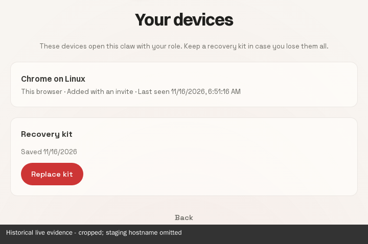
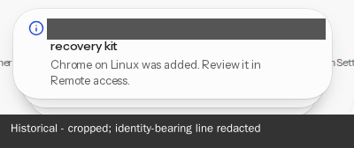
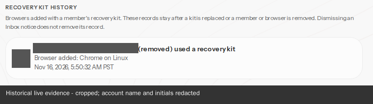

# Historical member recovery-kit live proof

These sanitized artifacts document two **historical live runs**, not a final-head rerun or an uninterrupted recording. Raw screenshots and result files remain private and are not committed. The incomplete `poll-fix` run is excluded.

## Frozen revisions for every artifact

All artifacts prefixed `historical-fc880c29-`, and `historical-fc880c29.result.json`, use:

- OpenClaw: `33fccfd098273b7945359fa74083667a382902e4`
- Loader: `fc880c29cd1d8b5122f599aef2327ad1db0b536f`
- Discovery: `903765ca6ca76c9644b65fe02572b0f55861a4f2`

All artifacts prefixed `historical-4f76bb64-`, and `historical-4f76bb64.result.json`, use:

- OpenClaw: `33fccfd098273b7945359fa74083667a382902e4`
- Loader: `4f76bb64aae2cbba6c0f931cac055230d946e448`
- Discovery: `903765ca6ca76c9644b65fe02572b0f55861a4f2`

The removal/history scenario belongs to the second run. Do not attribute it to loader `fc880c29`.

## Save, wipe and recover

Historical loader `fc880c29`: the cropped saved-kit screen shows that a recovery kit was saved. The sanitized result records the subsequent site-data wipe and recovery: the account, person, role and scopes stayed the same; the device changed; its approval kind was `member_recovery_kit`.

The wipe is script/result evidence, not visual evidence. The historical scenario's `ux-scenario.mjs` used `Storage.clearDataForOrigin` with `storageTypes: 'all'`; its recovery assertions compared before/after account, person and role, required a different device, and checked the approval kind. Boolean-only summaries preserve these comparisons without identity values.

## Owner notice

Historical loader `fc880c29`: the cropped toast shows recovery-kit/browser-added wording. Its identity-bearing first line is replaced with an opaque rectangle.

**Inbox is a harness assertion, not a screenshot proof.** The historical `recover-fsn1.mjs` helper waited for `[data-attention-kind="openClawIdRecoveryUse"]` and recorded `inbox: true`. The summary exposes this as `ownerInboxScriptAssertion`. The source images named `owner-inbox` did not show an open/readable Inbox panel and are excluded.

## Retained history after member removal

Historical loader `4f76bb64`: this separate scenario shows the event retained with “(removed)” and no review-browser link. The member name and avatar initials are replaced with opaque rectangles.

Its boolean-only result also records wrong-account and removed-kit refusals. This image does not independently prove every retention condition in the UI copy, such as kit replacement, browser removal or Inbox dismissal.

## Publication and interpretation limits

- Every screenshot is a cropped/redacted derivative and was visually inspected before commit. No staging hostname, email, invite identifier, person/account/device identifier, fingerprint or recovery-kit material is retained.
- Result JSON values are booleans only. `sameScopes` compares sorted scope arrays; the other identity-preservation and new-device values compare source before/after fields. No raw identifiers are copied.
- The runs used checkpoints and resumed stages. These artifacts are not an uninterrupted end-to-end recording.
- They do not prove the current head, the later canonical-label fix or current persistent-storage UI. Those need their own revision-specific evidence.
- Source proof directories remain private. No retired secret state is part of this package.
