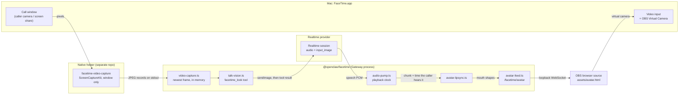

# FaceTime vision and avatar: design

Two opt-in additions to the FaceTime voice carrier. Both are off by default and do
nothing until their flag is set.

| Flag             | Default | What it turns on                                                               |
| ---------------- | ------- | ------------------------------------------------------------------------------ |
| `vision.enabled` | `false` | The agent can look at the caller's FaceTime video: camera or shared screen.    |
| `avatar.enabled` | `false` | A lip-synced animated avatar page for OBS, which feeds FaceTime's video input. |

The flags live under `plugins.entries.facetime.config`. The carrier stays audio-safe:
neither feature can fail, delay, or end a call. Anything that goes wrong in them is
logged once and the call continues as an ordinary voice call.

Operator steps, live verification, and approvals are in the
[test plan](vision-and-avatar-test-plan.md).

## Where each piece lives



| Piece                                | Owner                                                         |
| ------------------------------------ | ------------------------------------------------------------- |
| Window capture, scaling, JPEG        | `facetime-video-capture` in `openclaw/openclaw-facetime`      |
| Newest-frame store, helper process   | `src/video-capture.ts`                                        |
| Look tool and what the model is told | `src/talk-vision.ts`, `src/talk-driver-config.ts`             |
| Image input on a realtime session    | `RealtimeVoiceBridge.sendImage` (SDK), OpenAI realtime bridge |
| Playback timeline                    | `src/audio-pump.ts` (unchanged owner; now observable)         |
| Speech to mouth shapes               | `src/avatar-lipsync.ts`                                       |
| Avatar page and viewer feed          | `src/avatar-feed.ts`, `assets/avatar.html`                    |

## Vision

### Capture

The plugin starts `facetime-video-capture` when a call's realtime session is created
and stops it when the call's media stops. The helper is a new binary in the native
package, next to `facetime-audio-capture`. It is not part of this repository; see
[Native helper](#native-helper).

- **Scope.** The helper captures only the call window owned by `com.apple.FaceTime`,
  through a ScreenCaptureKit filter for that single window. It never captures a
  display or another app, and it excludes the cursor. What the agent sees is what that
  window shows: the caller's camera, or their screen while they share it.
- **Rate and size.** One frame every 2 seconds, longest side 768 px, JPEG quality
  0.6. That is about 60-150 KiB per frame. These are constants, not settings.
- **Transport.** The helper writes records to stdout: a little-endian `uint32` byte
  length, then one JPEG. The plugin rejects a zero length, a length over 1 MiB, or a
  payload without a JPEG header, and stops the helper when it sees one.
- **Freshness.** The plugin keeps exactly one frame: the newest. A frame older than
  6 seconds is never shown to the model. When the helper reports that the call window
  left the screen, the plugin drops the frame at once.
- **Permission.** The helper checks Screen Recording access without prompting and
  exits if it is missing. It never raises a permission dialog.
- **Session.** The helper must run in the Mac user's GUI (`Aqua`) session, as the
  Gateway already must for audio. From a background or SSH session ScreenCaptureKit
  cannot tell which app owns a window, and the helper finds no call window.
- **Failure.** A helper that is missing, exits, or misbehaves turns vision off for
  that call. It is not restarted. The call is unaffected.

### Ingest: the model looks when it needs to

Chosen path: **image input on the realtime session, on demand.**

The realtime session gets one extra tool, `facetime_look`, and a short instruction
block that tells the model to call it when the caller shows something, shares a
screen, refers to something visible, or asks what it sees. When the model calls the
tool, the plugin:

1. takes the newest frame from memory,
2. adds it to the conversation as a user image (`sendImage`),
3. answers the tool call with `{ ok: true, frameAttached: true, frameAgeMs }`.

The provider then generates the reply with the image in context. If there is no
current frame, the tool result is `{ ok: false, error: "<why>" }` and the model is
instructed to say it cannot see anything right now.

This is the same pattern Control UI Video Talk uses for OpenAI (`describe_view`):
one bounded JPEG when the model asks for visual context.

**Why not push every captured frame into the session.** Capture is periodic; ingest
is not. A frame every 2 seconds would add about 30 images a minute to a realtime
conversation. That fills the model's context within a minute or two, forces
truncation of earlier turns, defeats prompt caching, and bills image tokens for
frames nobody asked about. On-demand looks cost one image per look and keep the
conversation stable.

**Latency.** A look is one extra model step: the tool call, an in-memory frame read,
and the response. The frame is at most 2 seconds old plus capture time. This was not
measured on a live call.

**Cost.** One image input per look, at the provider's image-token rate for the
session's model. Nothing is sent while the model is not looking.

### SDK seam

`RealtimeVoiceBridge` gains one optional method:

```ts
sendImage?(image: { mimeType: "image/jpeg" | "image/png"; data: Buffer }): void;
```

It adds an image to the conversation as caller-side context and does not request a
response. `RealtimeVoiceBridgeSession.sendImage(image)` returns `false` when the
session is closed or the provider has no `sendImage`.

The OpenAI realtime bridge implements it as a `conversation.item.create` user message
with one `input_image` part, the same wire shape the Control UI sends from the
browser. An image sent while the socket is not connected is dropped, not queued: a
stale view is worse than none.

### Which sessions can see

The look tool is offered only when both hold:

- the resolved provider reports `supportsVideoFrames` for the session's model, and
- the native helper is installed.

Otherwise the session is created exactly as before: no tool, no vision instructions,
no capture process. The plugin logs one warning that says which condition failed.

OpenAI's `gpt-realtime-2.1`, `gpt-realtime-2.1-mini`, and `gpt-realtime-2` report
`supportsVideoFrames`. A live check on 2026-11-26 sent a JPEG through the bridge to
`gpt-realtime-2.1-mini` and got a correct description back; the other two were not
run. GPT-Live models are audio-only and stay blind. Google Live
reports the capability but has no `sendImage` yet, so a look there returns
`this voice session cannot receive images`.

**Fallback: agent consult turns.** When the session cannot take images, the route
that remains is to describe the frame with an image-capable model and hand the text
to the realtime model or the consulted agent. It costs a second model call and one
to three seconds per look. It is documented here and not built: the production model
takes images directly.

### Privacy and retention

- Frames exist only in the Gateway's memory. One frame at a time, replaced every
  2 seconds, dropped when the call window leaves the screen and when the call ends.
- Nothing writes a frame to disk: not the helper, not the plugin, not the logs.
  Talk events and logs record byte counts and frame age only.
- A frame leaves the machine only when the model looks, and only to the configured
  realtime provider, over the session's existing connection.
- The helper runs with provider and Gateway credentials removed from its environment,
  like the audio helper.
- One existing exception applies: with debug proxy capture enabled, the Gateway
  records provider WebSocket frames. That already includes call audio and would
  include looked-at frames. It is off unless an operator turns it on.

### Native helper

`facetime-video-capture` belongs in `openclaw/openclaw-facetime`, which owns the
native sources and their signing pipeline. It needs its own change there, a signed
and notarized release, and a Homebrew formula update. Until a native package that
contains it is installed, `vision.enabled` only produces a startup warning and a
non-blocking preflight row.

The plugin looks for the helper next to the audio helper in the verified native
install directory. It has no configurable path.

## Avatar

### Pipeline

1. **Source of truth for timing.** `audio-pump.ts` already models when the caller
   hears each chunk of model speech. It now reports two events: each accepted chunk
   with the wall-clock time at which it starts playing, and each discard (barge-in,
   suspension, stop).
2. **Speech to mouth shapes.** `avatar-lipsync.ts` turns each PCM chunk into one
   mouth shape per 20 ms: jaw openness (0-100) and mouth width (-100 rounded to
   100 spread). Openness follows loudness relative to a slowly decaying peak. Width
   follows the balance of energy above and below about 900 Hz, which separates
   "oo"-like from "ee"-like sounds. Hiss-like sounds nearly close the jaw. It costs
   under 1 ms per second of audio and uses no model, weights, or GPU.
3. **Feed.** `avatar-feed.ts` broadcasts the shapes, with their play time, to viewers
   over a WebSocket on the Gateway route `/facetime/avatar`. A `clear` message closes
   the mouth the moment speech is interrupted.
4. **Renderer.** `assets/avatar.html` is one self-contained page: Canvas 2D, no
   external requests. It draws a stylized character that breathes, blinks, and moves
   its eyes when idle, and schedules mouth shapes against the same clock the audio
   uses.
5. **Into the call.** OBS shows the page as a browser source. OBS Virtual Camera,
   already FaceTime's video input, carries it into the call.

No audio, transcript, or text reaches the page. It receives call state (`idle` or
`active`) and mouth numbers.

### Feed protocol

Server to page, JSON text frames. The page sends nothing; a viewer that sends a
message is closed.

| Message                                                        | Meaning                                          |
| -------------------------------------------------------------- | ------------------------------------------------ |
| `{"type":"hello","now":<ms>,"call":"idle"\|"active"}`          | Sent on connect. `now` aligns the page's clock.  |
| `{"type":"call","state":"idle"\|"active"}`                     | The call started or its media stopped.           |
| `{"type":"speak","at":<ms>,"hopMs":20,"frames":[o,w,o,w,...]}` | Mouth shapes; frame _i_ plays at `at + i*hopMs`. |
| `{"type":"clear"}`                                             | Discard scheduled shapes now.                    |

Page URL parameters: `demo=1` animates without a call, for placing the source in
OBS. `offsetMs` trims lip sync against the video path's delay. `bg` and `accent` set
colors.

### Access

The route is registered only when `avatar.enabled` is set. It uses plugin-managed
auth and admits only direct loopback connections: a request from another address, or
one that carries proxy forwarding headers, gets `403`. That keeps the Gateway token
out of OBS scene files.

The page and feed hold no secrets. They do reveal when the agent is on a call and
when it is speaking, which is why they are loopback-only.

### Sync

Audio reaches FaceTime through SoX and the virtual microphone; video through OBS and
the virtual camera. The two paths have different delays, and FaceTime adds its own.
The feed carries the audio path's play time, and `offsetMs` on the page URL shifts
the mouth to match. The right value for a given machine has to be found on a live
call.

## Alternatives rejected

| Alternative                                                      | Why not                                                                                                                                                           |
| ---------------------------------------------------------------- | ----------------------------------------------------------------------------------------------------------------------------------------------------------------- |
| `/usr/sbin/screencapture -l <window>`                            | Apple-signed and needs no new helper, but it writes every frame to disk, cannot scale, spawns a process per frame, and needs a second tool to find the window ID. |
| Read frames inside the injected FaceTime helper                  | Reaches into FaceTime's private video pipeline. Fragile across macOS versions and far outside the helper's audio and call-control scope.                          |
| Stream every frame to the model                                  | See [Ingest](#ingest-the-model-looks-when-it-needs-to): context, cache, and cost.                                                                                 |
| Describe frames with a second model for every look               | Adds a model call and seconds of delay when the realtime model can take the image itself. Kept as the documented fallback.                                        |
| Neural talking head (MuseTalk, Wav2Lip, SadTalker, LivePortrait) | Needs model weights with mixed or non-commercial licenses, a GPU budget this Mac shares with the Gateway and OBS, and seconds of latency. Possible later upgrade. |
| Hosted streaming avatar (HeyGen, D-ID, Simli)                    | Paid per minute, sends call audio to a third party, and adds a network hop to every word.                                                                         |
| A camera system extension instead of OBS                         | Needs entitlements, signing, notarization, and a system-extension approval. OBS Virtual Camera is already installed and selected.                                 |
| A separate local HTTP port for the avatar                        | The Gateway already serves plugin routes and WebSocket upgrades. A second listener would be a new surface to secure and to keep alive.                            |
| Polling the Gateway for mouth state                              | Adds latency and steady load. A WebSocket pushes shapes ahead of their play time.                                                                                 |
| A companion plugin                                               | Vision needs the call's realtime session and the avatar needs the call's playback clock. Both are owned by this plugin; a second plugin would need them exported. |

## Limits

- Vision depends on the call window being on screen on the Mac. A minimized or
  covered-by-fullscreen window yields no frame.
- The agent sees a still from the last 2 seconds, not motion.
- The consulted agent does not receive the frame. The realtime model has to put what
  it saw into the question it delegates.
- Lip sync is driven by sound, not by phonemes. It reads as speech; it does not
  form exact visemes.
- The avatar is one built-in character. Custom art is not supported yet.
